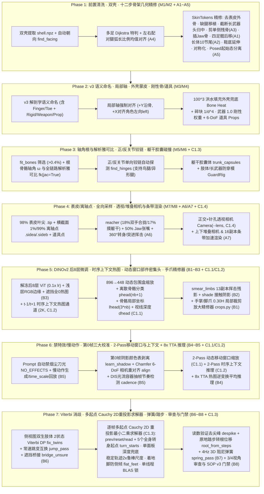

# 实施计划（Plan B 全栈终极版 · 含 M1–M8 + A1–A7 + B1–B8 + C1.1–C1.4）：`video2rig` 最佳实践全量融合方案

## 目标概述

本计划按照 **Plan B（全面升级至 `monster-bone-taxonomy-v3` 解剖学语义架构）**，在**保留云端 SkinTokens 4 候选生成**与**默认保留手指/脚趾（`fold_digits=False`）**的前提下，将对比报告中梳理出的**基础 8 大模块（M1–M8）+ A 类 7 项模型/骨骼/采样细节（A1–A7）+ B 类 8 项下游训练/校准/后处理与审查机制（B1–B8）+ C1 类 4 项 Reader 主干深层机制（C1.1–C1.4）**全部纳入 [`packages/monster/`](../../packages/monster)，划分为 **7 个清晰、可独立验证的实施阶段（Phase 1 ~ Phase 7）**。



---

## 核心规范确认（User Review Required）

> [!IMPORTANT]
> **1. `monster-bone-taxonomy-v3` 解剖学语义命名体系（默认 `fold_digits=False`）**
> - **中轴躯干与头尾**：`Root`、`Hips`、`Spine1..N`、`Neck1..N`、`Head`、`Jaw`、`Tail1..10`（长体生物自适应扩展至最多 10 节）。
> - **分类肢体计划（`LEG_PLANS`，带 `.L` / `.R` 后缀）**：
>   - 二足下肢：`Thigh.L/.R, Shin.L/.R, Foot.L/.R, Toes.L/.R`
>   - 四足/半人马后肢：`Thigh.L/.R, Shin.L/.R, HindPaw.L/.R, HindToes.L/.R`
>   - 四足/半人马前肢：`Scapula.L/.R, UpperArm.L/.R, Forearm.L/.R, FrontPaw.L/.R, FrontToes.L/.R`
>   - 上肢手臂：`Shoulder.L/.R, Arm.L/.R`（或 `UpperArm.L/.R`）, `LowerArm.L/.R`（或 `Forearm.L/.R`）, `Hand.L/.R`
>   - 翅膀（截面展幅比 `flatness > 5.0`）：`WingShoulder.L/.R, WingUpper.L/.R, WingForearm.L/.R, WingHand.L/.R`
>   - 多足生物（$\ge 6$ 条触地腿）：`Coxa<k>.L/.R, Femur<k>.L/.R, Tibia<k>.L/.R, Tarsus<k>.L/.R`
>   - 额外成对/单链：`Pair<k>_<i>.L/.R`、`Limb<k>_<i>`
> - **手指与脚趾分支（默认 `fold_digits=False` 保留，`--fold-digits` 可选折叠）**：
>   - `Finger<f>_<i>.L/.R`（手掌/翼掌下的指骨，从内侧向外侧编号）与 `Toe<f>_<i>.L/.R`（脚掌/兽爪下的趾骨）。
>   - 配套引入 **C1.1 动态移动窗口裁剪（$\sim 1.8\times$ 分辨率增益）** 与 **B1 手掌/脚爪局部放大精修器（`crop_reader`，$0.30 H \to 224\times 224$）** 高精度定位密集手指。
> - **刚性骨、手持长武器、独立 6-DoF 道具与柔性附属链**：
>   - `Rigid<k>[.L/.R]`：刚性甲壳/头角/背刺骨（`fixed_local=True`，0 旋转自由度，提供父骨扭转观测力臂）；
>   - `Weapon.L/.R`：由 `cut_held_prop` 自动识别截断的手持细长武器刚性段（赋 `1.0` 刚性权重，并在 `GuardRig` 中注册剑身中点与剑尖防穿模点）；
>   - `Prop_<name>`：场景独立 6-DoF 刚体道具（含 `.end1/.end2/.mid` 关键点与 SVD Kabsch 求解）；
>   - `Ear<k>_<i>.L/.R`、`Flex<k>_<i>[.L/.R]`：耳朵与柔性挂件链（接入 3D 阻尼弹簧 `spring_pass` 跟随）。

---

## 七阶段文件级修改详情（Proposed Changes）

### Phase 1：模型前置清洗、体素双壳提取、自动朝向与十二步骨架几何精修（M1/M2 + A1~A5）

#### [NEW] [`packages/monster/worker/skeleton_postprocess.py`](../../packages/monster/worker/skeleton_postprocess.py)
新建几何后处理引擎（约 850 行），完整实现：
1. **`voxelize` & `find_facing`**：构建 $1\%$ 身高体素网格与欧氏距离变换，通过镜像重叠度确定左右轴，结合 97% 顶分位（头）与底部 $4\%$ vs $6\sim 15\%$（脚尖相对脚踝）前伸量自动识别 `-Y / +Y / -X / +X` 朝向。
2. **`manylegs_build`（含 A4）**：$\ge 6$ 条细腿触地时，用表皮排斥代价 $w = \text{step}\big(1 + \frac{3.0}{0.5(d_a+d_b)+0.5}\big)$ 的 Dijkstra 最短路追踪腿中心线；**强制将左右配对腿的 3 个中间关节在弧长上的比例 `fractions` 取左右均值（A4）**，生成 `Coxa/Femur/Tibia/Tarsus<k>.L/.R`。
3. **`postprocess_skintokens_skeleton`（十二步精修）**：
   - `fold_digits`（默认 `False`，开启时折叠 $<0.22 H$ 短分叉）；
   - `drop_outside`（剔除 $>50\%$ 在水密壳外的废骨，回缩穿出尖端至表皮内，保底 $30\%$ 原长）；
   - `transplant_missing_legs`（检测底部 $Z < \text{floor} + 0.02 H$ 且排除 1~2 体素薄下摆的触地斑块；若候选漏腿，从 3D `skeletonize` 中轴树 `centre_tree` 移植腿骨链）；
   - `cut_held_prop`（检测手臂末端厚度 $\le \min(1.5\times\text{voxel}, 0.5 r_{\text{arm}})$ 且延伸 $>0.10 H$ 的武器，在拳头处截断手骨并生成 `Weapon.L/.R`）；
   - `flatness`（正交截面展幅比 $>5.0$ 标为 `winged`）；
   - `head_to_face`（将偏入侧耳 $>0.08 H$ 的头骨拉回面部正中）+ **`lone_head_ends`（A3：剪除头部单侧 $<0.25 H$ 且无镜像配对的孤立残枝）** + `jaw_at_mouth`（扫描头部正中矢状面 $|X|<0.04 H$ 的上下唇间空腔，自动插入 `Jaw` 骨）；
   - **四足兽后腿髋关节后移修正（A1）**：对带尾巴的四足兽，将后腿 `Thigh` 的 `head` 后移至尾巴根部前方、膝盖正上方且低于脊柱 $0.25 r_0$ 的解剖学髋臼位置；
   - **长体生物自适应 10 节尾链切分（A2）**：当后腿之后的躯干长度 $> 1.0 H$ 时，保持 `Hips` 简短，将后段按每 $0.16 H$ 自动切分为最多 10 节 `Tail1..Tail10`；
   - `soles`（触地脚底延伸至 97% 脚尖）+ `symmetrize` / `extend_to`（网格对称度 $\ge 0.80$ 时镜像平均，非对称站姿但骨长比 $\ge 0.75$ 时保持方向拉齐骨长）。
4. **非静息起始姿态 `pose_basis` 与逆蒙皮 `rest_coords` 分离（A5）**：
   - 支持第 0 帧已处于摆拍姿势的绑定模型，同时保存静息 `matrix_local` 与起始姿态 `pose_basis (p0)`，通过逆 LBS 反算静息网格坐标 `rest_coords`。

---

### Phase 2：全新 `v3` 解剖学语义命名体系、`+X=left` 局部轴对齐、体素外壳兜底蒙皮与刚性骨/6-DoF 道具系统（M3/M4）

#### [MODIFY] [`packages/monster/worker/bone_taxonomy.py`](../../packages/monster/worker/bone_taxonomy.py) (`L54-760`)
- 将 `BONE_TAXONOMY_SCHEMA` 升级为 `"monster-bone-taxonomy-v3"`，更新 `_CANONICAL_NAME_RE`、[`infer_kind_and_side_from_name`](../../packages/monster/worker/bone_taxonomy.py)、[`classify_rig_bones`](../../packages/monster/worker/bone_taxonomy.py)、[`canonicalize_rig_bone_names_in_blender`](../../packages/monster/worker/bone_taxonomy.py) 与 [`validate_canonical_rig_bone_names`](../../packages/monster/worker/bone_taxonomy.py)。
- 在 `classify_rig_bones` 中同时对离线历史评测数据（`v2` schema）保留只读解析兼容。

#### [MODIFY] [`packages/monster/worker/studio_bpy_worker.py`](../../packages/monster/worker/studio_bpy_worker.py) (`L113-540`, `L2336-2766`, `L3089-3418`)
- 在预检与 G1 候选构建中导出 `shell.npz`（原始薄网格 + $0.012 H$ 体素水密壳）。
- 强制对齐所有 EditBone 局部轴：$+Y$ 沿骨向量，$+X$ 对齐角色水平左向 `left`（使 `rx=bend, ry=twist, rz=side`）。
- 合入 `solid_copy`（当 `ARMATURE_AUTO` 获权顶点 $<50\%$ 时，构建 $100^3$ 洪水填充外表面跑 Bone Heat 再经 `KDTree` 映射回原双层网格）与 `loose_weights`（$<2\%$ 碎块按 $1/d^4$ 赋权，伸出 $>0.10 H$ 的长武器赋 `1.0` 刚性权重，清理跨肢体串权重）。
- 支持独立 6-DoF 刚体道具 `Prop_<name>` 的导出与关键帧矩阵写回。

---

### Phase 3：根骨骼轴角（Axis-Angle）与全链路解析雅可比、正/反关节单向铰链自动探测（`find_hinges`）与躯干胶囊自碰撞（M5/M6 + C1.3 基础）

#### [MODIFY] [`packages/monster/worker/bone_taxonomy.py`](../../packages/monster/worker/bone_taxonomy.py) (`L1083-1640`, `L2860-3857`)
1. **有效骨骼筛选（`fit_bones`）、根骨骼轴角参数化与全链路正向运动学解析雅可比（`fk(..., jac=True)`）**：
   - 标记蒙皮质量占比 $>0.4\%$ 的骨骼及其祖先为有效运动通道（`Rigid*` 与空根骨除外）。
   - 主根骨（`Hips` / `Root`）旋转支持 3D 轴角向量 $\boldsymbol{\omega} \in \mathbb{R}^3$、罗德里格斯指数映射 `exp_so3`、右雅可比解析导数 $J_r(\boldsymbol{\omega})$ 与跨帧连续解缠绕 `unwrap_rotvecs`。
   - 实现完整正向运动学及所有骨骼头/尾/表皮叶尖/离轴侧点对自由度向量的**解析雅可比矩阵 `bone_points(params, jac=True)`**（叉乘力臂 $\mathbf{a}_c \times (\mathbf{p}_i - \mathbf{p}_{\text{joint}})$），支撑 Phase 7 的逐帧多起点非线性 2D 重投影最小二乘求解器。
2. **几何扰动轴角色（`axis_roles`）与正/反关节单向铰链探测（`find_hinges`）**：
   - 对膝盖（`Shin`）与手肘（`Forearm/LowerArm`）搜索与父骨夹角最小的笔直角 `straight`；若起始姿态弯曲 $>12^\circ$（`rest_bend`），以折叠角继续减小的方向作为 `hinge_sign`（原生支持鸟腿/异形反关节腿！），否则按膝向后、肘向前定方向，设置单向弯曲范围 `[straight - 0.05, straight + 2.7] rad`（并与 LBS 边拉伸安全上限取交集）。
3. **躯干胶囊体自碰撞（`trunk_capsules` & `GuardRig`）**：
   - 为躯干骨构建胶囊体（半径取蒙皮顶点中位距离），对自由肢体关键点、骨中点及 `Weapon.L/.R` 剑身中点/剑尖施加防穿透约束。

---

### Phase 4：表皮 98% 叶尖 `.tip`、横截面离轴侧点 `.sidea/.sideb`、全向/自遮挡采样、正交+透视相机与条带/堆叠渲染（M7/M8 + A6/A7 + C1.4）

#### [MODIFY] [`studio_bpy_worker.py`](../../packages/monster/worker/studio_bpy_worker.py), [`bone_taxonomy.py`](../../packages/monster/worker/bone_taxonomy.py), [`pose_features.py`](../../packages/monster/worker/pose_features.py), [`pose_visibility.py`](../../packages/monster/worker/pose_visibility.py)
1. **关键点定义升级**：
   - 叶骨骼末端移至主导蒙皮顶点（$w>0.3$）沿骨轴的 **98% 分位处（`.tip`）**；
   - 肢体末段（`Hand, Foot, FrontPaw, HindPaw, Head`）横截面主次轴 1% 与 99% 分位处提取 **离轴表面侧点（`.sidea1/2, .sideb1/2`）**，连同道具点（`.end1/.end2/.mid`）追加在 $2N_{\text{bones}}$ 槽位之后，直接为末端骨与父骨提供轴向扭转（Twist/Roll）观测。
2. **采样分布全面强化（含 `reacher` 与 A6）**：
   - 合入 `reacher`：**18% 概率双手/双前肢在胸前合拢（`TOGETHER`）**，**17% 概率自由肢体触摸躯干表面（`ONTO_BODY`）**，**50% 概率 `Jaw` 随机张嘴**，75% 道具悬浮持握；
   - 合入 **A6 全向与大幅度根运动采样**：非平缓姿态中 **25% 概率采样水平 $360^\circ$ 全向转身（`yaw ~ Uniform(-pi, pi)`）**、**20% 概率采样 $\pm 75^\circ$ 深度俯仰倾角**、**50% 画幅 `[3%, 97%]` 内随机漫游（`roamer`）**、**30% 腾空跳跃（最高 $+0.30 H$）**；运动模糊帧中加入 **25% 快速挥击（`STRIKE`，自由肢体速度 $\times 2.5$）** 与 **30% 全身突进转身（`LUNGE`）**。
3. **正交 + 针孔透视相机模型（`Camera` & `--lens`，C1.4）与上下堆叠相机 / 16 副本横向条带渲染加速（A7）**：
   - 在 `pose_features.py`、`mocap_priors.py` 与 `studio_bpy_worker.py` 中引入统一 `Camera` 类，同时支持**正交投影（`type='ortho'`）**与**针孔透视投影（`type='persp'`, `--lens 50` 毫米焦距、`focal_px`、镜头平移 `shift_px`）**的正向投影 `project(X, jac=True)`、视线深度 `depth(X)` 与像素射线反投 `ray_at_depth(u, z)`，并支持从自定义 Blender 场景导出多面板相机 `cameras.json`；
   - 新增 `stacked`（上方 `side` 侧视 + 下方 `top` 俯视，共享水平像素列）相机模式支持，以及 Blender 场景内复制 16 份角色排成横向条带（奇偶前后错开 2.5m）批量渲染模式。

---

### Phase 5：DINOv2 后 8 层微调、双遍时序上下文热图、动态窗口离散部件密集头、挥击残影增强与手爪放大精修器（B1~B3 + C1.1/C1.2）

#### [MODIFY] [`packages/monster/worker/dinov2_pose_trainer.py`](../../packages/monster/worker/dinov2_pose_trainer.py) & [`pose_features.py`](../../packages/monster/worker/pose_features.py)
1. **DINOv2 后 8 层微调 + 浅层 RGB 边缘分支 + 遮挡全 0 热图（B3）+ 双遍时序上下文热图输入（`context=True`，C1.2）**：
   - 支持冻结 `embeddings` 与前 4 个 Transformer block（`torch.no_grad()`），以 $0.1\times$ 解码器学习率微调后 8 个 block；
   - 将浅层高分辨率 RGB 卷积边缘特征（`rgb_detail_branch`）设为默认常驻开启；完全被非邻接骨骼遮挡的关键点目标热图峰值衰减至 0；
   - **合入时序上下文热图通道（C1.2）**：解码器融合层支持接收前后相邻帧（$t-1, t+1$）预测出的热图（`2K` 通道）；训练时以 `CONTEXT_SHARE = 0.5` 的概率喂入由前后微扰姿态生成的带噪/随机微平移热图（其余 50% 置零），使单帧无上下文模式与双遍带上下文模式共用同一套权重。
2. **动态移动窗口裁剪（`896→448`，约 $1.8\times$ 有效分辨率增益）与离散骨骼部件分类 + 骨骼局部坐标密集头（C1.1）**：
   - 支持合成渲染 `896px` 面板并按生物紧密包围盒 `1.12 × p95_extent` 动态裁剪缩放至 `448×448` 训练；
   - 将密集表面头升级为 `video2rig/reader/dense.py` 的三合一多任务密集头：
     1. **`phead`（`nb + 1` 通道）**：每像素所属骨骼的离散部件分类（Cross-Entropy Loss，背景为 0，各骨为 $1..N_{\text{bones}}$）；
     2. **`lhead`（`3 * nb` 通道）**：每像素在其真值所属骨骼自身静止局部坐标系下的归一化偏移 $\mathbf{R}_{j,0}^T(\mathbf{x}_{\text{rest}} - \mathbf{h}_{j,0}) / \max(L_j, 0.05 H)$（Smooth L1 Loss）；
     3. **`dhead`（1 通道）**：每像素相对生物中心的视线深度（Smooth L1 Loss）；
     4. 从密集场反投回完整 $N_{\text{kp}}$ 关键点的解析解码器 `joints_from_dense_fields`（含可见骨 SVD 刚体配准 + 骨骼局部点直接加权投票）。
3. **高速挥击肢体残影涂抹增强（`smear_limbs`，B2）+ 手掌/脚爪局部放大精修检测器（`crop_reader`，B1）**：
   - 新增 GPU 张量级 `smear_limbs_gpu`（35% 概率沿肢体法向复制 13 份拉出 $15\%\sim 70\%$ 身高扇形残影）与 `inject_contact_shadow_gpu`（45% 概率合成脚底接触暗影）；
   - 新增围绕手腕/脚踝裁剪 $0.30 H \to 224\times 224$ 的局部放大精修器（`crop_reader`），专门精修掌部下辖的密集手指/脚趾（`Finger*` / `Toe*`）与离轴侧点。

---

### Phase 6：视频生成禁特效/慢动作、第 0 帧三大自动校准、2-Pass 移动窗口/时序上下文与 8x TTA 推理（B4~B5 + C1.1/C1.2）

#### [MODIFY] [`packages/monster/worker/pipeline_runner.py`](../../packages/monster/worker/pipeline_runner.py), [`mocap_priors.py`](../../packages/monster/worker/mocap_priors.py), [`dinov2_pose_trainer.py`](../../packages/monster/worker/dinov2_pose_trainer.py)
1. **视频生成 Prompt 自动禁烟尘/刀光尾句（`NO_EFFECTS`）与慢动作生成 + `time_scale` 倍速回放（B5）**：
   - 在 [`pipeline_runner.py:build_split_screen_prompt`](../../packages/monster/worker/pipeline_runner.py) 中默认追加 `NO_EFFECTS` 禁视觉特效约束；支持 `slow_motion_scale` 半速生成与 `time_scale` 倍速烘焙。
2. **第 0 帧接触阴影剥离（`learn_shadow`）、第 0 帧双向 Chamfer + IoU 6-DoF 相机重对齐（`align`）与 DIS 光流抽帧节奏检测（`cadence`）（B5）**：
   - 在 [`mocap_priors.py`](../../packages/monster/worker/mocap_priors.py) 中合入 `learn_frame0_shadow_table`、`align_frame0_camera_chamfer` 与 `detect_video_cadence_optical_flow`。
3. **2-Pass 动态移动窗口读取（C1.1）+ 2-Pass 时序上下文读取（C1.2）+ 8x TTA 热图逆变换平均推理（B4）**：
   - 在 [`dinov2_pose_trainer.py:infer_dual_view_frames`](../../packages/monster/worker/dinov2_pose_trainer.py) 中完整实现：
     - **2-Pass 动态移动窗口缩放（C1.1）**：当启用动态窗口时，Pass 1 全面板粗读定位每帧生物可见核心点中心，经时序平滑后在 Pass 2 裁剪 `1.12 × p95_extent` 移动窗口放大至 `448×448` 精读，并将窗口内坐标映射回全面板像素；
     - **2-Pass 时序上下文热图注入（C1.2）**：Pass 1 以零上下文推理全序列，Pass 2 将 Pass 1 预测出的 $t-1, t+1$ 热图输入网络再次推理；
     - **8x TTA 逆变换平均（B4）**：每帧生成 1 个原图 + 7 个微平移（$\pm 6\text{ px}$）/微缩放（$0.95\sim 1.05$）副本，热图经 `F.grid_sample` 逆变换求均值后再执行软 argmax 解码，并用手爪局部放大器（`crop_reader`）覆盖更新高置信手指/脚趾读数。

---

### Phase 7：Viterbi 左右消歧、逐帧多起点 Cauchy 2D 重投影最小二乘求解器、弹簧/踏步后处理与 SOP 门禁（B6~B8 + C1.3）

#### [MODIFY] [`mocap_priors.py`](../../packages/monster/worker/mocap_priors.py), [`bone_taxonomy.py`](../../packages/monster/worker/bone_taxonomy.py), [`studio_bpy_worker.py`](../../packages/monster/worker/studio_bpy_worker.py), [`packages/monster/skills/monster-workflow/scripts/*`](../../packages/monster/skills/monster-workflow/scripts)
1. **多视图左右双生肢体消歧与长短遮挡预处理管线（B6）**：
   - 在 [`mocap_priors.py`](../../packages/monster/worker/mocap_priors.py) 中按序执行：
     1. **`fix_twins_viterbi`**：利用正视图与侧视图的双视图正交/透视三角化残差对比「保持 vs 交换侧视图 `.L/.R` 肢体读数」，运行 **2 状态 Viterbi 动态规划**（切换代价 `6.0` 帧）全局纠正侧视图左右肢体互换；
     2. **`jump_pass_constant_velocity`**：基于前两帧常速外推 $2\mathbf{u}_{t-1} - \mathbf{u}_{t-2}$ 纠正单面板内的单帧左右跳变互换；
     3. **`downweight_overlapping_twins`（`twin_same`）**：侧视图中左右同名关节距离 $<0.06 H_{\text{px}}$ 时将两者置信度乘以 `0.4`；
     4. **`bridge_unsure_stretches`**：对 $\le 24$ 帧低置信（$<0.4$）遮挡段做线性桥接引导；
     5. **`downweight_contradicting_far_limb`（`pick_panels`）**：当正视图清晰可见而侧视图远端被遮挡肢体产生 $>0.12 H_{\text{px}}$ 矛盾残差时，将侧视图该肢体权重乘以 `0.1`。
2. **逐帧多起点非线性 2D 重投影 Cauchy 最小二乘求解器核心（`fit_clip_2d_reprojection`，C1.3）**：
   - 在 [`bone_taxonomy.py`](../../packages/monster/worker/bone_taxonomy.py) 中实现 `video2rig/reader/fit.py` 的完整 2D 重投影非线性最小二乘求解器，与原有 3D 解析求解器无缝协同，包含全部 5 项核心机制：
     1. **直接 2D 像素重投影残差 + 解析雅可比 `scipy.optimize.least_squares`**：直接最小化所有相机面板的 2D 投影误差 $\mathbf{P}_v(\mathbf{X}_i(\mathbf{p})) - \mathbf{u}_{t,v,i}$、先验正则项、躯干胶囊防穿模项与地面防穿透项；
     2. **单面板 + 上一帧深度兜底（`read_one_panel=True`）**：当某关节仅在 1 个面板可见（另一面板置信度 $<0.2$）时，利用上一帧该关节在该面板下的视线深度 `depth(v, X_prev)` 反投 3D 射线位置参与初始旋转弧段估计（`read_start`）；
     3. **多起点竞争 + 5 个全身大角度转身逃逸起点（`turn_starts`）**：每帧同时从 `prev`（上一帧解）、`reset`（误差恶化 $>1.5\times$ 时重置为静止姿态）、`read`（三角化弧段初值 + 道具 SVD Kabsch 初值）出发求解并取最低代价解；若最优解高置信关节点的中位像素误差仍 $>8.0\text{ px}$，自动触发绕竖直轴旋转 $\pm 45^\circ, \pm 90^\circ, 180^\circ$ 的 **5 个全身转向逃逸起点（`turn_starts`）** 竞争，彻底解决角色快速转身时的局部极小值卡死；
     4. **稳定轨迹双倍自适应 Cauchy 鲁棒尺度（`cauchy_px=6.0, stable_scale=2.0`）与着地脚掌防侧倾惩罚（`flat_feet=120.0`）**：对高置信度且二阶时序差分加速度极小的平滑轨迹将 Cauchy 核宽度放大 $2\times$；当脚掌距离地面 $<5\%$ 身高时施加横向水平度约束；
     5. **单线程 BLAS 确定性锁（`threadpool_limits(limits=1)`）**：在求解循环外包裹 `threadpoolctl.threadpool_limits(limits=1)`，固定输入与运行环境下限制 BLAS 归约差异；跨机器/依赖版本不承诺逐比特一致，按数值容差及重投影误差验收。
3. **动作捕捉物理后处理三件套（B7）**：
   - **`despike_reading_backed`**：剔除单帧 $>6^\circ$ 毛刺，但若原始未平滑姿态在双视图高置信 2D 读数上的重投影中位误差比平滑后小 $>1.0\text{ px}$ 则保留（保护真实快拳/快爪）；
   - **`recover_root_translation_from_steps`（`root_from_steps`）**：当检测到原地踏步（触地脚在 $\ge 55\%$ 帧中以方向一致性 $\ge 0.92$ 向后滑行 $>0.08 H/\text{s}$）时，将支撑脚后滑负速度经 `2.0 Hz` 低通滤波后积分还原为根骨骼水平前进位移；
   - **`simulate_damped_spring_chains`（`spring_pass`）**：对 `Tail*`、`Ear*`、`Flex*` 骨链运行 4 倍子步长的 **3D 阻尼谐振子物理仿真**（$f = 4.0\text{ Hz}, \zeta = 0.55$，每子步长严格投影守恒骨长），再反解回骨骼旋转角。
4. **关节极限卡死诊断（`at_limit`）、3/4 立体斜向视角对比审查片（B8）与 SOP 门禁/热更新**：
   - 自动统计并告警超过 $25\%$ 帧卡在关节极限 $2^\circ$ 以内的非铰链骨；
   - 增加 **3/4 斜向立体正交俯视图（偏航 $50^\circ$、俯仰 $18^\circ$）** 及轮廓叠加 IoU 审查片，支持 `cadence` 小数帧（Sub-frame）关键帧写入；
   - 更新全部 SOP 6 大门禁脚本、形式化验证（P1–P4）、单元测试与 [`SKILL.md`](../../packages/monster/skills/monster-workflow/SKILL.md)。

---

## 验证计划（Verification Plan）

### 自动化测试与门禁校验
每个 Phase 完成后运行对应单测，全部完成后执行全量门禁与热更新验证：
```bash
# 1. Monster 全量语法、Notebook 契约、单元测试与形式化数学门禁 (P1-P4)
npm run monster:check
npm run monster:formal-gate -- self-test

# 2. 2K 历史评测基准向后兼容回归测试
npm run monster:eval -- run fantasy_creature_2k_v2 --tier fast

# 3. 真实 Headless Blender 预检、v3 语义重命名、外壳兜底蒙皮与 G1 渲染回归
MONSTER_TEST_BLENDER=/Applications/Blender.app/Contents/MacOS/Blender python3 -m unittest packages/monster/tests/test_preflight.py -v

# 4. 插件打包、技能同步、构建版本刷新与本地运行目录热更新
npm run monster:package
npm run build
npm run check:distribution
npm test
```
最后将构建产物热同步至本地运行目录 `/Users/bugyaluwang/.local/share/codex-integrations/game-studio-local/runtime` 并核验生效。


> 以下为代码入口索引，不代表每项需求均已验收。逐项差异、已验证机制和剩余工作以 [完成度复核](monster_video2rig_completion_audit.md) 为准；原 Plan 范围保持完整。

## 落地入口与兼容边界（2026-10-26）

| 阶段 | 实际模块与接入点 |
| --- | --- |
| 1 | `worker/skeleton_postprocess.py`；预检写出 `shell.npz`，G1 四候选与云端 audit 调用几何精修；`pose_basis` 与逆 LBS 导出保留起始态/静息坐标的区分 |
| 2 | `worker/anatomical_names.py`、`video2rig_blender.py`；新候选输出 v3 名称，旧 v2 名称只读解析；局部轴对齐、100 格外壳 Heat、松散部件/武器赋权与 `Prop_*` 独立根通道 |
| 3 | `worker/reprojection_solver.py`；SO(3) 根、完整解析 FK 雅可比、测量单向铰链、有效通道与躯干胶囊 |
| 4 | `studio_camera.py`、`video2rig_blender.py`；表皮/离轴标签、reacher/全向采样、透视/堆叠、相机导出与 16 姿态正交条带 |
| 5 | `reader_v3.py` + `dinov2_pose_trainer.py`；448 输入、骨骼分类/局部坐标/深度头、上下文、GPU 增强、共享权重的 224 手爪精修和末 8 层微调 |
| 6 | `video2rig_pipeline.py`、`reading_pipeline.py`；首帧校准、双遍动态窗口/上下文、8x 热图逆 TTA、禁特效与慢动作时间映射 |
| 7 | 同上 + `sop_g3_exam.py`、`sop_formal_gate.py`；观测消歧、多起点像素求解、后处理、卡限诊断，以及实际 GLB 回读、3/4 和轮廓叠加审查 |

新数据/权重显式保存 `monster-reader-v3`。旧 checkpoint 继续走原有推理路径；改名、局部轴、蒙皮及标签变更不能复用旧权重或旧审批。`anatomical_reader_v3_migration` 使 G1/G2/G3/最终批次重新审查；仅 Reader 标签更改用 `reader_label_contract_change`，重新生成标签、训练及 G3。未迁移任何用户角色目录、审核账本或生产文件。

原生视频首帧和推理标定保持原分辨率；v3 合成面板独立使用 896 方形训练标定，动态窗口缩至 448。手爪精修与主 Reader 共享权重，并在 224 输入上补充训练。透视与堆叠使用逐面板渲染；16 副本条带适用于平行正交摄影棚，不改变透视投影语义。

本次是算法机制的独立实现，没有复制/打包 AGY scratch 内的上游 Python 源码。轮廓 IoU 来自背景分割视频与 GLB 渲染 alpha 的比较，明确作为外观一致性指标，不能冒充三维真值误差。

验证证据和本机热更新记录见 [monster_video2rig_integration_verification.md](monster_video2rig_integration_verification.md)。本地合成夹具验证不等于真实角色 GPU 训练质量验证；新契约应在固定角色版本上重新完成 G1/G2、训练和独立 G3。


## 2026-10-27 本地代码落地验收

七阶段M1–M8、A1–A7、B1–B8、C1.1–C1.4已完成代码接入和本地逐项验证，发布0.3.16并热同步实际运行目录。最终252项检查、零跳过，Node73项、历史九探针与实际HTTP/MCP/原Chrome主窗口版本一致性通过；以[0.3.16交接](monster_video2rig_0316_handoff.md)与[完成度复核](monster_video2rig_completion_audit.md)中的逐项证据为准。

验收口径澄清：A2单轴Tail1..10不扩展为多根/分叉尾的重切协议，后者保留原拓扑；单线程BLAS只验证固定环境可重复，不能独自保证原文所说跨硬件100%位级一致。真实角色的GPU训练、用户审核及远端运行进程部署属于使用此实现时的独立生产步骤，本次没有伪造相应通过记录。


## 2026-10-27 审查后的修订

原C1.2把上游离线Reader误写为t-1/t-2；核对AGY保存的55d51b3源码后，新权重修正为t-1/t+1，首尾按上游夹到边界帧。旧权重通过显式时间上下文契约保持原因果行为，原几何标签可复用重新训练。常速跳变过滤的前两帧外推仍按其原公式，不与网络上下文混淆。

0.3.17另修复低光流抹除时间、接触守卫归零冻结basis、弱热图被空间softmax抬高置信度，并让P2实际验收抽样随机/边界/世界根姿态，拒绝恒返p0及空/非有限结果。详见[修复交接](monster_video2rig_0317_handoff.md)。此前0.3.16“全部完成”结论需按这些反例修正，不将局部采样门禁视为穷尽证明。
