# `video2rig` vs. `MonsterStudio`：六阶段架构深度对比与全流程零遗漏拆解

本文档对外部开源项目 `canitcode/video2rig` 与我们项目中的 [`monster-workflow`](../skills/monster-workflow/SKILL.md)（核心实现位于 [`packages/monster/worker/`](../packages/monster/worker)）进行源码级深度对比，并完整拆解走通 `video2rig` 全流程时每一步的命令、输入输出、内部数学公式与几何启发式细节。

---

## 一、 核心设计哲学与总体路线差异

虽然两者在顶层范式上同源——都采用 **「自带绑定模型 $\to$ 合成随机姿态渲染与精确真值标签 $\to$ 训练角色专属（Per-Creature）DINOv2 2D 探针 $\to$ 读取多视图 AI 视频 $\to$ 3D 运动学重建 $\to$ 写回 Blender 动画」** 的路线（彻底绕开通用人体姿态估计器无法泛化到异形怪物的痛点），但在**数学建模、感知目标定义、神经架构解冻策略、视频生成与校准、以及 3D 运动学求解器**上走出了两条截然不同的技术路线：

```mermaid
flowchart TB
    subgraph V2R["video2rig (单机 CLI · 2D 重投影非线性最小二乘优化路线)"]
        direction LR
        V1["1. 绑定与简化骨架<br/>UniRig 4抽样 / 多足Dijkstra<br/>折叠手指(<22%H) · 识别单向铰链<br/>导出 rig.json + mesh.npz"] --> V2["2. 姿态采样与条带渲染<br/>3000 姿态 (含18%双手合拢/17%摸身体)<br/>EEVEE 16副本横向条带 + 55%动态模糊<br/>CPU Z-Buffer 遮挡真值 (遮挡=全0热图)"]
        V2 --> V3["3. DINOv2-small 检测器<br/>解冻后8层 Transformer (0.1x lr)<br/>+ 浅层RGB细边缘分支 (448→112)<br/>GPU 肢体残影涂抹增强 (smear_limbs)"]
        V3 --> V4["4. AI 视频读取与校准<br/>Seedance (自动禁特效/慢动作)<br/>第0帧阴影学习 + Chamfer相机重对齐<br/>光流检测抽帧节奏 + 8x TTA 热图平均"]
        V4 --> V5["5. 2D 重投影运动学拟合<br/>Viterbi 修正侧视左右肢体互换<br/>逐帧多起点 Cauchy 鲁棒最小二乘<br/>原地踏步转位移 + 脚锁IK + 尾耳弹簧"]
        V5 --> V6["6. Blender 动画导入<br/>真实内容时间戳映射小数帧<br/>四元数半球连续 + 刚体道具矩阵还原"]
    end

    subgraph OURS["MonsterStudio (本地 SOP + 云端 GPU · 3D 深度融合 + 解析式分级 FK + 门禁审计路线)"]
        direction LR
        M1["1. 绑定与规范分类学 (G1)<br/>预检拆装饰物 + SkinTokens 4候选<br/>保留全部手指 (DIGIT) · 10类规范命名<br/>LBS 边拉伸探针 + 三层耦合自碰撞 (G2)"] --> M2["2. 4模态分层采样渲染<br/>5000 姿态 (协同/解耦/反相极限/跨区遮挡)<br/>Cycles 16spp + 50%快门模糊<br/>BVH 射线可见度 + 29点重心稠密表面图"]
        M2 --> M3["3. DINOv2-base 探针 (G3)<br/>全冻结 ViT-B/14 (SDPA 加速)<br/>4x 反卷积 + 窗口化 DSNT 软极大值<br/>注意力池化深度/可见度头 + 稠密表面头"]
        M3 --> M4["4. AI 视频读取与对极门禁<br/>ComfyUI MiniMax H3 (124帧/2K分块)<br/>单次前向推理 + 5帧 Hampel 短缺口修复<br/>跨面板呼吸缩放/垂直漂移 IRLS 校准"]
        M4 --> M5["5. 3D 融合与分级解析 FK<br/>双/三视图可见度加权深度融合<br/>Whittaker/Charbonnier 平滑 + Kabsch 根求解<br/>按骨骼类别解析 FK + 1D 轴向扭转搜索 + 稠密LBS精修"]
        M5 --> M6["6. Blender GLB 烘焙与闭环验证<br/>每帧静息态重置消除四元数漂移<br/>测地线误差闭环验证 + 首尾循环接缝平滑"]
    end
```



### 七大本质差异总览

| 维度 | `canitcode/video2rig` | 我们的 `MonsterStudio` (`packages/monster`) |
| :--- | :--- | :--- |
| **1. 骨骼粒度与手指处理** | **主动折叠手指/脚趾**（`fold_digits` 将 $<22\%$ 身高的短分支合并为单根掌/脚骨），认为 480p/720p 视频无法分辨手指；但支持**独立刚体道具（Props，6 DoF）**。 | **完整保留手指/脚趾（`DIGIT_*`）**，通过 10 类规范命名 `<KIND>_<SIDE>_<GROUP>_<INDEX>` 分类，并在预检阶段自动拆分装饰物（`rigid` 挂接 / `flex` 蒙皮传递）。 |
| **2. 轴向扭转（Roll/Twist）如何可观测** | 不直接用骨头首尾 $2N$ 点，而是在肢体末端（手/蹄/头/角）蒙皮网格横截面主轴的 1% 和 99% 处取**离轴表面侧点（`.sidea1/2`, `.sideb1/2`）**作为 2D 关键点（`side_points`），靠离轴点的 2D 投影直接约束扭转角。 | 预测全部骨骼首尾 $2N$ 关键点 + **子骨骼断开力臂（Disconnected Child Lever-Arm）** + **子铰链可达性代价（`_child_twist_cost`）** + **稠密表面 3D 静息坐标头（Dense Surface Rest-XYZ）** 解锁叶片/掌部骨骼 $\pm 40^\circ$ 轴向滚转。 |
| **3. 遮挡与第 3 维（深度）处理** | **纯 2D 感知 + 遮挡归零**：CPU Z-Buffer 光栅化判断关键点是否被非邻接骨骼遮挡；**被遮挡点训练目标为全 0 热图**（让网络在遮挡时输出近 0 置信度），推理时靠多视图未遮挡面板与时序桥接优化。 | **2D + 相对深度 + 可见度联合预测**：BVH 射线采样每个骨骼表面 12 个支撑三角形计算 `visibility_ratio` 与 `depth_relative`；训练 `aux_head` 输出异方差深度与可见度，重建时单侧被遮挡可由另一侧预测深度兜底。 |
| **4. DINOv2 架构与训练策略** | **`dinov2-small` ($d=384$) 部分解冻**：仅冻结前 4 层，**解冻第 4~11 层 Transformer**（$0.1\times$ 学习率）+ 浅层 RGB 边缘卷积分支 + 在 GPU 上在线合成 **AI 视频肢体残影涂抹（`smear_limbs`）** 与地面接触阴影。解码用 $112\times 112$ 峰值 **1D 抛物线插值**。 | **`dinov2_vitb14_reg` ($d=768$) 全冻结骨干**：使用 SDPA 加速，接 $4\times$ 反卷积头（`192x220` 至 `368x412`）+ **窗口化峰值 DSNT 软极大值（`windowed_peak_dsnt_torch`）** + 多层特征融合稠密表面头。 |
| **5. 视频畸变与相机/时序校准** | 针对商业 I2V（Seedance）做了极深适配：① **第 0 帧学习阴影颜色表**剥离接触阴影；② **第 0 帧轮廓双向 Chamfer + IoU 优化 6 自由度相机重对齐**（含 $\pm 30^\circ$ 视角旋转搜索）；③ **DIS 光流自动检测容器抽帧节奏**（如 `30fps_drop_every_5th`）；④ **8x TTA 平移缩放热图平均**。 | 针对自建 ComfyUI `MiniMax H3`（首尾帧锁死 + 2K 时空分块精修）：① 推理采用单次批处理；② **跨面板尺度呼吸与垂直漂移校准（`calibrate_view_scale_drift`）**，通过 4 轮 Huber IRLS + Whittaker 正则消除面板间呼吸缩放与上下漂移。 |
| **6. 运动学求解器范式** | **逐帧全局非线性最小二乘优化（`scipy.optimize.least_squares`）**：先用 **2状态 Viterbi 动态规划**修正侧视图左右肢体互换（`fix_twins`），再在关节角空间 $p \in \mathbb{R}^n$ 上直接最小化多视图 2D 重投影残差（**自适应 Cauchy 鲁棒损失**）+ 地板惩罚 + 躯干胶囊自碰撞，每帧从 **4~9 个起点（含解析三角化起点与 $\pm 45^\circ/\pm 90^\circ/180^\circ$ 全身旋转起点）** 竞争逃逸局部极小。 | **先 3D 融合平滑，再按骨骼类别（Per-Kind）分层解析 FK + 局部网格搜索**：先融合多视图 2D/深度/可见度得 3D 轨迹，经 Whittaker/Charbonnier 平滑后，用 **多锚点 IRLS Kabsch** 求根骨骼，再按拓扑序对每类骨骼用**双分支局部欧拉角解析解 + 1D 由粗到精扭转搜索**，最后可选用稠密 LBS 表面重投影微调。 |
| **7. 后处理与物理补偿** | 包含 **原地踏步自动积分还原根位移（`root_from_steps`）**、**基于 2D 读数验证的去尖峰（`despike`）**、**变速 Butterworth 低通（4/5/8 Hz）**、**驻留脚底板雙端 IK 锁定（`lock_feet`）**、以及 **尾巴/耳朵 3D 阻尼弹簧谐振器（`spring_pass`）**。 | 包含 **SO(3) 四元数分骨骼类别 Whittaker-Charbonnier 平滑**、**速度门控去微抖动（`dejitter_velocity_gated`）**、**自动脚部驻留锚定（`apply_floor_and_foot_contact_constraints`）**、**实测支撑面凸包接触优化（`surface_contact.py` / `motion_contact.py`）**、以及 **首尾帧循环接缝平滑**。 |

---

## 二、 六大阶段逐环节源码级深度对比

### 阶段 1：自己的绑定模型（Rigged Model & Auto-Rig / 关节约束）

#### 1.1 自动绑定（Auto-Rig）与网格预处理
* **`video2rig` 的实现**：
  * 支持导入任何已有绑定（Mixamo、Rigify、Unreal、手工绑定），或通过三步自动绑定管线从静态网格生成绑定：
    1. **网格清洗与双壳导出（`blender/autorig_prepare.py`）**：清空旧 Armature 与顶点组，烘焙世界变换，将水平中心移至 $(0,0)$、最低点移至 $Z=0$。同时导出两套网格到 `shell.npz`：一套是原始表面 `skin_verts/skin_faces`（保留单层薄披风/翅膀膜），另一套是经 `VOXEL` 重网格化（体素大小 $0.012 \times \text{height}$）的闭合水密外壳 `verts/faces`。
    2. **骨架生成（`video2rig/autorig/unirig.py`、`manylegs.py`、`skeleton.py`）**：
       * **多足生物特判（`manylegs.build`）**：先用 $1\%$ 身高体素化并计算欧氏距离变换 `depth`。核心躯干定义为 `depth >= 0.5 * depth.max()` 并向外膨胀 `1.2 * depth.max()`；剩余连通块用带表皮排斥代价的 Dijkstra 最短路（步长代价 $w = \text{step} \times (1 + \frac{3.0}{0.5(d_a+d_b)+0.5})$，强制沿管状肢体中心线走）追踪腿部。若 $\ge 6$ 条腿触地（蜘蛛、螃蟹、蝎子），直接旁路 UniRig（因 UniRig 绘蜘蛛腿只到膝盖），按从前到后每条腿切 4 段：`Coxa1.L`、`Femur1.L`、`Tibia1.L`、`Tarsus1.L`。
       * **UniRig 4 次抽样择优（`unirig.py:run_unirig` & `missing_feet`）**：对非多足生物，在同一个 GLB 内把网格复制 `--draws 4` 份（`mesh_0..3`），调用 `quick_inference_skeleton_articulationxl_ar_256.yaml` 一次推理出 4 套候选骨架。按以下代价函数打分选最优：
         $$\text{cost} = 100 \times N_{\text{未覆盖触地脚掌}} + 100 \times \text{mirror\_gap}_{p90} + 100 \times \mathbb{I}(\text{far\_from\_bone} > 0.33)$$
       * **UniRig 骨架九步几何精修**：
         1. `fold_digits`：递归折叠所有长度 $< 0.22 \times \text{height}$ 的分叉末端（手指、脚趾、利爪、耳尖），将父骨末端直接延伸到各分支末端的均值点。
         2. `drop_outside`：剔除 $>50\%$ 采样点落在体素表皮外（容差 $2.5 \times \text{voxel}$）的幽灵分支；若末端穿出表皮，沿骨轴向内回缩（最多回缩至原长的 $30\%$）。
         3. `transplant`：检测地板接触斑块（$Z < \text{floor} + 0.02 H$，且排除在 $0.05 H$ 与 $0.10 H$ 截面厚度仅 1~2 体素的拖地长袍下摆）。若 UniRig 漏掉了某条腿，直接从 `skeleton.py`（基于 `skimage.morphology.skeletonize` 3D 中轴树提取的骨架）把缺失的腿部骨链移植过来！
         4. `flatness`：在肢体 $30\%, 45\%, 60\%, 75\%$ 处做正交截面，求截面主次轴展幅比；中位数 $> 5.0$ 判定为翅膀（`winged`）。
         5. `head_to_face` 与 `jaw_at_mouth`：若 UniRig 把 `Head` 骨拐进了侧面的兽耳，将其拉回中垂面鼻尖/面部前端；并在头部正中矢状面切片（$|X| < 0.04 H$）扫描上下唇之间的张口空腔（空腔长 $\ge 3$ 体素、高 $1\sim 12$ 体素），自动在嘴角到下巴尖插入一根 `Jaw` 骨！
         6. `soles` 与 `symmetrize`：将触地脚掌骨沿鞋底延伸至 97% 分位脚尖；若网格镜像对称度 $\ge 0.80$，将 `.L`/`.R` 对称骨坐标取镜像平均（若模型本身处于非对称站姿但左右骨长比 $\ge 0.75$，则保持姿态方向但强制拉齐左右骨长！）。
    3. **鲁棒蒙皮构建（`blender/autorig_build.py`）**：
       * 先以 $10^{-5}$ 阈值焊接 UV 裂口，对占比 $\ge 2\%$ 顶点的主连通块执行 Blender `ARMATURE_AUTO`（Bone Heat）。
       * **双层非流形网格兜底（`solid_copy`）**：Tripo 等 AI 生成的网格常因内外双层壳交错导致 Bone Heat 失败（获得权重的顶点 $<50\%$）。此时脚本在内存构建 $100^3$ 体素网格，从边界做 6-邻域洪水填充（Flood-fill）提取纯外表面，经体素重网格化后在干净外壳上跑 Bone Heat，再用 `KDTree` 传回原网格！
       * **碎块与手持长武器自动判定（`loose_weights`）**：对 $<2\%$ 顶点的独立小部件（爪尖、肩甲、武器），找到其接触的肢体骨；若该部件沿手部前方延伸超出 $> 0.10 \times \text{height}$（判定为剑刃/长矛），直接赋予手部骨骼 `1.0` 刚性权重（绝不弯曲）；否则按到最近两根同肢体骨骼的**距离负四次方（$1 / d^4$）**分配平滑权重。最后抹除跨肢体串权重并限制每顶点最多 4 个权重。

* **我们的 `MonsterStudio` 实现**：
  * **预检与装饰物无损拆解（[`sop_preflight_check`](../packages/monster/worker/studio_bpy_worker.py)）**：备份 `decorations_backup.blend` 并登记 `decoration_manifest.json`（自动识别 `armor, cape, weapon, horn, ribbon` 等子网格），送入云端 SkinTokens 的是剥离易碎装饰后的干净主体。
  * **SkinTokens 4 候选并发生成与打分（[`run_stage1_skintokens_candidates`](../packages/monster/worker/pipeline_runner.py) + [`score_candidate_rig`](../packages/monster/worker/studio_bpy_worker.py)）**：采用 4 组温度 `TEMPS=[0.75, 0.85, 0.95, 1.05]` 与束宽 `BEAMS=[10, 10, 8, 12]` + $196^3$ 体素后处理生成 4 个候选，通过 BVH 6 向射线检测空气弦骨（`air_bridging_bones`）与穿出骨（`protruding_bones`），在 [`sop_prepare_g1_candidates`](../packages/monster/worker/studio_bpy_worker.py) 中恢复装饰物并渲染 4 候选同屏运动对比视频供 **G1 人工门禁** 挑选。

#### 1.2 骨骼参数化与关节约束（Parameterization & Joint Limits）
* **`video2rig` 的实现（`rig.py`, `creature.py`）**：
  * **参数向量 $p \in \mathbb{R}^n$**：
    * `p[0:3]`：根骨骼（`root`，即拥有最多加权顶点的最高层骨骼，如 `Hips`）在 Armature 空间下的位移偏移 $\Delta \mathbf{t}_{\text{root}}$。
    * `p[3 : 3+C]`：所有参与拟合骨骼（权重占比 $>0.4\%$ 且非手指/眼睛的骨骼及其祖先）的旋转通道。**核心亮点**：普通骨骼使用骨骼局部静息系下的本征欧拉角 $R_x(a) R_y(b) R_z(c)$；但 **根骨骼 `root` 的 3 个通道使用的是轴角旋转向量（Axis-Angle Rotation Vector $\boldsymbol{\omega} \in \mathbb{R}^3, R = \exp([\boldsymbol{\omega}]_\times)$）**，并在 `rig.py:_rodrigues_jac` 中手写了基于 $SO(3)$ 右雅可比矩阵 $J_r(\boldsymbol{\omega})$ 的解析导数，彻底避免了角色侧翻 $90^\circ$ 倒地时的万向节死锁（Gimbal Lock）！
    * `p[3+C :]`：每个刚体道具（Prop）6 个自由度（3 平移 + 绕道具几何中心的 3 欧拉角）。
  * **单向铰链与反关节自动探测（`Creature.find_hinges`）**：
    * 通过正则匹配膝盖（`shin|calf|tibia|knee|lowerleg`）和手肘（`forearm|lowerarm|ulna|radius|elbow`）。
    * 对主弯曲轴施加 $+0.3\text{ rad}$ 微扰：如果起始姿态该关节已经弯曲 $>12^\circ$（`rest_bend`），则令折叠角进一步变小的方向为合法弯曲方向 `sign`（**这使它能自动兼容鸟腿、异形反关节腿！**）；若起始姿态是笔直的，则以膝盖向后弯、手肘向前弯确定 `sign`。单向铰链的弯曲范围设为相对于笔直角 `straight` 的 `[-0.05, +2.7] rad`（或 `[-2.7, +0.05] rad`）。
* **我们的 `MonsterStudio` 实现（[`bone_taxonomy.py`](../packages/monster/worker/bone_taxonomy.py)）**：
  * **LBS 网格拉伸安全上限探针（[`probe_rig_joint_limits`](../packages/monster/worker/bone_taxonomy.py)）**：不依赖英文骨骼名正则，先将所有骨骼规范化为 10 类 `<KIND>_<SIDE>_<GROUP>_<INDEX>`，再对每根骨骼每个轴从 $15^\circ$ 到 $120^\circ$ 逐步做 LBS 变形测试，计算网格边拉伸比 $r = L_{\text{posed}} / L_{\text{rest}}$，一旦 $r > 1.80$ 或 $r < 0.45$ 的坏边比例超过 $2\%$ 即截断安全角。
  * **三层姿态协调系统（[`coordinate_pose_angles`](../packages/monster/worker/bone_taxonomy.py)）**：包含单骨骼内部 2D/3D 椭球轴间耦合（$\gamma_q=0.85, \gamma_o=0.78$）、跨骨骼耦合（父子 $\gamma=0.85$、两跳 $\gamma=0.86$、同父兄弟 $\gamma=0.84$）以及每骨双球体 FK 自碰撞回退（`resolve_volume_collisions_fk`），并在 **G2 门禁** 通过 50 张边界探索姿态图人工审计。

---

### 阶段 2：随机姿态渲染与精确标签（Pose Sampling, Rendering & Labels）

| 细节维度 | `canitcode/video2rig` | 我们的 `MonsterStudio` |
| :--- | :--- | :--- |
| **起始帧工作室（Start Frame）** | `blender/render_start.py`：`1920x1080`（默认 `front,side` 各 `960x1080`，中间 `4px` 暗色分隔线），中灰背景 `(0.42, 0.41, 0.40)`，两盏平行太阳光（`3.2` 与 `1.2`），Cycles 64 samples，AgX。另提供上下堆叠版 `render_stack.py`（上方侧视+下方俯视，共享水平像素列以应对长体怪兽大幅前后冲刺）。 | [`setup_dual_orthographic_studio`](../packages/monster/worker/studio_bpy_worker.py)：2 视图 `1344x768`（2K 模式 `2560x1440`）或 3 视图 `left,front,right` `1344x768`（2K 模式 `2688x1440`），深暗背景 `(0.035, 0.04, 0.055)`，三点追踪面光源（Key 900W / Fill 550W / Rim 700W，训练时随机扰动位置与色温），Cycles 16 samples + OIDN 降噪。 |
| **关键点定义（Keypoints）** | `reader/__init__.py:keypoints`：<br/>1. 参与拟合骨骼的 `head`（$f=0$）；<br/>2. 无子叶骨骼的 `.tip`（**取该骨权重 $>0.3$ 的蒙皮顶点沿骨轴的 98% 分位处**，确保点落在可见表皮上而非空气中）；<br/>3. 肢体末端骨骼横截面主成分轴 1%/99% 分位的 **离轴侧点 `.sidea1/2`, `.sideb1/2`**（用于观测手/蹄/头部的滚转 Twist）；<br/>4. 刚体道具的 `.mid` 或 `.end1/.end2/.mid`（细长道具在训练与读取时将面板中靠左的一端恒定标为 `.end1` 以消除对称歧义）。 | [`generate_stage2_synthetic_dataset`](../packages/monster/worker/studio_bpy_worker.py)：<br/>严格输出全部 $N_{\text{bones}}$ 根规范骨骼的 **`head` 与 `tail`（共 $K = 2N_{\text{bones}}$ 个关键点）**，外加当开启稠密表面时的 `dense_mask` 与 `dense_rest_xyz`（29 点重心坐标网格细分的静息表面归一化 3D 坐标图）。 |
| **随机姿态采样分布** | `reader/poses.py:sample`（默认 **3,000 姿态**）：<br/>• 30% 平缓姿态（幅度 $\times 0.4$）+ 70% 全范围姿态；<br/>• **双手合拢/持握优化（`reacher`, 18%）**：用 30 步 `least_squares` 把左右自由肢体末端拉到胸前同一点（模拟双手握剑/合十的重度互遮挡）；<br/>• **触摸身体自遮挡（`ONTO_BODY`, 17%）**：将自由肢体末端拉到躯干随机非肢体顶点上；<br/>• **全身大幅旋转与漫游**：20% 姿态俯仰倾角达 $\pm 75^\circ$，25% 姿态水平 $360^\circ$ 随机朝向（`Uniform(-pi, pi)`），50% 在画幅 `[3%, 97%]` 内随机漫游，30% 腾空跃起；<br/>• **55% 姿态带 3D 运动模糊速度（`velocities`）**：其中 25% 挥击（肢体速度 $\times 2.5$），30% 突进旋转（单帧转角达 $69^\circ$）。 | [`sample_stratified_pose_euler_dict`](../packages/monster/worker/bone_taxonomy.py)（默认 **5,000 姿态**，按 `idx % 20` 严格分层）：<br/>• **40% `synergistic`**：手指独立卷曲/张开 + 父子链正相关 + 尾/翼余弦行波；<br/>• **30% `decoupled`**：零相关全轴独立均匀采样；<br/>• **15% `antiphase_extreme`**：双峰边界采样 + 父子反相折叠（$\text{corr} = -0.58$）；<br/>• **15% `workspace_cross_occlusion`**：四肢双峰极限越界 + 手腕全扭转。<br/>50% 样本开启 Cycles 帧中心快门运动模糊，且必须通过 `audit_pose_dataset_coverage` 统计门禁。 |
| **渲染加速与可见度计算** | `blender/render_poses.py` + `reader/visible.py`：<br/>• **16 副本横向条带技巧**：用 `BLENDER_EEVEE`（8 samples），在 Blender 场景中将角色复制 16 份沿相机水平轴排成一排（奇偶副本沿视线前后错开 `2.5m` 防止阴影与长尾互戳），**单次渲染即得 16 个姿态**！<br/>• **6 进程 CPU Z-Buffer 光栅化并行算遮挡**：GPU 渲染同时，CPU 进程在 $224\times 224$ 分辨率光栅化蒙皮网格；若关键点投影周围 $5\times 5$ 窗口内没有任何像素属于「该骨自身、父骨或直接子骨」的主导三角形，则标记 `vis = False`。 | [`generate_stage2_synthetic_dataset`](../packages/monster/worker/studio_bpy_worker.py) + [`pose_visibility.py`](../packages/monster/worker/pose_visibility.py)：<br/>• 使用 `CYCLES` GPU（`use_persistent_data=True`）逐样本渲染双/三视图拼图。<br/>• **BVH 12 支撑面射线可见度**：为每根骨预选权重 $w_0 \ge 0.45$ 的专属三角形，每帧向离关节最近的 12 个专属三角形质心发射相机射线，统计未被非邻接骨骼挡住的比例 `visibility_ratio` 及相对深度 `depth_relative`。 |

---

### 阶段 3：训练角色专属 DINOv2 关节检测器（DINOv2 Joint Reader）

#### 3.1 网络架构对比（`video2rig/reader/net.py` vs. `dinov2_pose_trainer.py`）
* **`video2rig` 的 `Reader` 模型**：
  1. **骨干网络与部分解冻**：使用 HuggingFace `facebook/dinov2-small`（$d=384$，12 层，patch 14）。输入图像保持宽高比缩放并灰边填充（Letterbox）至固定的 **`448x448`**（产生 $32\times 32$ 个 token）。**关键设计**：仅冻结 `embeddings` 和前 **`FROZEN = 4`** 个 Transformer block（在 `torch.no_grad()` 下运行），**第 4~11 层共 8 个 Transformer block 参与微调**，学习率设为解码器的 $0.1\times$（`6e-5` vs `6e-4`）。
  2. **浅层细边缘分支（`self.fine`）**：为弥补 14px patch 丢失的利爪/剑刃边缘精度，直接从 `448x448` RGB 图走两层 `stride=2` 的 $3\times 3$ 卷积（`3 -> 32 -> 48` 通道，带 BN+ReLU），得到 $112\times 112$ 的高分辨率边缘特征。
  3. **融合解码器**：DINOv2 输出的 $32\times 32\times 384$ 特征经 $1\times 1$ 卷积压至 `96` 通道 $\to$ 双线性上采样至 $64\times 64$ $\to$ $3\times 3$ 卷积 $\to$ 双线性上采样至 **`112x112`（步长 `STRIDE = 4`）**，与 `self.fine` 的 `48` 通道拼接（若启用时序上下文则再拼入前两帧热图 `2K` 通道），经两层 $3\times 3$ 卷积（`96` 通道）后由 $1\times 1$ 卷积输出 $K$ 张 $112\times 112$ 热图。
  4. **可选扩展头**：`dhead`（每关键点视线深度图）、`shead`（4 通道静息坐标图）、或 `dense` 模式下的 `phead`（`nb+1` 类骨骼部件分割头）+ `lhead`（`3*nb` 通道骨骼局部静息坐标回归头）。
  5. **亚像素解码（`net.py:decode`）**：在 $112\times 112$ 热图上取离散峰值 $(i_x, i_y)$，利用左右/上下相邻像素值 $(l, c, r)$ 做 **1D 抛物线插值**：
     $$\delta_x = \text{clamp}\left(\frac{r - l}{2(2c - l - r)}, -0.5, +0.5\right), \quad u_{\text{crop}} = (i_x + \delta_x + 0.5) \times 4$$
     峰值高度 $c$ 直接作为置信度（因为遮挡点以全 0 热图训练，被遮挡时 $c \approx 0$）。

* **我们的 `MonsterDINOv2PoseProbe` 模型（[`dinov2_pose_trainer.py:172-363`](../packages/monster/worker/dinov2_pose_trainer.py)）**：
  1. **骨干网络**：使用 Meta `dinov2_vitb14_reg`（$d=768$，含 4 个 register tokens），**全量冻结骨干参数**，注入 `F.scaled_dot_product_attention` 加速。输入面板按 `mode="edge"` 对称填充至 14 的倍数（如 `672x768 -> 672x770`）。
  2. **解码与窗口化 DSNT**：两层 `ConvTranspose2d(k=4, s=2)` 将特征图放大 $4\times$（如 `192x220` 或 2K 下的 `368x412`），通过温度 $\beta=12.0$ 的全局 DSNT 软极大值结合峰值周围 $7\times 7$ 窗口的局部期望（`windowed_peak_dsnt_torch`）输出连续坐标。
  3. **注意力池化深度/可见度头（`aux_head`）**：用下采样热图作为软注意力权重池化对应位置的 768 维 ViT 局部特征，拼接全局特征、视角 One-Hot 和关键点 Embedding（共 $1552+N_{\text{views}}$ 维），经 MLP 直接预测相对深度、深度对数方差 `depth_logvar` 与可见度 `visibility_logits`。
  4. **稠密表面分支（`enable_dense_surface`）**：融合 ViT 第 8 层与第 11 层特征 + 浅层 RGB 分支（`64` 通道），残差修正关键点热图并预测 5 通道稠密表面图（前景掩码 + 3D 静息归一化坐标 + 不确定度）。

#### 3.2 合成域到 AI 视频域的数据增强（Domain Randomization）
* **`video2rig` 的 GPU 在线增强（`reader/train.py:augment`）**：
  * **严禁水平镜像翻转**（因为一旦镜像，模型在正面视图将无法区分 `.L` 和 `.R`）。
  * **2D 相似变换重构图**：随机缩放 $\exp(U(\ln 0.85, \ln 1.15))$、随机旋转 $U(-12^\circ, +12^\circ)$、随机平移 $\pm 8\%$。
  * **合成地面接触阴影（`shade`, 45% 概率）**：根据当前图像最低可见关键点位置，在角色脚下合成一块椭圆形高斯渐变暗影（强度 $U(0.18, 0.45)$），模拟 AI 视频生成的地面接触阴影。
  * **高速挥击肢体残影涂抹（`smear_limbs`, 35% 概率）**：**极具针对性的创新**！Seedance 在快速挥剑/出爪时会把肢体画成宽达 30~100px 的半透明扇形残影，而躯干依然清晰。`smear_limbs` 随机挑 1~2 根肢体线段，切出胶囊形掩码，将胶囊内的像素沿垂直于骨轴的方向复制 13 份（跨度达身高的 $15\%\sim 70\%$）并做平均混合，同时保持真值标签在原中心，教会网络「穿过半透明扇形残影找正中心」！
  * **前景加权 MSE 损失**：目标热图 $\sigma = 2.0$ 格子（即 $8\text{ px}$），前景权重 $w = 1 + 9 \cdot \mathbb{I}(\text{target} > 0.05)$（峰值附近权重放大 $10\times$，防止网络偷懒输出全 0）。

---

### 阶段 4：读取 AI 多视图视频（Video Generation, Calibration & Reading）

#### 4.1 视频生成提示词工程（`video2rig/generate.py`）
* `video2rig` 对接 BytePlus ModelArk 的 `dreamina-seedance-2-5-260628` 接口（将 `start/start.png` 作为 `first_frame` 传入），内置了两条实战总结出的强制规则：
  1. **强制追加反特效尾句（`NO_EFFECTS`）**：Seedance 默认会在马蹄踏地时加烟尘、挥剑时加火花与刀光残影，导致在干净渲染图上训练的 Reader 对烟尘下的蹄子产生错误高置信猜测。因此每次提交默认自动追加禁特效指令（禁灰尘、烟雾、碎片、火花、速度线、刀光、镜头晃动）。
  2. **慢动作生成再倍速回放技巧（`--slow-motion 0.5`）**：对于极快挥砍动作，自动向 Prompt 注入 *"The whole action is filmed in slow motion at half its real speed..."*，让挥砍分布在两倍的帧数上以减轻残影；随后在 `creature.json` 中设置 `"time_scale": 0.5`，导出 Blender 时将时间戳乘以 $0.5$ 恢复正常打击速度！

#### 4.2 视频预处理与三大自动校准（`video2rig/clip.py`）
1. **背景建模与第 0 帧接触阴影剥离（`background` & `learn_shadow`）**：
   * 取全视频每像素亮度的 85% 分位数帧，拟合鲁棒三次多项式曲面得到干净背景板 `bg`。
   * 在第 0 帧，由于角色的精确 3D 起始姿态已知，将 3D 网格光栅化得到真实前景掩码 `model_mask`。那些「比背景暗，但落在 `model_mask` 之外」的像素就是 Seedance 画出的地面阴影！算法统计这些阴影像素与真实机体像素在 $(\ln(I / I_{\text{bg}}), \|\text{chroma} - \text{chroma}_{\text{bg}}\|)$ 二维直方图上的分布比，生成查找表，在后续所有帧中自动把地面阴影从前景轮廓 `silhouette` 中剔除！
2. **第 0 帧双向 Chamfer + IoU 相机 6 自由度重对齐（`clip.py:align`）**：
   * Seedance 常在生成视频的第 0 帧轻微缩放、平移甚至转动相机视角。`align` 在第 0 帧优化相机的对数缩放 `ls`、2D 偏移 `(dx, dy)` 以及 3D 旋转向量 `rv`（若初始轮廓 IoU $< 0.90$，先在方位角 $\pm 30^\circ$、仰角 $\pm 12^\circ$ 网格搜索最佳视角），最小化模型投影轮廓与视频第 0 帧轮廓的双向距离变换 Chamfer 误差，最后用坐标模式搜索最大化轮廓 IoU（若优化后 IoU 未比原始相机提升 $>0.005$，则拒绝修改以防退化）。
3. **光流自动检测容器抽帧节奏（`clip.py:cadence`）**：
   * Seedance 导出的 MP4 常把 24fps 内容硬塞进 30fps 容器（每 5 帧抽掉 1 帧，导致每隔 4 帧出现一次双倍位移跳变）。`cadence` 在前景掩码内计算逐帧 `DISOpticalFlow` 中位位移 $d_t$，对比正常步长与疑似抽帧位置的比值。若中位跳变比 $> 1.55$ 且 $>75\%$ 的周期吻合，自动将该视频识别为 `30fps_drop_every_5th`（真实时间戳 $t_i = \frac{i + \lfloor i/4 \rfloor}{30}$）或 `25fps_drop_every_25th`（$t_i = \frac{i + \lfloor i/24 \rfloor}{25}$）！

#### 4.3 8x 测试时增强推理（`reader/read.py:_read`）与拟合前对极检查（`check.py`）
* **8x TTA 热图融合**：每帧每个视角生成 8 个确定性抖动副本（第 1 个原图 `(1.0, 0, 0)`，后 7 个在 $[-6, +6]\text{ px}$ 随机平移、$[0.95, 1.05]$ 随机缩放），经 DINOv2 推理后将 8 张热图用 `grid_sample` 逆变换对齐回标准 $112\times 112$ 网格并**求平均热图**，再做抛物线峰值解码（使手臂帧间抖动降低 $34\%\sim 47\%$）。
* **多视图几何一致性门禁（`video2rig check`）**：用正交投影矩阵 $A$ 构造线性三角化残差算子 $H = A A^+ - I$。对双视图置信度均 $\ge 0.3$ 的关键点计算 $|H(\mathbf{u} - \mathbf{b})|$（除以角色身高 $H_{\text{body}}$）：
  * 若躯干中轴线关键点中位残差 $> 1.5\%$ 身高（`BODY_FAIL = 0.015`），判定 **`FAIL`**（两个面板画成了不同动作，直接放弃该视频）。
  * 若四肢残差 $> 2.0\%$ 身高（`LIMBS_WARN = 0.02`）或第 0 帧轮廓 IoU $< 0.85$，判定 **`WARN`**。

---

### 阶段 5：运动学重建（Kinematic Reconstruction）

这是两套系统算法差异最核心的部分：

#### 5.1 `video2rig` 的三步重建流水线（`video2rig/reader/fit.py`）
> [!IMPORTANT]
> `video2rig` 在 `fit.py` 中强制使用 `threadpool_limits(limits=1)` 单线程运行 BLAS。原因记录在源码注释中：多线程 OpenMP 矩阵归约的非结合律浮点舍入误差，会导致多起点最小二乘在势均力敌时选到相差 $175^\circ$ 的相反分支；而且在小雅可比矩阵上单线程反而比多线程快 $2.4\times$！

1. **阶段 5A：多视图左右肢体消歧与轨迹预清洗（`fix_twins` & `panels_agree`）**
   * **侧视图双生肢体 Viterbi 动态规划纠错（`fix_twins`）**：在侧视图中，左腿与右腿、左手与右手形状完全一样，DINOv2 极易将 `.L` 和 `.R` 标反。算法利用正视图（左右分明）与侧视图构成的双视图三角化残差 $\|H(\mathbf{u} - \mathbf{b})\|$，对比「保持侧视图原标签（`keep`）」与「交换侧视图 `.L`/`.R` 读数（`swap`）」的 3D 重投影一致性。若 `swap < 0.6 * keep` 且节省残差 $> 0.04 \times \text{height\_px} \times N_{\text{pts}}$ 记为 $+1$（倾向交换），反之记为 $-1$（倾向保持），模糊帧记为 $0$。随后在全视频时间轴上运行 **2 状态 Viterbi 动态规划**（切换代价 `twin_switch = 6.0` 帧，模糊帧偏向保持原标签 `twin_lean = 1.0`），一次性纠正整段侧视图的左右互换！
   * **单帧常速跳变互换（`jump_pass`）**：在任意单面板中，用前两帧常速外推预测当前帧位置 $\hat{\mathbf{u}}_t = 2\mathbf{u}_{t-1} - \mathbf{u}_{t-2}$；若左右双生点相距 $\ge 20\text{ px}$ 且交换后外推误差降至 $< 0.3\times$ 并减少 $> 40\text{ px}$，则交换回正确一侧。
   * **双生点重叠降权（`twin_same`）**：若侧视图中左右同一关节读数靠得极近（$< 0.06 \times \text{height\_px}$），而同肢体相邻关节相距 $>3\times$ 该距离，说明网络把左右两点都猜在了前景同一条腿上，将两者置信度乘以 `0.4`。
   * **短遮挡线性桥接（`bridge_unsure`）**：对连续 $\le 24$ 帧置信度 $< 0.4$ 的低置信区间，用两端高置信帧线性插值 2D 坐标（但保持原低置信度权重，仅起温和引导作用，防止优化器被 200px 外的噪点拉飞）。
   * **远端肢体矛盾降权（`pick_panels`）**：对侧视图中被身体挡在后方的远端肢体，若正视图看得很清楚（$\text{conf} \ge 0.3$）但双视图三角化残差超过 $\max(0.12 H_{\text{px}}, 2 \times \text{中轴线残差})$，将侧视图该肢体（含前后各 1 帧）的权重乘以 `0.1`。

2. **阶段 5B：逐帧多起点非线性最小二乘拟合（`fit_clip`）**
   * 在每一帧 $t = 0 \dots T-1$，调用 `scipy.optimize.least_squares`（带解析雅可比 `jac`、关节角边界 `(lo, hi)`、`max_nfev=60`）求解姿态参数向量 $p_t$。
   * **残差向量构成（`resid(p)`）**：
     $$\mathbf{r}(p) = \begin{bmatrix} w_k \big(\Pi_v(X_k(p)) - \mathbf{u}_{v,k}\big) & \text{(多视图 2D 关键点重投影，} w_k < 0.05 \text{ 置零)} \\ w_{\text{smooth}} (p - p_{t-1}) & \text{(时序平滑：角度 } 30\text{ px/rad，根位移 } 600\text{ px/m)} \\ w_{\text{prior}} (p - p_0) & \text{(起始姿态先验：弯曲 } 2.0\text{，扭转 } 25.0\text{，脊柱 } 15.0\text{，铰链非弯轴 } 60.0\text{)} \\ w_{\text{floor}} \min(X_k(p) \cdot \mathbf{u}_{\text{up}} - z_{\text{floor}}, 0) & \text{(地板穿模惩罚：} 3000\text{ px/m)} \\ w_{\text{flat}} \big((G_{\text{foot}}(p)\mathbf{e}_{\text{lat},0}) \cdot \mathbf{u}_{\text{up}}\big) & \text{(着地脚掌侧倾惩罚：} 120.0\text{)} \\ w_{\text{self}} \, d_{\text{pen}}(X_{\text{limb/weapon}}(p), \text{TrunkCapsules}(p)) & \text{(躯干胶囊体自碰撞与武器穿模惩罚：} 3000 / H\text{)} \end{bmatrix}$$
   * **自适应 Cauchy 鲁棒损失**：对重投影残差使用 $\rho(z) = C^2 \ln(1 + z / C^2)$，基础尺度 $C = 6.0\text{ px}$；若某关键点在 $t-1, t, t+1$ 连续三帧置信度 $\ge 0.6$ 且二阶加速度极小（判定为 `stable`），将其 $C$ 翻倍至 $12.0\text{ px}$ 以增强高可信读数的拉力；而对躯干自碰撞项设 $C = 10^4$（等价于硬平方惩罚）。
   * **每帧最多 9 起点竞争（Multi-Start Escape）**：
     1. `prev`：上一帧解 $p_{t-1}$；
     2. `reset`：躯干保持 $p_{t-1}$，但所有四肢重置回起始姿态 $p_0$；
     3. `read`（`limb_reader`）：将双视图一致的高置信 2D 点三角化为 3D 点（或单视图高置信点结合上一帧深度），从肢体根部向外逐骨沿最短弧旋转指向目标 3D 点，构造解析几何初值；
     4. `prop`（`prop_placer`）：三角化道具关键点并用 SVD Kabsch 求解道具 6 DoF 初值；
     5. `turn_starts`：若上述起点拟合并收敛后，高置信关键点的中位重投影误差仍 $> 8.0\text{ px}$（如角色发生快速转身），立即额外生成 **5 个将全身绕竖直轴旋转 $\pm 45^\circ, \pm 90^\circ, 180^\circ$ 的起点**重新拟合！

3. **阶段 5C：八步动作捕捉后处理（`clean_motion`）**
   1. **根骨骼四元数转身平滑（`smooth_turn`）**：将根骨骼旋转向量转为符号连续的四元数，剔除 $>6^\circ$ 的单帧毛刺后做零相位二阶 Butterworth 低通滤波，再解缠绕回旋转向量。
   2. **基于 2D 读数验证的智能去尖峰（`despike`）**：若某帧相较前后帧均值跳变 $>6^\circ$，尝试用前后帧均值替换；**但如果原始未平滑姿态在视频高置信 2D 点上的重投影中位误差比平滑后小 $> 1.0\text{ px}$，则保留该尖峰**（保护奔跑中真实的单帧快速挥爪/踏地！）。
   3. **速度自适应多档 Butterworth 低通滤波**：快速运动通道用 `8.0 Hz` 截止频率；慢速通道（中位角速度 $<150^\circ/\text{s}$ 且 p90 $<450^\circ/\text{s}$）用 `4.0 Hz`（若含短时爆发峰值则用 `5.0 Hz`）。
   4. **滤波后地板穿模弯腿修正与平滑抬升（`floor_bend='still'`）**：滤波可能令脚尖轻微下沉穿地；先单独优化穿地肢体的关节角使其在不偏离当前 2D 投影的前提下抬离地面，剩余穿模量通过 60 次高斯平滑包络线平稳抬高根骨骼 $Z$。
   5. **原地踏步自动积分还原前进位移（`root_from_steps`）**：AI 视频常把奔跑画成「背景滚动、角色在画面中央原地踏步（跑步机效应）」。算法检测触地脚掌（高于静息地面 $< 0.04 H$）是否在 $\ge 55\%$ 的帧中以一致方向（方向一致性 $\ge 0.92$，配速变异系数 $\le 0.5$）向后滑行（速度 $> 0.08 H/\text{s}$）。一旦确认，将支撑脚向后滑行的负速度经 `2.0 Hz` 低通滤波后对时间积分，直接叠加到根骨骼的水平位移上，把原地踏步还原为真实的向前奔跑！
   6. **驻留脚掌双端 IK 锁定（`lock_feet`）**：当支撑腿最末段骨骼接近地面（$<0.03 H$）且在 3D 和 2D 视频读数中均静止（速度 $<0.2 H/\text{s}$）达 $\ge 3$ 帧时，将该骨骼的首尾两端锚定在其驻留期中位位置上，按每帧单腿 `least_squares` IK 反解腿部关节角（进出锁定期带 3 帧线性淡入淡出）。
   7. **尾巴与耳朵 3D 阻尼弹簧跟随（`spring_pass`）**：对所有匹配 `tail|ear`（排除翅膀 `wing`）的骨链，在 3D 空间以拟合出的轨迹为平衡目标，运行 **4 倍子步长的 3D 阻尼谐振子物理仿真**（固有频率 $f = 4.0\text{ Hz}$，阻尼比 $\zeta = 0.55$，从根到尖刚度递减 $40\%$，每子步长严格投影保持骨长不变），再将弹簧仿真出的 3D 节点反解回骨骼旋转角，消除视频中长尾被遮挡时的生硬卡顿，赋予自然的物理惯性甩动！
   8. **最终躯干自碰撞推离（`keep_out`）**：对平滑或弹簧仿真后侵入躯干胶囊体的肢体再做一次轻量级局部推离优化。

#### 5.2 我们的 `MonsterStudio` 重建流水线对比
* 我们在 [`reconstruct_frames_with_kind_solvers`](../packages/monster/worker/bone_taxonomy.py) 中采用 **「先多视图可见度加权 3D 深度融合（`fuse_depth_visibility`）$\to$ 3D 轨迹 Whittaker-Henderson + Minimum-Jerk 平滑 $\to$ 4 轮 IRLS Kabsch 求解根骨骼 $\to$ 按 10 类骨骼分级解析求解 FK（含双分支局部欧拉角解析钳制 `build_bounded_local_euler_rotation` 与 1D 轴向扭转由粗到精搜索）$\to$ SO(3) 四元数 Whittaker-Charbonnier 保边平滑与速度门控去微抖 $\to$ 稠密 LBS 表面重投影微调（`refine_frames_with_dense_lbs`）$\to$ 脚部驻留与实测支撑面凸包接触优化（`surface_contact.py` / `motion_contact.py`）」**。
* **优劣势互补**：我们的方案单帧计算极快、确定性高、不会陷入多自由度 2D 重投影的局部极小分支跳变，且完整支持手指与装饰物；而 `video2rig` 的 `fix_twins`（侧视图左右互换 Viterbi 纠错）、`root_from_steps`（跑步机原地踏步转真实位移）、`spring_pass`（尾/耳阻尼弹簧物理跟随）以及 `smear_limbs`（挥砍残影合成增强）则非常巧妙地解决了 AI 视频生成特有的退化问题。

---

### 阶段 6：Blender 动画写回与验证（Blender Animation Export & Import）

| 维度 | `canitcode/video2rig` | 我们的 `MonsterStudio` |
| :--- | :--- | :--- |
| **导出文件格式** | `out/<clip>.npz`（含 `bones`, `root`, `quaternions [T,B,4]`, `root_location [T,3]`, `props`, `prop_matrices [T,P,4,4]`, `times [T]`, `armature_world [4,4]`）。 | 直接由 [`bake_3d_joints_to_animated_glb`](../packages/monster/worker/studio_bpy_worker.py) 烘焙进 Blender 并导出标准动画 `.glb`（同时保存 `joints_3d.json` 与诊断报告）。 |
| **时间轴与抽帧处理** | `blender/import_motion.py`：利用 `times`（经 `cadence` 抽帧补偿和 `time_scale` 缩放后的真实秒数），按 `frame = scene.frame_start + t * fps` **直接打在浮点数小数帧（Sub-frame）上**，插值设为 `'LINEAR'`，完美还原被 Seedance 抽掉的帧间隔！同时兼容 Blender 4.x 与 Blender 5.x 的 Slotted Actions (`act.layers[].strips[].channelbags[]`)。 | 固定 24fps 整数帧序列（`0 .. T-1`），每帧开始前**强制将所有 PoseBone 重置回单位四元数静息态**（消除跨帧四元数累积漂移），并执行首尾循环接缝平滑（`loop_lock`）与 [`verify_exam_glb_roundtrip`](../packages/monster/worker/studio_bpy_worker.py) 全 SO(3) 测地线误差闭环验证。 |

---

## 三、 如果走 `video2rig` 的全流程，每一步具体要做什么？（零遗漏实操与内部执行全解）

如果你想完全按照 `video2rig` 的方式从零跑通一个角色，以下是**不放过任何一个细节、参数、文件产物与内部运算**的完整十步操作指南：

### Step 0：环境准备与目录初始化
1. **安装环境**：
   * Python 3.10+，安装 PyTorch（CUDA 版，需 12GB+ 显存如 RTX 3060/4070）及依赖：`pip install -r requirements.txt`（核心包：`numpy, scipy, scikit-image, networkx, opencv-python, pillow, transformers, threadpoolctl`）。
   * 安装 **Blender 4.x 或 5.1**，以及命令行 **ffmpeg**（可通过环境变量 `V2R_TORCH_PYTHON` 和 `V2R_FFMPEG` 指定路径）。
   * 若需对无绑定网格做自动绑定，克隆并配置外部 `UniRig` 仓库。
2. **创建角色工程目录 `<project>`（例如 `my_wolf/`）**：
   * 在 `my_wolf/creature.json` 中写入基础配置（最简只需一行 `{}`，默认 `rig: "rig"`, `start: "start"`）：
     ```json
     {
       "name": "my_wolf",
       "up": "Z",
       "front": "-Y",
       "fit_bones": "auto",
       "hinges": "auto",
       "joints": {},
       "solve": {},
       "clips": {}
     }
     ```

---

### Step 1：获取绑定模型（两条路径二选一）

#### 路径 A：如果你只有静态网格（`.glb/.fbx/.obj/.blend`）$\to$ 执行三步 Auto-Rig
1. **Step 1A-1：网格清洗与水密壳提取**
   ```bash
   blender -b -P blender/autorig_prepare.py -- raw_mesh.glb my_wolf/autorig
   ```
   * **内部做了什么**：删除场景内所有旧骨骼、空物体和顶点组；合并网格并烘焙旋转缩放；将模型底部最低点对齐到 $Z=0$、水平中心对齐到 $(0,0)$；保存 `my_wolf/autorig/model.blend`。随后复制一份网格添加 `REMESH (mode='VOXEL', voxel_size = 0.012 * height)` 修改器生成水密外壳，将水密壳 `verts/faces` 与原始薄面片 `skin_verts/skin_faces` 一起写入 `my_wolf/autorig/shell.npz`。
2. **Step 1A-2：生成骨架 `joints.json`**
   ```bash
   python -m video2rig.autorig.unirig my_wolf/autorig --unirig-dir /path/to/UniRig --draws 4
   ```
   * **内部做了什么**：
     * 先调 `manylegs.build(work)` 检查是否有 $\ge 6$ 条细腿触地（若是蜘蛛/螃蟹则直接用体素中心偏置 Dijkstra 追踪出每条腿 4 节骨骼并退出）。
     * 否则将 `shell.npz` 中的原始网格复制 4 份写入 `unirig_in.glb`，调用 UniRig 的 `run.py` 生成 4 套预测骨架，按「未覆盖触地脚掌数 $\times 100$ + 左右不对称度 $\times 100$ + 远离骨骼顶点比例惩罚」选出最佳一套。
     * 依次执行：`fold_digits`（折叠 $<0.22 H$ 的手指/脚趾分叉）$\to$ `drop_outside`（砍掉 $>50\%$ 在表皮外的废骨并回缩穿出尖端）$\to$ `transplant`（若漏了触地腿，从 `skeleton.py` 的 3D 体素骨架树移植腿骨）$\to$ `flatness`（截面宽厚比 $>5$ 标为翅膀）$\to$ `label`（赋名 `Root, Hips, Spine1..N, Neck1..N, Head, Tail1..N, Thigh/Shin/Foot/Toe.L/.R` 等）$\to$ `head_to_face` $\to$ `jaw_at_mouth`（扫描嘴部空腔自动插入 `Jaw` 骨）$\to$ `soles`（延伸脚底板至 97% 脚尖）$\to$ `symmetrize`（镜像对称化或等长化）。
     * 输出 `my_wolf/autorig/joints.json` 与三视图骨架预览图 `my_wolf/autorig/skeleton-sheet.png`。
3. **Step 1A-3：构建 Armature、鲁棒蒙皮与四姿态自检图**
   ```bash
   blender -b my_wolf/autorig/model.blend -P blender/autorig_build.py -- my_wolf/autorig/joints.json my_wolf/model_rigged.blend
   ```
   * **内部做了什么**：按 `joints.json` 创建 Armature（严格设置骨骼局部轴：$+Y$ 沿骨方向，$+X$ 尽量对齐角色水平左轴 `left` 以固定弯曲轴向）。焊接 $10^{-5}$ 裂口后跑 `ARMATURE_AUTO` 骨热权重；若因 AI 网格内外双层壳导致 $<50\%$ 顶点获得权重，自动构建 $100^3$ 体素洪水填充外表面跑骨热再经 `KDTree` 映射回原网格；对 $<2\%$ 顶点的碎块按 $1/d^4$ 赋权（若伸出手掌 $>0.10 H$ 则作为刚性武器赋 `1.0` 给手骨）；清理跨肢体杂散权重并限制每顶点 4 权重。最后自动摆出 4 个测试姿态（跑步、举手转身、深蹲抬头、跃起）渲染 `my_wolf/autorig/poses-sheet.png` 供检查蒙皮是否撕裂。

#### 路径 B：如果你已有绑定好的 `.blend` 文件 $\to$ 直接进入 Step 2

---

### Step 2：导出轻量级数学绑定与渲染双视图起始帧
1. **Step 2.1：导出绑定数据到 `my_wolf/rig/`**
   ```bash
   blender -b my_wolf/model_rigged.blend -P blender/export_rig.py -- my_wolf/rig
   ```
   * **可选参数**：`--armature <name>` 指定骨骼名；`--props Sword,Shield`（或将道具放进 Blender 的 `props` 集合）将手持或场景独立道具作为 6 DoF 刚体导出。
   * **内部做了什么**：
     * 在当前帧（第 0 帧起始姿态）读取所有骨骼与网格，转换到 **Armature 局部空间**（乘以 `arm.matrix_world.inverted()`）。
     * 对每个顶点提取权重最高的前 4 个骨骼索引 `joint_idx [V, 4]` 与归一化权重 `joint_weights [V, 4]`；若有独立刚体道具，将其追加为虚拟骨骼编号 `nb + k`（权重 `[1, 0, 0, 0]`）。
     * 将被选中用于正/逆向动力学的表面采样点（`n_samples=6000`）、三角面片 `tris`、UV 坐标以及通过静息态逆蒙皮反算出的 `rest_coords` 写入 `my_wolf/rig/mesh.npz`。
     * 将每根骨的 `parent`、`head`、`tail`、`matrix_local`（静息局部 $4\times 4$ 矩阵）、`pose_basis`（第 0 帧起始姿态的局部旋转矩阵）、以及道具的 `rest_center` 写入 `my_wolf/rig/rig.json`，并导出贴图 `texture_0.png`。
2. **Step 2.2：渲染双视图起始帧到 `my_wolf/start/`**
   ```bash
   blender -b my_wolf/model_rigged.blend -P blender/render_start.py -- my_wolf/start --views front,side
   ```
   * **可选参数**：
     * 默认正交相机（`ortho`），边距 `--margin 1.8`（留足挥剑和跳跃空间）；若角色有超长尾巴或大翅膀，可调大 `--margin 2.2`。
     * 若想用透视相机，传 `--lens 50`（50mm 焦距）。
     * 若是长体四足兽/怪兽需要大幅前后扑击，改用上下堆叠脚本：`blender -b my_wolf/model_rigged.blend -P blender/render_stack.py -- my_wolf/start`（上方 `side` 侧视、下方 `top` 俯视，均为 `1920x540`，共享水平像素列与完全相同的 `px/m` 比例）。
   * **输出产物**：`my_wolf/start/start.png`（`1920x1080`，左右各 `960x1080`，中间 `4px` 暗线分隔）和 `my_wolf/start/cameras.json`（精确记录每个面板的 `x0_px, y0_px, width_px, height_px, location, right, up, forward, ortho_width`）。

---

### Step 3：训练角色专属 DINOv2 关节检测器（每个角色只需跑一次）

#### 标准模式一键命令（推荐）：
```bash
python -m video2rig.reader.prepare my_wolf --blend my_wolf/model_rigged.blend
```
该命令内部按顺序串行/并行执行以下 **4 个子步骤**：

1. **子步骤 3.1：确定关键点清单（`reader/__init__.py:keypoints`）**
   * 自动选出所有 `fit_bones` 及其祖先（剔除手指、眼睛和 `root` 之上的总根骨）的 `head`（$f=0$）。
   * 若存在 `Jaw` 骨（哪怕默认不在 `fit_bones` 中），只要它能同时观测首尾，将其加入关键点（后续拟合时 `fit.py:creature_for` 会自动把 `Jaw` 纳入拟合通道，实现张嘴咆哮动画！）。
   * 对所有无子叶骨骼添加 `.tip`（位置 $f$ 取该骨蒙皮顶点沿骨轴的 98% 分位）。
   * 对每条肢体链最末段骨骼及头部，计算其蒙皮顶点在垂直于骨轴平面上的协方差特征向量；若展幅 $\ge 0.6 L$ 且单侧外延 $\ge 0.22 L$，添加 2~4 个离轴表面侧点 `.sidea1, .sidea2, .sideb1, .sideb2`（编码为分数编码 $f = 10 + 4\text{ 或 }5 + \text{idx}$）。
   * 对刚体道具添加 `.mid`（球形）或 `.end1, .end2, .mid`（长条形）。

2. **子步骤 3.2：生成 3,000 个随机姿态与运动模糊速度（`reader/poses.py`）**
   * 采样 `--poses 3000` 个姿态矩阵 `params [3000, n]`：
     * 第 0 个固定为起始姿态 `p0`。
     * 30% 为 `calm` 姿态（采样方差缩放到 $0.4\times$），70% 为全幅度姿态。
     * 18% 姿态触发 `reacher` 双手合拢优化，17% 姿态触发手摸躯干自遮挡优化。
     * 施加全身俯仰/横滚/偏航旋转（非 calm 姿态中 20% 深度俯仰 $\pm 75^\circ$、25% 水平 $360^\circ$ 任意朝向），70% 贴地、30% 腾空，50% 在画幅内水平漫游，50% 随机张嘴 `Jaw`，75% 道具悬浮在双手之间或胸前。
     * 为 55% 的姿态生成帧间运动速度 `v`，构造前一帧 `pa = params - v` 与后一帧 `pb = params + v`。
   * 写入 `my_wolf/reader/poses/poses.npz`。

3. **子步骤 3.3：Blender EEVEE 16 副本条带渲染 + 6 进程 CPU Z-Buffer 可见度计算**
   * **GPU 侧（`blender/render_poses.py`）**：每批处理 960 个姿态。在 Blender 中把角色复制 16 份排成横向长条带，设置 `EEVEE` 8 samples、`motion_blur_shutter = 0.5`，在第 0、1、2 帧分别打入 `pa, params, pb`，渲染第 1 帧（每个面板高度缩放到 `--fit 448`），切分保存为 `my_wolf/reader/poses/<view>/<batch>.jpg`（16 个姿态拼成一条 JPEG），并将精确的 Armature 空间骨骼首尾坐标写入 `labels.npz`。
   * **CPU 侧并行（`reader/visible.py`）**：在 Blender 渲染的同时，主进程拉起 6 个 CPU 子进程，在 $224\times 224$ 画布上用 NumPy Z-Buffer 光栅化每个姿态的蒙皮网格，判断每个关键点投影周围 $5\times 5$ 窗口内是否可见（`vis [3000, V, K]`），合并进 `labels.npz`。

4. **子步骤 3.4：训练 DINOv2 检测器（`reader/train.py`）**
   * 留出最后 5%（150 个姿态，编号 $2850\sim 2999$）作为验证集 `val_idx`。
   * 默认训练 `--minutes 8`（或指定 `--steps 9000` 跑满约 40 分钟以获得最高精度），`batch_size = 24`，`AdamW`（解码器 `lr=6e-4`，DINOv2 第 4~11 层 `lr=6e-5`），`bfloat16` 混合精度。
   * 每步在 GPU 上实时执行相似变换重构图、45% 概率加脚底接触阴影、色彩增益/Gamma 抖动、35% 概率加 `smear_limbs` 挥砍残影涂抹、高斯/方向模糊与降采样噪声。
   * 训练结束保存权重 `my_wolf/reader/reader.pt` 与训练指标 `my_wolf/reader/train.json`（关注 `val_median_px`：在视频分辨率下达到 **2~4 px** 即为优秀）。

> [!TIP]
> **进阶模式（针对复杂 Boss 或手部精细动作）**：
> 1. **手部/爪部局部放大检测器（Crop Reader）**：若角色手掌很小，可追加运行 `python -m video2rig.reader.crops train my_wolf --minutes 5`，在手腕/脚踝周围裁剪边长为 $0.30 \times \text{height}$ 的局部窗口放大到 `224x224` 单独训练一个局部精修网络 `reader/crops.pt`。
> 2. **稠密表面+视线深度检测器（Dense Reader）**：针对树怪 Leshy 等复杂造型，运行：
>    ```bash
>    python -m video2rig.reader.prepare my_wolf --blend my_wolf/model_rigged.blend --poses 6000 --fit 896 --render-only
>    python -m video2rig.reader.dense prepare my_wolf
>    python -m video2rig.reader.dense train my_wolf --steps 9000
>    ```
>    它会以 `896px` 渲染 6000 个姿态，动态裁剪围绕角色本体的紧致方框缩放到 `448x448`（有效分辨率提升 $1.8\times$），光栅化生成 $112\times 112$ 的骨骼部件分类图与 3D 骨骼局部静息坐标图，训练出同时预测关键点、相对视线深度 `dhead`、部件分割 `phead` 与局部表面坐标 `lhead` 的 `reader/reader_dense.pt`！

---

### Step 4：生成或放入多视图 AI 视频（`clips/<clip>.mp4`）

1. **编写动作提示词文件 `prompts/attack01.txt`**：
   * 必须遵循 `docs/VIDEO.md` 的黄金结构：**双面板声明 $\to$ 相机锁死与中灰背景无阴影声明 $\to$ 精确清点肢体数量（如 "two arms, two legs, one sword in right hand"）$\to$ 清晰分步动作描述 $\to$ 回归起始姿态**。
2. **调用 API 生成视频（或在网页端生成后放入 `my_wolf/clips/attack01.mp4`）**：
   ```bash
   python -m video2rig.generate my_wolf attack01 --prompt prompts/attack01.txt --variants 3 --resolution 720p --duration 5
   ```
   * 若是极快挥砍动作，加上 `--slow-motion 0.5`，并在 `my_wolf/creature.json` 的 `"clips": {"attack01": {"time_scale": 0.5}}` 中登记。
   * 脚本会自动检查 `~/.byteplus-pack.json` 余额防止超额扣费，自动在 Prompt 末尾拼上 `NO_EFFECTS` 禁烟尘/刀光指令，提交任务并把 `task_id` 实时持久化到 `clips/attack01.task.json`（断网或休眠后可用 `--resume` 续传），下载完成后保存为 `my_wolf/clips/attack01-1.mp4 .. attack01-3.mp4`。

---

### Step 5：拟合前快速多视图几何体检（`check`，耗时仅数秒）
在花时间跑多起点非线性拟合前，先筛掉「左右两个面板各演各的」废片：
```bash
python -m video2rig check my_wolf attack01-1
```
* **内部执行流程（`video2rig/check.py`）**：
  1. 解码视频帧，学习背景与第 0 帧阴影表，完成第 0 帧 Chamfer + IoU 相机重对齐，用光流检测抽帧节奏（缓存至 `my_wolf/work/attack01-1/`）。
  2. 若尚未读取关节，调用 `reader.read` 对视频跑 **8x TTA** DINOv2 推理，生成 `my_wolf/work/attack01-1/reader.npz`。
  3. 计算高置信点（双视图 $\text{conf} \ge 0.3$）的正交三角化残差 $|H(\mathbf{u} - \mathbf{b})| / H_{\text{body}}$。
  4. 输出 `PASS`、`WARN` 或 `FAIL`（写入 `work/attack01-1/check.json`）。若 `body > 0.015` 报 `FAIL`，直接换下一个变体 `attack01-2`！

---

### Step 6：执行核心读取与 3D 运动学重建（`run`）
对通过体检的视频片段运行一键重建：
```bash
python -m video2rig run my_wolf attack01-1
```
*(若使用了 `dense` 稠密表面检测器，则运行：`python -m video2rig.reader.dense read my_wolf attack01-1` 与 `python -m video2rig.reader.dense fit my_wolf attack01-1`)*

* **内部完整执行链路（`reader/road.py` $\to$ `reader/fit.py`）**：
  1. **读取 2D 关键点轨迹**：加载或生成 `work/attack01-1/reader.npz`（含 `uv [T, V, K, 2]` 与 `conf [T, V, K]`；若有 `crops.pt` 则自动对双掌/双脚跑局部放大精修覆盖原坐标）。
  2. **构建动态 Creature 实例（`creature_for`）**：检查 `keypoints` 中是否有 `Jaw` 等默认未激活但首尾俱全的骨骼，自动将其加入本次拟合的自由度向量。
  3. **多视图消歧与桥接预处理**：依次运行 `fix_twins`（侧视图左右肢体 Viterbi DP 纠错）$\to$ `jump_pass`（单帧常速外推纠错）$\to$ `twin_same`（重叠双生点降权 $\times 0.4$）$\to$ `bridge_unsure`（$\le 24$ 帧短遮挡线性插值桥接）$\to$ `pick_panels`（远端肢体矛盾降权 $\times 0.1$）。
  4. **逐帧多起点 Cauchy 最小二乘求解（`fit_clip`）**：在单 CPU 线程下逐帧从 `prev`、`reset`、`read`（三角化解析初值）、`prop`（Kabsch 初值）及必要时的 5 个 `turn_starts`（$\pm 45^\circ, \pm 90^\circ, 180^\circ$）出发优化，最小化 2D 重投影 + 帧间平滑 + 起始先验 + 地板非穿模 + 着地脚掌水平约束 + 躯干胶囊自碰撞。
  5. **八步后处理（`clean_motion`）**：四元数根旋转滤波 $\to$ 2D 读数验证去尖峰 $\to$ 速度自适应 Butterworth 低通（4/5/8 Hz）$\to$ 穿地肢体微弯与根高度平滑包络抬升 $\to$ `root_from_steps` 原地踏步转水平前进位移 $\to$ `lock_feet` 驻留脚掌双端 IK 锁定 $\to$ `spring_pass` 尾巴与耳朵 3D 阻尼弹簧跟随 $\to$ `keep_out` 最终自碰撞推离。
  6. **保存产物与质量报告**：
     * 拟合参数缓存：`my_wolf/work/attack01-1/fit.npz`
     * Blender 动作文件：`my_wolf/out/attack01-1.npz`
     * 自动质量报告：`my_wolf/work/attack01-1/report.json`（由 `report.py` 生成，包含每视角轮廓平均 IoU、最差 5 帧编号、最大轴向扭转角、单帧最大跳变角及发生在哪根骨哪一帧、穿地帧数、以及超过 25% 帧卡在关节极限边界上的骨骼告警）。

---

### Step 7：生成四合一视觉审查对比片（`review`）与参数微调
```bash
python -m video2rig review my_wolf attack01-1
```
* **内部做了什么（`video2rig/review.py`）**：
  * 对每个面板渲染三列：`[SEEDANCE 原视频 | VIDEO2RIG 拟合网格渲染 | OVERLAY 半透明叠加 + 蓝/红双轮廓线 + 实时 IoU 数值]`。
  * 在底部额外渲染一个**原视频从未有过的 3/4 立体斜向俯视图（偏航 $50^\circ$、俯仰 $18^\circ$）**，专门用来暴露视线深度方向的错误和被遮挡肢体的姿态！
  * 按照 `times` 真实内容时间戳通过 `ffmpeg` 合成 60fps 对比视频 `my_wolf/work/attack01-1/review.mp4`。
* **若发现特定瑕疵，如何在不重跑检测器的情况下秒级重拟合**：
  * 如果 `report.json` 提示某根骨头在 $>25\%$ 帧卡在关节范围尽头（说明视频动作幅度超出了默认关节限制），在 `creature.json` 中放宽该骨范围：`"joints": {"UpperArm.R": {"range": [[-160, 120], [-90, 90], [-120, 120]]}}`。
  * 如果视频本来就是原地动作但被误判成了走路位移，或想调整平滑度，直接调用 `reader.fit` 覆盖单参数（秒级完成，因为直接读取缓存的 `reader.npz`）：
    ```bash
    python -m video2rig.reader.fit my_wolf attack01-1 --set steps=false --set lowpass_hz=6.0
    ```

---

### Step 8：导入 Blender 生成最终动画（`import_motion.py`）
```bash
blender -b my_wolf/model_rigged.blend -P blender/import_motion.py -- my_wolf/out/attack01-1.npz --save my_wolf/animated_attack01.blend
```
* **可选参数**：`--action Attack01` 指定 Action 名称；`--frame-start 1` 指定起始帧号。
* **内部做了什么（`blender/import_motion.py`）**：
  1. 新建 Blender `Action` 并绑定到 Armature（自动适配 Blender 4.x `act.fcurves` 与 Blender 5.x `act.layers[].strips[].channelbags[].fcurves`）。
  2. 将 `times` 数组映射为 `frames = scene.frame_start + times * fps`（支持小数帧位置以精确补偿抽帧）。
  3. 遍历每一根骨骼，将其 `rotation_mode` 设为 `'QUATERNION'`，检查相邻帧四元数点积 `q.dot(last) < 0` 时取反以保证半球符号连续，写入 4 条 `rotation_quaternion` F-Curve；对根骨骼额外写入 3 条 `location` F-Curve，并将所有关键帧插值设为 `'LINEAR'`。
  4. 若包含刚体道具 `props`，按 $\mathbf{W}_t = \mathbf{A} \mathbf{M}_t \mathbf{A}^{-1} \mathbf{W}_0$（其中 $\mathbf{A}$ 为导出时的 `armature_world`，$\mathbf{W}_0$ 为道具初始世界矩阵）还原每帧世界矩阵，逐帧打上道具的 `location` 与 `rotation_quaternion` 关键帧，最终保存 `.blend` 文件。
