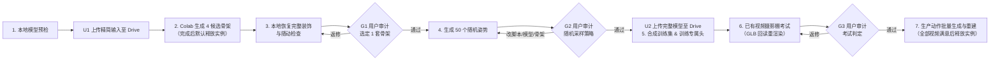

# MonsterStudio 完整流程与用户审计规范（SOP）

本规范定义将静态怪物模型转化为三维骨骼动画的标准作业流程（SOP），涵盖模型预检、Google Drive 资产传输、SkinTokens 四候选骨架生成、三道用户审计关卡（G1 / G2 / G3）、DINOv2 专属姿态头训练、双视图动作生成重建及 Colab 实例生命周期管理。

---

## 1. 全流程总览与用户审计关卡

### 1.1 标准主线

### 1.2 审计关卡定义

三道关卡与最终动作视频均以**用户明确确认**为准。自动评分、代码阈值达标、Agent 建议或等待超时均不替代用户通过。

| 关卡 | 审计输入材料 | 准出条件与锁定内容 | 不通过退回路径 |
| :--- | :--- | :--- | :--- |
| **G1 骨架审计** | 4 套候选恢复完整装饰后的**同一测试动作多视角视频**（正/侧/3/4）＋ **Blender 标准八面体骨骼四视角图**（正/侧/背/3/4，共 16 张）＋ 随动问题清单 | 用户指定唯一 `selected_candidate_id`，锁定完整绑定模型与骨架 | 修复骨架/蒙皮/装饰随动，或重生成四候选后重审 G1 |
| **G2 姿势审计** | 选定模型生成的 **50 个真实随机姿势**（正/侧原图＋标签叠加图、单页缩略图总览、关节随机范围与异常摘要） | 用户认可随机策略，锁定完整模型、采样脚本与关节参数范围 | 仅采样问题改脚本重抽 50 个；模型/蒙皮问题局部修复并补审 G1；骨架或输入缺陷退回四候选生成或预检 |
| **G3 考试审计** | **已有视频**与**导出 GLB 重渲染视频**并排同步对照（正/侧/3/4＋骨骼叠加）＋ 误差曲线与技术报告 | 用户判定考试通过，锁定专属 `dinov2_head.pt` 进入生产动作生成 | 视频/标定/IK 问题修后重考 G3；姿态泛化不足退回 G2 重采样训练；骨架缺陷退回 G1 |

---

## 2. 阶段一：输入预检与 Google Drive 传输

### 2.1 自动骨架输入模型预检

预检针对准备送入自动骨架服务的导出模型（`rig_input_variant`），在上传前输出正/侧视实模图与检查摘要：

| 检查项 | 标准要求 | 异常处理 |
| :--- | :--- | :--- |
| **无关装饰分离** | 排查挂件、饰品、外壳等无需参与主体动作解算、易遮挡关节或干扰轮廓的部件 | 临时隐藏或拆离装饰生成骨架输入；保留原工程完整装饰供阶段二恢复，禁止直接删毁源装饰 |
| **姿态与朝向** | 人形采用标准 A-pose / T-pose；非人形怪物校准正前方向与世界坐标轴 | 修正导出朝向与基础姿态 |
| **原点归零** | 根原点置于世界 `(0, 0, 0)`，保持各分件相对装配位置，导出重导入复核 | 应用偏移变换（非仅清零对象面板数值），防止子分件几何塌缩到同一原点 |
| **拓扑独立性** | 检查装饰与主体是否共顶点/边/面或焊接粘连（仅材质槽不同不算拓扑分离） | 沿用既有合理分件，仅拆离与主体实际粘连的装饰边界，不按材质或碎面机械切碎 |
| **网格基础质量** | 排查错误孔洞、内部多余面、重叠面、退化面、孤立点边、非流形与反法线 | 定向清理几何错误，保留衣物领口/袖口、发片、设计叠层等正常开口结构 |
| **正侧视遮挡** | 在固定正/侧正交相机下检查四肢、关节是否长期重叠或左右难以区分 | 对易混淆的左右肢体添加随部位运动的**差异化图案**作为视觉线索；**严禁采用左右纯改色**，避免训练依赖固定颜色 |

### 2.2 Google Drive 资产持久化与上传节点（U1 / U2）

所有资产遵循**「本地预检登记 → 上传 Google Drive → Colab 挂载读取 → 结果回存 Drive」**，禁止通过 Gradio 临时文件框或代码单元格直传临时 VM 代替持久化。

全流程仅设**两处常规本地模型上传点**，模型未发生实质改动时不重复上传：

1. **U1（首次自动骨架输入）**：上传预检通过的精简主体 GLB 及依赖清单，供 Colab 生成四候选骨架。
2. **U2（本地结合骨架并恢复装饰后）**：在本地完成装饰恢复、权重修复并通过相应审阅后，于下一次云端任务（云端渲染或合成训练）消费前，上传完整绑定模型的 `.blend` / GLB、贴图及 `studio_rig_meta.json`。
3. **增量同步规则**：仅修改采样脚本、关节角度范围、随机 seed 或动作提示词时，只同步脚本与配置；新增考试/参考视频或本地数据集时单独上传对应文件。

---

## 3. 阶段二：四候选骨架生成、装饰恢复与 G1 审计

### 3.1 四候选生成与装饰恢复

1. **生成四候选**：Colab 运行 SkinTokens 生成 4 套候选骨架，保存各自 `.blend` 与元数据至 Drive。取回本地后，**默认释放本任务独占的 Colab 实例**（见 7.2 节）。
2. **恢复完整装饰**：在本地将预检阶段临时隐藏/拆离的装饰恢复至 4 套候选模型上：
   - 刚性挂件绑定至对应骨骼父级，柔性分件配置蒙皮权重并保持独立分件（不焊接合并至主体）。
   - 检查静止姿态与测试动作下的漂移、脱离、穿插及异常拉伸。
   - **后续 G1、G2 与正式训练均使用恢复装饰后的完整模型。**

### 3.2 G1 审阅包制作标准

- **四候选同动作多视角视频**：
  - 按怪物形态从 3.3 节参考库**择一**代表姿势或短动作（建议 6～12 秒）。
  - 4 套候选在相同时间线、帧率、动作相位、相机与灯光下执行同一动作意图（骨架拓扑不同时按部位映射控制，不得挑选各自有利的不同动作）。
  - 输出正面、侧面、3/4 视角视频（支持四候选并排同步播放、暂停、逐帧对照与单候选放大，标注候选 ID、视角与帧号）。
- **Blender 标准骨骼四视角图**：
  - 每套候选提供**正面、侧面、背面、3/4** 共 4 张材质预览（Material Preview）＋ **八面体（Octahedral）变形骨骼透显叠加图**（4 套共 16 张），清晰展示骨骼头尾、层级与关节落点。

### 3.3 G1 各形态测试动作参考库（按模型择一）

复杂姿势可选用 imagen 生成保持角色比例与外观一致的参考图辅助对位，以 Blender 实际蒙皮求值结果交付：

| 怪物形态 | 候选测试动作（择一执行） | 重点核查部位与缺陷 |
| :--- | :--- | :--- |
| **带翼类** | **收翼**（展开→收拢折叠）、**飞行**（上下拍翼周期）、**展翅**（翼根至翼尖完全展开）、**落地**（伸腿触地缓冲） | 翼根/翼中/翼尖联动、羽片或翼膜折叠间隙、躯干与尾羽随动、是否卷束穿体 |
| **人形类** | **盘膝坐下**、**双手举顶站立**、**双手合十**、**飞踢**、**握拳半蹲** | 肩/肘/前臂扭转/腕/指闭合、髋/膝/踝/趾配合、腋下与胯部体积挤压、衣摆随动 |
| **四足/多足兽** | **站立重心转移**、**走跑周期**、**急停起步**、**转向侧移**、**伏低趴卧**、**跳跃扑击**、**撕咬**（具可动下颌时）、**抬爪/摆尾** | 前后左右腿交替支撑与相位、肩髋深屈曲、脊柱/颈/尾联动、下颌开合（不以整头旋转伪装张嘴） |
| **异形怪物** | **多肢交替支撑/交叉抓取**、**长尾/蛇躯盘绕伸展**、**多触手异步卷曲**、**钳爪/口器铰接开合** | 多节链条扭转累积、软肢局部塌陷、铰接轴心准确度与刚柔部件边界 |

---

## 4. 阶段三：50 个随机姿势小样与 G2 审计

### 4.1 随机采样原则

G1 用户明确选定 1 套 `selected_candidate_id` 后，仅对该套完整绑定模型运行正式合成采样器，**直接按当前锁定的目标视频生成分辨率**（默认最高稳定档双视图拼合 `1344×768`＝单面板 `672×768` 正视＋`672×768` 侧视；若开启 `ENABLE_2K_RESOLUTION=True` / `MONSTER_ENABLE_2K=1` 特性开关则统一使用 2K 拼合 `2560×1440`＝单面板 `1280×1440`）生成 **50 个随机姿势**（`pose_001`～`pose_050`，每个 ID 含正/侧正交双视图原图及 2D 标签叠加图）：

- **充分且稍激进的联合随机**：单样本同时随机多个关节，保留左右/前后肢体独立变化；不绑定步态模板，不要求姿势具备日常动作语义，也不要求足底贴地站稳。
- **按结构约束严重异常**：根据当前骨架局部轴与自由度设定较宽的转动范围，仅拦截错误轴向、严重反折、几何撕裂爆炸或肢体脱离。
- **真实抽样纪律**：记录固定 `seed`、关节范围与实际求值分布摘要；严禁反复更换 seed 挑图或手工摆拍替代随机采样输出。若启用严重异常自动重抽，须记录被拒样本原提案、原因与补样对应关系。

### 4.2 G2 审阅展示与分级返修

审阅页单屏展示全部 50 个姿势缩略图，支持点击放大原图、正/侧视与标签图层切换、前后翻页及关节参数查看。用户反馈（或授权 Agent 优化）按问题根因分级回退：

| 问题根因分类 | 调整内容 | 重审与版本失效规则 |
| :--- | :--- | :--- |
| **1. 采样策略问题**（幅度保守、方向设反、镜像锁定） | 修改采样脚本、关节轴向、角度范围或关联约束 | 重新随机抽样 50 个 → 提交 **G2**（模型与骨架未变，保留原 G1 通过状态） |
| **2. 选定模型局部缺陷**（局部权重拉扯、关节轴偏移、装饰脱节） | 在本地修复选定模型的网格、骨骼轴向、蒙皮权重或装饰绑定 | 补交受影响的 **G1** 动态/骨骼材料确认 → 重新生成 50 个姿势提交 **G2** |
| **3. 自动骨架结构缺陷**（核心关节缺失、层级无法满足运动） | 调整自动骨架配置或绑定方案，重新生成四候选 | 退回**四候选生成** → 本地恢复装饰 → **G1** → **G2** |
| **4. 输入模型基础缺陷**（初始姿态、拓扑粘连、严重遮挡） | 修改源模型结构、分件或图案标记，更新 U1 输入 | 退回**阶段一预检与 U1** → 四候选生成 → **G1** → **G2** |

---

## 5. 阶段四：数据合成、专属训练与 G3 摄影棚考试

### 5.1 完整训练集合成与 DINOv2 训练

1. **前置门禁与分辨率对齐**：校验当前模型与采样器具备有效的 G1、G2 通过记录，模型更新已完成 U2 上传。**训练图与静止首帧基准图（`idle_split_1344x768.png` 或 2K 模式下的 `idle_split_2560x1440.png`）必须采用与目标视频生成完全一致的原生渲染分辨率**（`composite_width = panel_width * 2`、`composite_height = panel_height`，默认为 `1344×768` 即单面板 `672×768`，开启 `MONSTER_ENABLE_2K=1` 时为 `2560×1440` 即单面板 `1280×1440`；严禁低清渲染后插值放大，或让训练图与视频生成使用不同分辨率）。
2. **批量合成与 GPU 渲染加速规范**：在固定正/侧正交双视图摄影棚下按上述锁定分辨率生成完整训练集（基线默认 3,000 姿态，或按资产专门约定如 10,000 姿态），输出双视图渲染图、2D 骨骼端点、相机标定（含锁定的 `panel_width`、`panel_height`、`composite_width`、`composite_height`）及 v2.3 深度/表面可见性代理标签。
   - **Cycles 光追与 OpenImageDenoise GPU 开关（必开）**：使用 `CYCLES` 渲染时，按 `OPTIX -> CUDA -> METAL` 顺序启用硬件 GPU 后端，并将 `prefs.devices` 中的 CPU 设备设为 `device.use = False`（禁止 CPU 混合抢占分块）；启用 `OPENIMAGEDENOISE` 时**必须显式设置 `scene.cycles.denoising_use_gpu = True`**（Blender 默认 `False`，若遗漏会导致每帧将緩衝区拷回 CPU 用 40+ 核慢速降噪、GPU 利用率仅 ~6%；开启 GPU OIDN 后 2K 16 samples 双视图渲染从 ~1.66s 降至 ~0.20s，提速约 8.5 倍）。
   - **常驻显存与相机/灯光标定**：必须开启 `scene.render.use_persistent_data = True` 避免跨帧与正/侧相机切换重复上传网格与重建 BVH；双正交相机锁定 `sensor_fit = "VERTICAL"` 并调用 `view_layer.update()` 后再读取 `matrix_world`；三盏 Area Light（`KeyLight`、`FillLight`、`RimLight`）朝向始终对准模型中心 `center`；表面可见性采样器缓存静态蒙皮权重归属与三角面拓扑，每帧仅更新变形顶点坐标。
3. **专属头训练与 GPU 算力满载规范**：冻结 DINOv2 主干，在同分辨率面板裁切输入上训练怪物专属关键点热图头与辅助头（14px patch 自动边缘填充：768P 下 `672×770 -> 192×220` 热图；2K 下 `1288×1442 -> 368×412` 热图，高斯核半径与面板高度同比例自适应；基线默认 15 epochs），备份旧权重后保存 `dinov2_head.pt`，并验证权重可在目标推理链正常加载求值。
   - **DINOv2 原生融合 SDPA 注意力**：必须将 `backbone.blocks[*].attn.forward` 绑定为 PyTorch `F.scaled_dot_product_attention`（FlashAttention / cuDNN SDPA），严禁在缺少 `xformers` 时退化为显式 $N \times N$ 注意力矩阵（2K 下 `N=9481` 会暴涨至 ~68 GiB 显存，SDPA 下 `batch_size=32` 仅占 ~29.6 GiB）。
   - **TF32、异步 DataLoader 与批量推理**：启用 `torch.backends.cuda.matmul.allow_tf32 = True`、`cudnn.allow_tf32 = True` 与 `cudnn.benchmark = True`；`DataLoader` 开启多进程 `persistent_workers=True`、`pin_memory=True` 与 `.to(device, non_blocking=True)` 异步 H2D 传输，并在 epoch 末统一同步标量 Loss 避免逐 batch `cudaStreamSynchronize` 阻塞流水线；推理阶段使用 `torch.inference_mode()` 多帧批量前向与多线程图片解码。

### 5.2 已有视频还原与 G3 考试审计

1. **独立考试素材**：使用独立于训练集的**已有视频**（核对正/侧正交相机标定、帧率、视图顺序，且**视频分辨率须与训练图锁定分辨率严格一致**；原 96 帧合成序列仅作附加技术回归，不替代已有视频还原）。
2. **还原与 GLB 回读重渲染**：
   `视频抽帧 → DINOv2 姿态推理 → 双视图同步检查与深度/可见性融合 → 三维轨迹重建 → Swing+Twist IK 解算与动画烘焙 → 导出实际 GLB → 重新导入 Blender 按原相机与相同最高分辨率重渲染对比视频`。
3. **代码测量与报告边界**：
   - **具 3D 骨骼真值**：报告骨端点位置误差、骨方向误差、非叶骨 SO(3) 旋转误差（基线参考阈值：逐骨平均方向误差均值 `< 3.5°`、最大值 `< 8.0°`、完整旋转平均误差 `< 3.5°`）。
   - **仅具 2D 标注**：报告 2D 重投影误差、双视图竖直同步（基线阈值：768P 下平均竖直差 `< 18 px`、2K 1440P 下按比例 `< 33.75 px`，相关系数 `> 0.82`）及骨长一致性。
   - **无标注原视频**：报告双视图同步、置信度自一致性与逐帧视觉对照，明确标注无真值项，不编造 MPJPE / SO(3) 数值。
4. **G3 审阅包**：提供原视频与最终 GLB 重渲染视频的并排同步播放器（含 3/4 视图、骨骼叠加、误差曲线与失败帧定位），由用户做出 G3 最终判定。

---

## 6. 阶段五：生产动作批量生成与交付

1. **双视图动作视频生成（对齐锁定分辨率与满血权重）**：校验当前 checkpoint 具备有效 G3 通过记录后，提交动作规格（如 `idle:loop walk:loop run:loop slash:once`），由 MiniMax H3 / ComfyUI 结合静止双视图生成动作视频。**模型权重默认采用 `H3_PROFILE="full"`（BF16 扩散模型＋BF16 文本编码器＋FP16 视频 VAE），视频输出分辨率必须与训练图及 `calibration` 标定分辨率严格一致**（默认单阶段 `1344×768`＝单视图 `672×768`；开启 `MONSTER_ENABLE_2K=1` 特性开关时输出 `2560×1440`＝单视图 `1280×1440`，内部采用两阶段 2K 工作流：Pass 1 在模型原生 `1344×768` 画布采样 8 步保证双视图动作与构图不崩坏，Pass 2 通过 `MinimaxH3LatentUpscaler3D` 24 通道 3D 潜空间超分至 `2560×1440` 后结合原生 2K 首尾帧条件与 `MMH3SplitUpscale` 1344×768 分块滑窗重采样 4 步 `denoise=0.30` 补齐 2K 锐利细节；禁止降低输出分辨率或跨分辨率推理）。
2. **同步检查与失败硬拦截**：FFmpeg 抽帧后由 DINOv2 预测双视图骨骼端点并校验双视图竖直同步（默认最多换 seed 重试 3 次）。**重试耗尽仍未通过同步检查时直接终止并标记失败，禁止继续执行后续 IK 烘焙或输出不合格 GLB。**
3. **三维重建与 IK 烘焙**：融合深度、可见性、遮挡插值、时序平滑与固定骨长约束生成三维轨迹，经 Swing＋子骨平面 Twist IK 逐帧重置 Rest Pose 烘焙，导出 `<action_name>_animated.glb`。
4. **归档与逐片验收**：将本批实际生成的动画 GLB、三维轨迹、报告与清单回存 Drive（打包清单仅列本批产物，不混入历史遗留文件）。本地重新导入 GLB 核验骨架、蒙皮、贴图与 `loop` 首尾接缝，逐片提交用户审阅。

---

## 7. 运行环境与 Colab 生命周期管理

### 7.1 云端服务启动与改造要求

- **标准启动顺序**：Cell 1（挂载 Drive、同步源码至 `MonsterStudio/src`、配置 `ENABLE_DEPTH_VISIBILITY=True`）→ Cell 2（SkinTokens 与 headless `bpy==4.2.0` 环境）→ Cell 3（ComfyUI `127.0.0.1:8193`、MiniMax H3、DINOv2 缓存）→ Cell 4（启动 Worker `7865` 端口并写入 `MonsterStudio/runtime/endpoint_registry.json`）。
- **Google Drive 持久目录**：`MonsterStudio/src/`（源码备份）、`MonsterStudio/runtime/endpoint_registry.json`（运行态发现）、`MonsterStudio/monsters/<monster_id>/`（输入模型、四候选、完整绑定工程、采样配置、checkpoint、考试报告、阶段状态与动画 GLB）、`SkinTokens/` 与 `MonsterStudio/cache/h3_models/`（环境与权重缓存）。
- **必改项汇总**（相对于原 Notebook `v2.3-20261020004015` 基线）：
  1. 移除或禁用 `600s` 空闲看门狗自动断连及动作批次 `finally` 中的无条件 `auto_shutdown_after=True`，改为下述分阶段显式释放。
  2. 补齐 `stage_state.json` 的用户审计门禁状态（`awaiting_rig_review`、`awaiting_pose_review`、`awaiting_exam_review` 及 `user_decision=pending|approved|changes_requested|rejected`），未获对应关卡 `approved` 前硬拦截下游任务。
  3. 同步检查 3 次重试失败后硬终止，修复 `bake_glb_on_cloud` 分支，将 `api_reexam_only` 绑定至远程端点，且打包归档仅统计当批产物。

### 7.2 Colab 实例复用与分阶段释放

| 阶段节点 | 实例处理策略 | 执行前提与安全边界 |
| :--- | :--- | :--- |
| **新任务启动前** | 优先跨任务、跨会话复用现有实例 | 盘点当前账号全部运行时及各任务 `--config` 登记；不同任务隔离工作目录与日志，GPU 任务排队执行 |
| **自动骨架生成完成** | **默认释放本任务独占实例** | 四候选工程与元数据已回存 Drive 并核验，本地副本已取回；确认无其他会话共用后停止实例，转本地恢复装饰与审阅 |
| **本地改模 / 本地审阅** | 保持本地作业，不空挂独占 GPU | 后续需云端合成、训练或生成视频时，再复用可用实例并按 U2 同步模型 |
| **视频生成与反馈迭代** | **持续保留并复用实例** | 涵盖视频生成、用户查看、等待反馈、调参重生成全过程；单片完成、代码检查通过或等待回复期间均不关闭实例 |
| **本批全部视频满意** | **完成收尾持久化后释放独占实例** | 用户对本批清单内全部视频的当前版本明确满意；所有产物已回存 Drive 并核验后执行释放 |

**跨会话释放安全检查（每次关闭前必做）**：
1. 核对目标实例 endpoint、账号运行时列表及所有本地 Codex 会话的工作目录、后台进程与 GPU 队列（CLI 显示 `IDLE`、`[?]` 或瞬时 GPU 利用率为 0 不等于无人占用）。
2. 若其他会话仍在使用或排队依赖该实例，**严禁释放**，仅保存本任务结果并记录保留原因。
3. 确认无共享占用后执行实例释放，并再次查询远端运行时列表核实已成功下线。
