# MonsterStudio 完整流程与用户审计规范（SOP）

本规范定义将静态怪物模型转化为三维骨骼动画的标准作业流程（SOP），涵盖本地模型预检与自动水密壳生成、Google Drive 资产持久化传输、SkinTokens 四候选骨架生成与几何精修、三道用户审计关卡（G1 / G2 / G3）、标定采样与 DINOv2 Reader 训练、多视图 2D 重投影运动学求解与 `clean_motion` 后处理、动作批量交付及 Colab 实例生命周期管理。

---

## 1. 全流程总览与用户审计关卡

### 1.1 标准主线

```mermaid
flowchart LR
    A["1. 本地模型预检与自动水密壳<br/>（含强制骨骼命名核验）"] --> A1{"预检与水密壳确认<br/>(Human-in-the-Loop)"}
    A1 -->|确认通过| B["U1 上传精简输入与水密壳至 Drive"]
    A1 -->|调整朝向/分件| A
    B --> C["2. Colab 生成 4 候选骨架<br/>（完成后默认释放实例）"]
    C --> D["3. 本地骨架精修与恢复完整装饰<br/>强制解剖学骨骼命名与随动检查"]
    D --> E{"G1 用户审计<br/>选定 1 套骨架"}
    E -->|通过| E2["4.0 几何/LBS 轴向探测与<br/>Agent 定制 joint_limits.json"]
    E -->|返修| D
    E2 --> F["4.1 边界探索随机采样<br/>生成 50 个随机姿势"]
    F --> G{"G2 用户审计<br/>边界探索与随机策略"}
    G -->|通过| H["U2 同步完整模型与 joint_limits.json<br/>5. 标定合成训练集 & 训练 Reader"]
    G -->|改 joint_limits/采样/模型| E2
    H --> I["6. 已有视频摄影棚考试<br/>（重投影求解 + GLB 回读重渲染）"]
    I --> J{"G3 用户审计<br/>考试判定"}
    J -->|通过| K["7. 生产动作批量生成与重建<br/>（全部视频满意后释放实例）"]
    J -->|返修| I
```

### 1.2 审计关卡定义

预检与水密壳确认、三道正式关卡（G1 / G2 / G3）及最终动作视频均以**用户明确确认**为准。自动评分、代码阈值达标、Agent 建议或等待超时均不替代用户通过。

| 关卡 | 审计输入材料 | 准出条件与锁定内容 | 不通过退回路径 |
| :--- | :--- | :--- | :--- |
| **预检与水密壳确认 (Human-in-the-Loop)** | 准备副本**原模型正/侧视实模图 (`preflight_front_side.png`)** ＋ **自动 3D 水密壳正/侧视图 (`preflight_watertight_shell.png`)** ＋ 3D 水密外壳 `watertight_shell.glb` / `shell.npz` ＋ 无损网格清理摘要 ＋ 审阅页 `preflight_review.html` | 用户看到原模型与水密壳预览并明确确认当前步骤 OK（记录 `--user-quote`），准予执行 U1 上传与四候选骨架生成 | 调整导出朝向 `--yaw-deg`、分件拆离或源模型后重跑阶段一预检 |
| **G1 骨架审计** | 4 套候选经几何精修并恢复完整装饰后的**同一测试动作多视角视频**（正/侧/3/4）＋ **Blender 标准八面体骨骼四视角图**（正/侧/背/3/4，共 16 张）＋ **解剖学骨骼规范命名核验清单（`monster-bone-taxonomy-v3` 100% 合规通过）** ＋ 随动问题清单 | 用户指定唯一 `selected_candidate_id`，锁定完整绑定模型、规范化骨架与 `studio_rig_meta.json` | 修复骨骼命名/骨架/蒙皮/装饰随动，或重生成四候选后重审 G1 |
| **G2 姿势审计** | 选定模型生成的 **50 个真实边界探索随机姿势**（正/侧原图＋逐视角裁剪图＋包含表皮关键点的 2D 标签叠加图、单页缩略图总览、关节随机范围与异常重抽日志） | 用户认可随机与边界探索策略，锁定完整模型、采样配置、`joint_limits.json` 与 `g2_review_sha256` 签名 | 仅采样或限角问题改配置重抽 50 个；模型/蒙皮/骨骼命名问题局部修复并补审 G1；骨架或输入缺陷退回四候选生成或预检 |
| **G3 考试审计** | **已有独立视频**与**实际导出 GLB 重渲染视频**并排同步对照（同视角＋`50°/18°` 3/4 视角＋轮廓叠加）＋ 误差曲线与诊断报告 | 用户判定考试通过，锁定专属 Reader 权重与 `g3_review_sha256` 签名，进入生产动作生成 | 视频/标定/求解后处理问题修后重考 G3；姿态泛化不足退回 G2 重采样训练；骨架缺陷退回 G1 |

---

## 2. 阶段一：输入预检、自动水密壳与 Google Drive 传输

### 2.1 模型预检（含强制骨骼命名规范与水密壳 Human-in-the-Loop 确认）

预检针对准备送入自动骨架服务的导出模型（`rig_input_variant`）以及任何已带骨骼进入/接续流程的绑定模型，在上传或进入下游前输出**原模型正/侧视实模图 (`preflight_front_side.png`)**、**3D 水密壳正/侧视预览图 (`preflight_watertight_shell.png`)**、3D 水密壳模型 (`watertight_shell.glb`)、双层体素壳 (`shell.npz`)、并排审阅页 (`preflight_review.html`)、**骨骼规范命名核验清单**与检查摘要，**并向用户展示预检结果与水密壳预览、等待用户明确确认后方可上传 U1**。

**本地工作目录与版本控制红线：** 在最终动作交付并获用户明确确认定稿（或授权正式接入引擎）前，阶段一的输入准备稿、颜色/图案试做稿、阶段二四候选、阶段三 50 姿势及阶段四考试中间产物一律放在 `scratch/work/`（检查渲染图放 `scratch/checks/`），严禁提前写入 `art_source/` 或游戏正式目录，严禁在 `art_source/` 下堆叠过程子目录，且绝对不得加入项目版本控制（Git / LFS / DVC）或正式来源／部署清单；淘汰的未确认过程稿可在 `scratch/` 中直接覆盖或随时删除：

| 检查项 | 标准要求 | 异常处理 |
| :--- | :--- | :--- |
| **无关装饰分离** | 排查挂件、饰品、外壳等无需参与主体动作解算、易遮挡关节或干扰轮廓的部件 | 临时隐藏或拆离装饰生成骨架输入，保存 `decorations_backup.blend` 与 `decoration_manifest.json` 供阶段二恢复，禁止直接删毁源装饰 |
| **姿态与朝向** | 人形采用标准 A-pose / T-pose；非人形怪物校准正前方向与世界坐标轴（预检用显式 `--yaw-deg` 调整并展示确认；锁定 -Y 正面、+Z 向上与输入 SHA，网格清理与候选生成绝不自动旋转） | 修正导出朝向与基础姿态 |
| **原点归零** | 根原点置于世界 `(0, 0, 0)`，保持各分件相对装配位置，导出重导入复核 | 应用偏移变换（非仅清零对象面板数值），防止子分件几何塌缩到同一原点 |
| **拓扑独立性** | 检查装饰与主体是否共顶点/边/面或焊接粘连（仅材质槽不同不算拓扑分离） | 沿用既有合理分件，仅拆离与主体实际粘连的装饰边界，不按材质或碎面机械切碎 |
| **网格基础质量与自动水密壳展示** | 自动清理孤立点、悬空边、零面积退化面与重复面，自动生成 `1.2% H` 双层体素水密壳 `shell.npz`、重建 3D 水密外壳 `watertight_shell.glb` 并渲染 `preflight_watertight_shell.png` 供用户确认 | `_sanitize_preflight_meshes` 在不破坏 UV 接缝与独立薄片的前提下自动清理几何垃圾；叶片/衣摆/领口等正常开放边界及多层接触非流形交界由自动生成的 `shell.npz` / `watertight_shell.glb`（`watertight_ready=True`）及阶段二 $100^3$ 水密外壳 Bone Heat（`solid_copy`）自动兜底，向用户展示水密壳预览图并获确认后放行，禁止手工对原始外观网格做破坏 UV 的全局焊接或拓扑修补 |
| **正侧视遮挡** | 在固定正/侧正交相机下检查四肢、关节是否长期重叠或左右难以区分 | 对易混淆的左右肢体添加随部位运动的**差异化图案**作为视觉线索；**严禁采用左右纯改色**，避免训练依赖固定颜色 |
| **骨骼规范命名（强制）** | 凡输入模型已含骨架或完成骨架绑定后，**必须**将全部变形骨骼统一规范命名为解剖学语义名（Schema `monster-bone-taxonomy-v3`：中轴 `Root`/`Hips`/`Spine1..N`/`Neck1..N`/`Head`/`Jaw`/`Tail1..N`，左右肢体带 `.L`/`.R` 后缀如 `Shoulder.L`/`Arm.L`/`LowerArm.L`/`Hand.L`、`Thigh.R`/`Shin.R`/`Foot.R`/`Toes.R`，指趾 `Finger1_1.L`/`Toe1_1.R`，附属 `Flex1_1.L`/`Ear1_1.L`/`Rigid1`/`Weapon.R`/`Prop_*`），同步更新 `vertex_groups`、父子关系、动画 `fcurves` 与 `studio_rig_meta.json`，并通过 `validate_canonical_rig_bone_names` 零匿名骨校验（`valid=True`） | **硬性阻断项：** 严禁携带 `bone_0..N`、`Bone.001` 等匿名或非标骨骼进入下游；必须调用 `canonicalize_rig_bone_names_in_blender` 并逐骨核对刚性甲壳/挂件/武器（`Rigid*`/`Weapon`）、柔性发辫/衣摆/触须（`Flex*`/`Ear*`）、四肢分段与指趾爪（`Finger*`/`Toe*`），输出完整命名映射表后方可放行 |

### 2.2 Google Drive 资产持久化与上传节点（U1 / U2）

所有资产遵循**「本地预检登记 → 上传 Google Drive → Colab 挂载读取 → 结果回存 Drive」**，禁止通过 Gradio 临时文件框或代码单元格直传临时 VM 代替持久化。

全流程仅设**两处常规本地模型上传点**，模型未发生实质改动时不重复上传：

1. **U1（首次自动骨架输入）**：在用户确认预检与水密壳后，上传精简主体 `rig_input_variant.glb`、`shell.npz`、`watertight_shell.glb` 及 `u1_manifest.json` 至 `MonsterStudio/monsters/<monster_id>/u1/`，供 Colab 生成四候选骨架。
2. **U2（本地结合骨架并恢复装饰后）**：在本地完成骨架精修、装饰恢复、权重绑定并通过 G1/G2 审阅后，于下一次云端任务消费前增量上传完整绑定模型的 `.blend` / GLB、`studio_rig_meta.json` 与 `joint_limits.json`。
3. **增量同步规则**：仅修改采样配置、关节角度范围、随机 seed 或动作提示词时，只同步对应配置；新增考试/参考视频时单独上传对应文件。

---

## 3. 阶段二：四候选骨架生成、骨架树精修、装饰恢复与 G1 审计

### 3.1 四候选生成、骨架树几何精修与强制解剖学骨骼命名

1. **生成四候选**：Colab 运行 SkinTokens 生成 4 套候选骨架，保存各自 `.blend`、`candidate_0..3.glb` 与元数据至 Drive。取回本地后，**默认释放本任务独占的 Colab 实例**（见 7.2 节）。
2. **骨架树几何精修与重绑（`prepare_candidate`）**：
   - **体素壳裁剪与尖端回缩**：使用 `1% H` 体素精修骨架与 `1.2% H` 双层体素壳。壳外比例通过随长度/体素调整的偶数中点采样测量，严格超过 50% 才删除；尖端回缩采用二分定位，最多缩至原长 30%。
   - **指趾完整保留与武器切分**：默认保留完整手指/脚趾树（`MONSTER_FOLD_DIGITS=0`；显式设置 `MONSTER_FOLD_DIGITS=1` 时按每条 digit 分支最大弧长 `< 0.22H` 折叠短指趾并合并权重）。连续薄末段长度严格 `> 0.10H`、厚度不超过 `min(1.5 体素, 0.5 * 近端掌半径)` 时，在薄段开始后 `0.03H` 保留拳头并生成刚性 `Weapon` 子骨。
   - **脚尖定位与成对子树对称化**：脚底按最近脚段分配低处网格点，以朝前投影 97% 分位尾部均值定位脚尖。成对子树在体积 IoU `>= 0.80` 时镜像平均；其余在链长比 `>= 0.75` 且对应骨段不过度悬殊时等长，并递归平移后代保持关节连接。
   - **非零起始姿态保留与水密外壳蒙皮兜底**：重绑时保留非零起始姿态（`monster-start-pose-v1`）及所有网格实际表面；`heat_bind_updated_skeleton` 在整体或任意 `>= 2%` 角色顶点的主分件覆盖率 `< 50%` 时自动回退到 $100^3$ Marching Cubes 水密外壳 `solid_copy` Bone Heat + `cKDTree` 最近表面权重回传；`< 2%` 角色顶点的独立小碎片（不含独立 `Prop`）按最近骨段 $1/d^4$ 分配至多四影响，并清理远侧串权重。
3. **恢复完整装饰**：在本地将预检阶段临时隐藏/拆离的装饰恢复至 4 套候选模型上：
   - 刚性挂件绑定至对应骨骼父级，柔性分件配置蒙皮权重并保持独立分件（不焊接合并至主体）。
   - 检查静止姿态与测试动作下的漂移、脱离、穿插及异常拉伸。
   - **后续 G1、G2 与正式训练均使用恢复装饰后的完整模型。**
4. **强制统一解剖学骨骼命名规范（Schema `monster-bone-taxonomy-v3` 硬门禁）**：在本地恢复完整装饰、导出 `studio_rig_meta.json` 与进入 G1 审计前，**必须调用 `canonicalize_rig_bone_names_in_blender` 将全部变形骨骼统一命名为解剖学语义名**，并通过 `validate_canonical_rig_bone_names` 校验 `valid=True` 且 `non_canonical_bones` 为空（同步重命名网格 `vertex_groups`、父子引用与动画曲线，并在 `studio_rig_meta.json` 记录 `schema_version=3`、`reader_contract="monster-reader-v3"`、`kind`、`anatomical_role`、`side`、`group_id`、`chain_index` 与 `bone_naming_validation`）：
   - **中轴骨骼（`side="C"`，骨名不加 `.C` 后缀）**：`Root`（世界根）、`Hips`（骨盆/重心根）、`Spine1..N`（躯干脊柱链）、`Neck1..N`（颈链）、`Head`（头颅主骨）、`Jaw`（下颌口器单向铰链）、`Tail1..N`（尾链）、`Limb<i>_<j>`（中轴附属链）、`Prop_<Name>`（独立场景道具根）。
   - **成对侧向骨骼（`side="L"|"R"`，骨名带 `.L` / `.R` 后缀）**：
     - 双足下肢（`biped`）：`Thigh.L/R`、`Shin.L/R`、`Foot.L/R`、`Toes.L/R`
     - 上肢手臂（`arm`）：`Shoulder.L/R`、`Arm.L/R`、`LowerArm.L/R`、`Hand.L/R`
     - 四足前肢（`front`）：`Scapula.L/R`、`UpperArm.L/R`、`Forearm.L/R`、`FrontPaw.L/R`、`FrontToes.L/R`
     - 四足后肢（`hind`）：`Thigh.L/R`、`Shin.L/R`、`HindPaw.L/R`、`HindToes.L/R`
     - 翼链（`wing`）：`WingShoulder.L/R`、`WingUpper.L/R`、`WingForearm.L/R`、`WingHand.L/R`
     - 多足肢体（`many`，触地肢 `>= 6`）：`Coxa<i>.L/R`、`Femur<i>.L/R`、`Tibia<i>.L/R`、`Tarsus<i>.L/R`
     - 额外成对附属链：`Pair<i>_<j>.L/R`
   - **指趾、柔性链与刚性附件**：`Finger<i>_<j>.L/R`（手指）、`Toe<i>_<j>.L/R`（脚趾）、`Flex<i>_<j>(.L/R)` / `Ear<i>_<j>(.L/R)`（柔性飘带/裙摆/发辫/触须/耳链）、`Rigid<i>(.L/R)`（刚性胸甲/挂件，0 局部旋转自由度 `fixed_local=True`）、`Weapon.L/R`（刚性持握武器）。
   - **10 类解剖运动角色（`kind`）**：`root`、`rigid`、`spine`、`head`、`jaw`、`limb`、`wing`、`flex`、`tail`、`digit`。**严禁保留 `bone_0..N` 等匿名骨名称进入 G1、G2 或数据合成**。

### 3.2 G1 审阅包制作标准

制作或补交时执行 [候选视频审阅规范 v1](candidate-video-review.md)：默认先展示四张候选独立视频卡片，每套正/侧/3⁄4 共 12 段，四宫格仅作折叠补充；保留全部候选及 FAIL 状态。

- **四候选同动作多视角视频**：
  - 按怪物形态从 3.3 节参考库**择一**代表姿势或短动作（建议 6～12 秒）。
  - 4 套候选在相同时间线、帧率、动作相位、相机与灯光下执行同一动作意图（骨架拓扑不同时按部位映射控制，不得挑选各自有利的不同动作）。
  - 输出每候选正面、侧面、3/4 独立视频，支持独立播放、暂停、拖动、切换视角与放大，标注候选 ID、视角与帧号；另保留同源四宫格同步比较。
- **Blender 标准骨骼四视角图**：
  - 每套候选提供**正面、侧面、背面、3/4** 共 4 张材质预览（Material Preview）＋ **八面体（Octahedral）变形骨骼透显叠加图**（4 套共 16 张），清晰展示骨骼头尾、层级与关节落点。

### 3.3 G1 各形态测试动作参考库（按模型择一）

复杂姿势可选用 imagen 生成保持角色比例与外观一致的参考图辅助对位，以 Blender 实际蒙皮求值结果交付：

| 怪物形态 | 候选测试动作（择一执行） | 重点核查部位与缺陷 |
| :--- | :--- | :--- |
| **带翼类 (`winged`)** | **收翼**（展开→收拢折叠）、**飞行**（上下拍翼周期）、**展翅**（翼根至翼尖完全展开）、**落地**（伸腿触地缓冲） | 翼根/翼中/翼尖联动、羽片或翼膜折叠间隙、躯干与尾羽随动、是否卷束穿体 |
| **人形类 (`humanoid`)** | **盘膝坐下**、**双手举顶站立**、**双手合十**、**飞踢**、**握拳半蹲** | 肩/肘/前臂扭转/腕/指闭合、髋/膝/踝/趾配合、腋下与胯部体积挤压、衣摆随动 |
| **四足/多足兽 (`quadruped`)** | **站立重心转移**、**走跑周期**、**急停起步**、**转向侧移**、**伏低趴卧**、**跳跃扑击**、**撕咬**（具可动下颌时）、**抬爪/摆尾** | 前后左右腿交替支撑与相位、肩髋深屈曲、脊柱/颈/尾联动、下颌开合（不以整头旋转伪装张嘴） |
| **异形怪物 (`aberrant`)** | **多肢交替支撑/交叉抓取**、**长尾/蛇躯盘绕伸展**、**多触手异步卷曲**、**钳爪/口器铰接开合** | 多节链条扭转累积、软肢局部塌陷、铰接轴心准确度与刚柔部件边界 |

---

## 4. 阶段三：G1 后关节限制定制、50 个边界探索随机姿势小样与 G2 审计

### 4.0 G1 通过后几何/LBS 轴向探测与 Agent 定制 `joint_limits.json`

在 G1 用户选定唯一 `selected_candidate_id` 且完成解剖学规范命名后、进入 G2 采样前，执行**「几何与 LBS 轴向探测 + Agent 专属定制 `joint_limits.json`」**步骤（调用 `monster_sop.py joint-limits probe / apply`）：
- **不绑定窄动作列表（保证模型通用性）**：`joint_limits.json`（Schema `monster-joint-limits-v1`）定义的是**该怪兽骨骼拓扑与蒙皮网格在生理和几何上能承受的完整动作无关安全运动包络（Morphological Safe Envelope）**。世界根旋转采用轴角 $\mathrm{SO}(3)$ 全向参数化（涵盖 360° 全向转身与 `±75°` 俯仰/横滚）及三维全身位移比例（`translation_fraction_xyz`），使训练出的姿态 Reader 在后续生成任意朝向、跳跃、扑击、受击等新动作时无需重训。
- **几何关节轴向角色与非零起始姿态测定（`probe_rig_joint_limits` / `axis_roles`）**：
  - 在恢复后的起始姿态 `p0` 中自动测量每骨局部 `rx/ry/rz` 在世界空间驱动骨端移动的 `bend`/`twist`/`side` 角色，结合 LBS 蒙皮边长拉伸率（`bad_edge_ratio <= 0.02`、`max_stretch_ratio <= 1.80`）与分件硬碰撞给出安全上限 `safe_lbs_ceiling_deg`（首次 15° 失败时在 0° 与失败角间做 8 次二分细分）。
  - **铰链轴与单向下颌铰链**：肘/膝等铰链关节根据静息父子骨弯曲平面自动选择局部 X 或 Z 轴（近乎笔直时使用起始姿态轴角色），记录 `hinge.axis` 与 `axis_name`，用正弦/余弦解析求与父骨最接近的 `straight`；起始弯曲 `> 12°` 时沿继续折叠方向确定正反铰链，其余按角色正面（膝向后、肘向前），范围为有向 `straight - 0.05` 到 `straight + 2.7` rad 与 LBS 安全范围的交集。`Jaw` 使用上下唇实体间前方开放的空腔定位，配置向下张嘴单向铰链范围 `[-0.05, +0.70]` rad（其余轴 `[-0.08, 0.08]`）。
  - **无观察依据的叶骨起始扭转锁定**：无观察依据的叶骨扭转若在保存的起始姿态 `p0` 中非零，通过 `frozen_start_channels_rad` 锁定在该起始角度，保留精度且不增加冗余求解自由度。
- **Agent 定制与形式化门禁**：Agent 结合怪兽形态与探测报告定制各骨 `limits_deg` 并落盘为 `scratch/work/<monster_id>/joint_limits.json`，自动运行 `sop_formal_gate.py` 校验骨架形式化不变量（$\mathcal{P}_1$–$\mathcal{P}_3$）。修改 `joint_limits.json` 仅触发 `sampler_script_or_seed_change`（保留 G1 通过状态，仅重抽 G2 50 个小样）。

### 4.1 与 video2rig 一致的起始姿态采样

G1 通过并冻结 joint_limits.json 后，使用 `pose_sampling_v3.sample_start_pose` 与 `sample_v3_pose` 生成 50 个 G2 小样；正式训练使用同一采样路径。

- video2rig 起始姿态采样：G2 与训练共用分布；30% 概率将幅度缩至 0.4，非铰链轴围绕保存的 p0 高斯采样，肘膝主轴在合法范围内均匀采样。保留小概率全身转向、俯仰、接触与位移；双侧极限覆盖率仅报告，不作为通过阈值。保留越限、非有限值、意外冻结、固定比例联动与网格安全检查。
- 非铰链轴标准差为 bend: `0.5*min(reach,1.6)`、twist: `0.3*min(reach,1.2)`、side: `0.4*min(reach,1.2)`，单位弧度；reach 从 p0 到两侧限制取最大值。固定骨与非拟合骨保留保存的姿势。目标仓库保留有蒙皮影响的指趾自由度，这一点不同于 video2rig 默认忽略手指的设置。
- 关节安全范围与训练概率分布分别管理；不要为了达到覆盖率而扩大限制或同时推满关节。该采样不保证姿态自然；头颈累计弯曲、肩胯局部蒙皮仍需 G2 视觉检查。
- 固定 seed，保留实际 `video2rig_calm` / `video2rig_active` 计数、边界触达、网格异常重抽、真实 Blender 图片与标签。禁止换 seed 挑图或把边界统计缺失显示为 100%。
- 采样契约为 `monster-calibrated-sampling-v2`；数据签名包含 `video2rig-start-pose-v1`。旧审阅包不能作为新策略的验收证据，策略变更按 `sampler_script_or_seed_change` 重建 G2。

### 4.2 G2 审阅展示与分级返修

审阅页统一采用技能专用审阅模板 [`assets/g2_review.html`](../assets/g2_review.html) 生成 `g2_review.html`，提供单视角自适应居中放大、多视角同步缩放平移对照、非遮挡右侧关节参数与全骨角度检查抽屉（悬停骨骼行与舞台 2D 骨骼向量双向联动高亮）、50 姿势底部缩略图导航栏与采样体制可筛选总览弹窗。用户反馈（或授权 Agent 优化）按问题根因分级回退：

| 问题根因分类 | 调整内容 | 重审与版本失效规则 |
| :--- | :--- | :--- |
| **1. 采样策略问题**（幅度保守、方向设反、镜像锁定） | 修改采样脚本、关节轴向、角度范围或关联约束 | 重新随机抽样 50 个 → 提交 **G2**（模型与骨架未变，保留原 G1 通过状态） |
| **2. 选定模型局部缺陷**（局部权重拉扯、关节轴偏移、装饰脱节） | 在本地修复选定模型的网格、骨骼轴向、蒙皮权重或装饰绑定 | 补交受影响的 **G1** 动态/骨骼材料确认 → 重新生成 50 个姿势提交 **G2** |
| **3. 自动骨架结构缺陷**（核心关节缺失、层级无法满足运动） | 调整自动骨架配置或绑定方案，重新生成四候选 | 退回**四候选生成** → 本地恢复装饰 → **G1** → **G2** |
| **4. 输入模型基础缺陷**（初始姿态、拓扑粘连、严重遮挡） | 修改源模型结构、分件或图案标记，更新 U1 输入 | 退回**阶段一预检与 U1** → 四候选生成 → **G1** → **G2** |

---

## 5. 阶段四：标定合成、DINOv2 Reader 训练与 G3 摄影棚考试

### 5.1 标定训练集合成、表皮关键点与 EEVEE 动画条带渲染

1. **前置门禁与摄影棚标定**：校验当前模型与采样配置具备有效的 G1、G2 通过记录，模型更新已完成 U2 增量上传。
   - **视频首帧基准图与生成视频分辨率**：静止首帧基准图（双视图 `idle_split_1344x768.png` / `idle_split_2560x1440.png`，或三视图 `idle_3view_1344x768.png` / `idle_3view_2688x1440.png`）与目标视频生成严格保持同一原生分辨率与视角排布（默认双视图 `[Front | Side]` 768P `1344×768`＝单面板 `672×768`，2K `2560×1440`＝单面板 `1280×1440`；开启 `MONSTER_ENABLE_3VIEW=1` 时为 `[Left | Front | Right]` 768P `1344×768`＝单面板 `448×768 × 3`，2K `2688×1440`＝单面板 `896×1440 × 3`；可选 `MONSTER_STUDIO_LAYOUT=stacked` 侧视在上、俯视在下；支持 `MONSTER_CAMERA_LENS=0` 正交或正数毫米焦距透视相机）。
   - **合成训练面板与 p95 移动窗口（`monster-reader-training-p95-window-v1`）**：合成训练集使用独立的 `896×896`/视角方形训练面板与 `training_calibration` 渲染原图；`ReaderDataset` 统计整批训练图片画幅内关键点横/纵跨度的 p95 再乘 `1.12`（四舍五入并限制在面板短边内）作为统一窗口边长（记入 checkpoint `reader_window`），窗口中心跟随各图关键点，将 RGB、2D 关键点、时序上下文与稠密场同步裁剪变换到 `448×448` Reader 输入。
2. **标定事件采样与表皮关键点标签（`monster-calibrated-sampling-v2` / `v3-anatomical-reader-4`）**：
   - **标定采样（基线默认 5,000 姿态）**：画幅采样使用所有标定相机 `[3%, 97%]` 的共同可行区域；接触目标取自实际蒙皮后的躯干三角面；按帧抽取 360° 全向 Yaw、`±75°` Pitch、漫游、跳跃、持握、张嘴、STRIKE、LUNGE 等动作事件并记入 `v3_sampling`，同时记录前序微扰姿态投影上下文（`monster-context-pose-v1`）与完整骨骼 `matrix_local`/`pose_basis`/rest 与 start 网格（`monster-start-pose-v1`）。在 Stage 2 结束时通过 `audit_pose_dataset_coverage` 校验指间解耦有效秩、反相比例与解剖包络覆盖率。
   - **表皮关键点（`surface_keypoints`）**：全部原始骨骼头/尾 `2N` 槽位在前，附加表皮点跟在其后：通过 `skin.bone_names` 映射实际蒙皮索引，对 `w > 0.3` 且至少有 4 个支持顶点的骨段生成 98% 轴向 `.tip` 以及由 `(outward, facing, up)` 确定性定向的横截面 1%/99% 主次轴侧点 `.sidea1/2`、`.sideb1/2`（使 `.L`/`.R` 成对骨骼解剖侧严格镜像一致，约束手掌/叶骨轴向 roll 与父骨扭转）；手部蒙皮延伸 `> 2.5 L_bone` 时自动生成 `.held_tip` 与 `.held_mid` 守卫点；独立道具 `Prop_*` 生成 `.end1`、`.end2`、`.mid` 及离轴点。
   - **混合可见性与 NPZ 导出**：默认 `MONSTER_VISIBILITY_MODE=hybrid` 同时保存 BVH `visibility_ratio` 与 CPU Z-buffer 布尔可见性，并在 `keypoints_gt.json` 旁同步导出 `labels.npz`、`visible.npz`、`poses.npz`（`MONSTER_EXPORT_NPZ_LABELS=1`）。
3. **EEVEE 动画条带批量渲染与可选 Cycles GPU 光追**：
   - **EEVEE 动画条带批量渲染（默认）**：摄影棚默认 `MONSTER_RENDER_ENGINE=EEVEE`、8 spp（`MONSTER_EEVEE_SAMPLES=8`），Stage 2 正交视图默认开启 `MONSTER_RENDER_STRIP=1`：目标最多 16 个独立骨架/Action 副本沿每个相机右方向横排，奇偶副本沿视线错开 2.5m，保留半面板间隔与逐副本灯光/阴影隔离（最大条带宽度 `16384` px 下 896px 面板每批 12 副本；前一半清晰、后一半 0.5 快门运动模糊分批渲染，渲染收据记入 `keypoints_gt.json.render_pipeline`）。透视相机与 G2 边界审阅使用逐样本路径。详细参数见 [v3 算法与运行参数](video2rig-v3.md#eevee-动画条带渲染)。
   - **可选 Cycles 硬件光追与 GPU OIDN**：显式设置 `MONSTER_RENDER_ENGINE=CYCLES` 时，按 `OPTIX -> CUDA -> METAL` 启用硬件 GPU 后端并禁用 CPU 混合抢占，显式设置 `scene.cycles.denoising_use_gpu = True` 与 `scene.render.use_persistent_data = True`。

### 5.2 DINOv2 Reader 训练（`Video2RigReaderNet`）

1. **视觉主干与部分微调**：默认采用 `MONSTER_BACKBONE=dinov2-small`（`facebook/dinov2-small` / `dinov2_vits14_reg`，$d=384$，12 层，patch 14；可选 `dinov2_vitb14_reg` $d=768$），遵循 `FROZEN=4`（冻结 `embeddings` 与前 4 层 block，解冻后 8 层 block 与末端 `norm`；前 1 轮热身检测头，之后主干学习率 `1e-4`、检测头 `1e-3`，余弦衰减，支持 `TRAINING_MODE="frozen"` 对照），配备 `STRIDE=4`、`HEAT=112`、`CH=96` 轻量双路融合解码器。启用 PyTorch 原生融合 SDPA 注意力、TF32、activation checkpointing 与异步 DataLoader；按姿态固定留出 5% 验证集保存验证最优权重（Worker 自动备份旧权重至 `backups/`）。
2. **三模型独立/统一探针角色**：
   - **基础检测器 `reader.pt` / `dinov2_head.pt`（`reader_role="base"`）**：预测关键点热图 + $K$ 通道逐关键点视线深度头 `dhead` `(B, K, H, W)`，通过 `sample_maps(dmap, coords)` 在预测 2D 坐标处双线性采样 `point_depth` `(B, K)`，由 `sight_depth_targets` 按角色高度归一化视线深度 `(X - mid_body) @ cam_fwd / H` 对所有画幅内关键点（含被遮挡点）施加 SmoothL1 监督。GPU 训练损失使用可微 DSNT，推理默认采用 `MONSTER_DECODE_MODE=parabola` 三点二次抛物线亚像素峰值解码与实际 sigmoid 峰值置信度。
   - **手爪局部放大器 `reader-crops.pt`（`reader_role="crops"`，可选开启 `MONSTER_READER_CROPS=1`）**：`end_groups` 提取每条侧向非松散肢体链末段及其指/趾后代，`crop_sides` 按最末两节骨长之和 `1.6 * reach` 计算裁剪边长并夹紧至 `[72, 320]` px 缩放至 `224×224`；推理期 `read_crops` 仅在局部裁剪置信度 `cq > c` 时覆盖手爪/足端关键点。
   - **密集表面场检测器 `reader-dense.pt`（`reader_role="dense"`，可选开启 `MONSTER_READER_DENSE=1`）**：`rasterize_dense_fields` 将骨骼局部坐标 `(pts - head) @ R` 按角色总高 $H$ 归一化（`local_norm="height"`），通过 `joints_from_dense_fields` 提供稠密表面几何约束。
3. **双向时序上下文防抄袭增强（`corrupt_context`）与胶囊挥击残影（`smear_limbs_capsules_gpu`）**：
   - 训练使用 `t-1 / t+1` 双向邻帧上下文（`temporal_context_contract="monster-reader-bidirectional-context-v2"`），通过 `corrupt_context` 施加 `1.5 px` 高斯抖动、5% 远距离离群点（`±0.2 * SIZE`）、16% 单点随机丢弃、25% 整条对称肢体左右互换（`twins`）、`U(0.3, 1.0)` 置信度缩放与 20% 全帧清空，防止网络直接抄袭邻帧上下文。
   - `smear_limbs_capsules_gpu` 以 35% 概率在训练图上抽取 1～2 条可见肢体线段，沿法线方向平移 13 份软边缘 2D 胶囊体副本做预乘 Alpha 混合，模拟高速挥击残影。

### 5.3 已有视频还原、2D 重投影求解、8 步 `clean_motion` 后处理与 G3 考试审计

1. **独立考试素材**：使用独立于训练集的**已有视频**（核对相机标定、帧率、`view_order` 视图顺序，视频分辨率与视角数须与锁定配置严格一致）。
2. **全链路推理、重投影求解与后处理管线（`infer_v3_frames`）**：
   - **首帧阴影剥离、相机轮廓对齐与视频节奏检测**：`learn_frame0_shadow_table` / `strip_shadow` 剥离地面阴影；`align_frame0_camera_chamfer` 在完整三角形集合上对齐首帧轮廓并报告优化前后 IoU 与双向 Chamfer（透视相机优化 6 外参，正交投影保持输入光轴平移并明确报告 `unobservable_parameters=["tz"]`）；`detect_video_cadence_optical_flow` 利用前景均值 DIS 光流按局部趋势检测周期性抽帧，映射为 `monster-video-timing-v1` 非整数时间基准（停顿与重复图像保留编码时间间隔）。
   - **粗读定位、移动窗口 + 8x TTA 精读与多探针融合**：全序列粗读仅定位窗口中心（失读中心沿时间插值后平滑，不将每帧范围抖动变为缩放）→ 按实际面板高度与训练面板高度换算 `reader_window` 边长裁剪 `448×448`，结合 `t-1 / t+1` 邻帧上下文与 8x 逆变换平均热图峰值解码 → 可选融合 `read_crops` 手爪局部放大与 `joints_from_dense_fields` 密集场。
   - **左右消歧与多视角读数预处理（`preprocess_readings`）**：保持神经网络训练面板顺序，在几何消歧阶段将主视图（`front` 或堆叠下的 `top`）置为主观测，依次执行：
     - `fix_twins_viterbi`：首帧 `t=0` 交换态施加 `switch_cost` 初始惩罚；`MONSTER_NO_CUT_TRACKS=1` 时对内部平滑且左右间距充足的交换区间整段取消翻转。
     - `jump_pass_constant_velocity`：逐关键点常速插值检验 + `_twin_parent_links` 父骨骼连接点距离保护（父点间距 `>= 20 px` 时要求子点交换同样缩短到父点距离）+ `MONSTER_TWOWAY_JUMP=1` 前后双向一致判定。
     - `panel_drift`（`MONSTER_PANEL_DRIFT=1`）：双正交共享轴 `> 5% H` 中线漂移校正。
     - `downweight_overlapping_twins`（`twin_same`）：检查同肢体链相邻关键点左右间距，当 `0 < max(apart) <= 3 * near`（双腿真实并拢站立）时不降权。
     - `downweight_flipped_limbs`（`flipped`）：上端关节静止（`< 2% H`）而肢体方向突然翻转 `> 60°` 并在 `<= 24` 帧内恢复（`< 30°`）时，末端权重乘以 `0.1`。
     - `downweight_contradicting_far_limb`（`pick_panels`）：3 帧窗口扩展 + 远侧肢根相机深度支持（近侧肢体与躯干不连带降权）+ 落在其他身体部位且跨视角矛盾的远端观测清零（`zero_contradicted=True`）。
   - **标定多视角极线同步硬门禁（`geometric_consistency`）**：在短遮挡桥接前直接测量真实读数的跨视角三角化重投影误差与竖直轨迹相关系数（768P 下平均误差 `< 18 px`、2K 1440P 下按比例 `< 33.75 px`）。
   - **短遮挡桥接与解析雅可比混合 Cauchy 2D 重投影求解（`fit_clip_2d_reprojection`）**：
     - 短遮挡桥接后，通过解析雅可比与 `robust_mode="scipy_hybrid"`（`robust_cauchy_loss`）直接拟合多视角 2D 重投影与单侧遮挡视线深度先验（`w_depth=0.2`、`depth_where="unseen"`）：对前 `n_robust` 个 2D/深度数据残差启用 SciPy 原生三行 Cauchy 核 + `x_scale="jac"`（前后三帧置信度 `>= 0.6` 且二阶像素差分 `< 2%` 投影身高的稳定轨迹，其 Cauchy 尺度从 6px 放宽为 12px）；对地面与胶囊体防穿模约束（`3000/H`，中心线上沿可运动确定性方向逃逸）、着地脚掌局部横向向量平足约束（`flat_feet=120`，腾空与竖直蹄不施加）、角色特定静息先验（`w_prior=2.0`，`RigModel.prior_weights`：`twist=25.0`、铰链非弯曲轴 `60.0`、`spine=15.0`、`clavicle=40.0`、`toe=30.0`、`loose=6.0`、主弯曲轴 `2.0`、根旋转单视角 `2.0`/多视角 `0.2`、根平移 `0.0`）及帧间平滑保持严格二次 L2。`Prop_*` 双端标签支持求解期按观测动态交换 `end1/end2`、`prop_place` 多起点候选及跨肢体胶囊遮挡降权。
   - **完整 8 步 `clean_motion` 后处理、实测表面接触守卫与卡限诊断**：
     - 按 `monster-video-timing-v1` 真实秒数依序执行 8 步 `clean_motion`（`MONSTER_CLEAN_MOTION=1`）：① `smooth_turn` 转向平滑 → ② `despike_reading_backed` 读数验证去尖峰（仅修改有毛刺角通道与 `> 0.03H` 根位移毛刺，保护单肢快速动作，不平均正常根位移）→ ③ `lowpass_motion_adaptive` 4/5/8Hz 速度自适应 Butterworth 低通 → ④ `floor_bend_and_smooth_lift` 静止着地段与 60 遍高斯单调抬升包络 → ⑤ `recover_root_translation_from_steps` 原地踏步根位移恢复（要求原地支撑、55% 移动份额、0.92 方向一致性、`0.08H/s` 速度、`steps_steady=0.5` 步幅离散度门控，按真实秒数做 2Hz 低通积分；已有根运动与独立道具保持，持握道具随身体平移）→ ⑥ `lock_feet` 双端点钉死 IK、1 帧间隙闭合与 `lock_blend=3` 线性淡入淡出 → ⑦ `simulate_damped_spring_chains` 阻尼弹簧链（每帧间隔 4 个约束子步、4Hz/0.55 阻尼解析状态转移、`spring_soft=0.4` 根到尖频率渐减，保持骨长并反解局部限角）→ ⑧ `keep_out` 终态胶囊防穿模推出。
     - **实测网格表面接触守卫（`surface_contact.py`，`MONSTER_SURFACE_CONTACT=1`）**：保留输入的完整冻结局部旋转与父坐标系偏移，仅调整实际拟合通道和授权根高度，确保鞋底/足底三角面接地且不穿地，输出表面接触收据以供 $\mathcal{P}_4$ 形式化门禁核验。
     - **卡限诊断（`at_limit`）**：统计非铰链骨距关节极限 `<= 2°` 的帧占比，超过 25% 帧时写入报告与审阅页告警。
3. **快速软光栅化质检与正式 Blender GLB 回读重渲染**：
   - **快速四联屏质检（`software_rasterizer.py`）**：`render_fast_review_frames` 通过 CPU/CUDA 分桶 Z-buffer 软光栅化快速输出 `[原视频 | 拟合渲染 | 50/50 叠加 + 红绿轮廓线 + IoU | 3/4 环绕视角]` 四联屏对照视频与剪影 IoU 统计。
   - **正式 G3 真实 Blender 烘焙与回读**：正式 G3 必须传入真实预测轨迹 JSON 与独立视频，调用真实 Blender 按 `monster-video-timing-v1` 的 `fps/fps_base` 小数关键帧将每骨每帧世界矩阵（保留空 `Root` 下 `Hips` 的位移）烘焙导出 GLB，重新导入核对小数帧世界矩阵，并以源视频实际帧率乘回放倍速渲染输出**同视角、50°/18° 的 3/4 视角与轮廓叠加对比视频**（`g3_comparison_sync.mp4`）。
4. **代码测量与分层报告边界（绝不编造指标）**：
   - **具 3D 骨骼真值（`3d_gt`）**：通过 `compute_stratified_motion_metrics` 同时报告 `all_bones`（全骨架）、`primary_bones`（除 `digit` 外的主骨骼）及 `by_kind` 的骨端点位置误差、骨方向误差与非叶骨 $\mathrm{SO}(3)$ 旋转误差。
   - **仅具 2D 标注（`2d_only`）**：报告 2D 重投影误差、跨视图极线同步与骨长一致性，3D 误差置为 `null`。
   - **无标注原视频（`unlabeled_video`）**：报告跨视图极线同步、置信度自一致性、骨长守恒、轮廓 IoU 与 `at_limit` 卡限诊断，明确将无真值的 3D/2D GT 误差置为 `null`，严禁编造 MPJPE / $\mathrm{SO}(3)$ 数值。
5. **G3 审阅包与签名锁定**：锁定 HTML、诊断报告、预测轨迹、原考试视频、对照/3/4/轮廓视频与烘焙 GLB 的 SHA-256（总签名 `g3_review_sha256`），由用户做出 G3 最终判定。

---

## 6. 阶段五：生产动作批量生成与交付

1. **多视图动作视频生成（对齐锁定分辨率、视角数、慢动作倍率与满血权重）**：校验当前 checkpoint 具备有效 G3 通过记录后，提交动作规格（如 `idle:loop walk:loop run:loop slash:once`；支持 `MONSTER_SLOW_MOTION_SCALE=0.5` 提示生成半速动作并默认以 `MONSTER_TIME_SCALE=2` 倍速映射烘焙，始终追加禁特效约束），由 MiniMax H3 / ComfyUI 结合静止首帧参考图（`idle_split_*.png` 或 `idle_3view_*.png`）生成单画布同步动作视频。**模型权重默认采用 `H3_PROFILE="full"`（BF16 扩散模型＋BF16 文本编码器＋FP16 视频 VAE），视频输出分辨率与视角数必须与训练标定严格一致**（默认单阶段 `1344×768`；开启 `MONSTER_ENABLE_2K=1` 时通过 `MinimaxH3LatentUpscaler3D` 24 通道 3D 潜空间超分与 `MMH3SplitUpscale` 1344×768 分块滑窗重采样输出 `2560×1440` 双视图或 `2688×1440` 三视图）。
2. **极线同步检查与失败硬拦截**：抽帧运行 Reader 并在短遮挡桥接前执行标定多视角极线同步检查（默认最多换 seed 重试 3 次）。**重试耗尽仍未通过同步检查时直接硬终止并标记失败，严禁继续执行后续求解烘焙或输出不合格 GLB。**
3. **三维重建与真实 Blender 烘焙**：经 2D 重投影求解、8 步 `clean_motion` 后处理与实测表面接触守卫生成三维轨迹（保存 `motion_structure` 含 `motion_roots`/`fitted_bones`），由真实 Blender 按 `monster-video-timing-v1` 烘焙导出 `<action_name>_animated.glb`。
4. **归档、形式化门禁与逐片验收**：将本批实际生成的动画 GLB、三维轨迹、报告与清单回存 Drive（`batch_manifest.json` 仅列当批产物，绝不混入历史遗留文件）。本地 `deliver` 脚本真实回读导出的 GLB，在轨迹 FPS 下逐帧核对骨骼与世界旋转、校验轨迹形式化不变量（`sop_formal_gate.py` $\mathcal{P}_1$ $\mathrm{SO}(3)$/限角盒/骨长与偏移守恒及 $\mathcal{P}_4$ 实测表面接触收据）、使用实际 Action 小数起止帧检查 `:loop` 动作首尾接缝跳变（`compute_loop_seam_metrics`），生成 `delivery_review.html` 逐片提交用户审阅。

---

## 7. 运行环境与 Colab 生命周期管理

### 7.1 云端服务启动与持久目录

- **标准启动顺序**：Cell 1（挂载 Drive、拉取最新代码或解包指定发布归档至 `/content/monster-releases/`，配置 `H3_PROFILE="full"`、分辨率与视角开关）→ Cell 2（分别准备 SkinTokens Python 3.11 / 内部 `bpy==4.5.15` 环境与独立渲染 `/content/monster-bpy/venv` Python 3.13 / `bpy==5.2.3` 环境）→ Cell 3（ComfyUI `127.0.0.1:8193`、MiniMax H3、DINOv2 缓存）→ Cell 4（启动 Worker `7865` 端口并写入 `MonsterStudio/runtime/endpoint_registry.json`）→ Cell 5（可选实时任务进度监控面板）。
- **Google Drive 持久目录**：`MonsterStudio/runtime/endpoint_registry.json`（运行态发现）、`MonsterStudio/monsters/<monster_id>/`（U1 输入与水密壳、四候选、完整绑定工程、关节限制配置、checkpoint、考试报告、阶段状态与动画 GLB）、`SkinTokens/` 与 `MonsterStudio/cache/h3_models/`（环境与权重缓存）。
- **核心运行保障**：
  1. 禁用空闲看门狗自动断连（`idle_timeout_sec=0`）及动作批次结束后的无条件自动关机（`auto_shutdown_after=False`），统一由 `sop_colab_guard.py` 执行分阶段显式释放。
  2. `stage_state.json` 与 `.game-studio/monster/<monster_id>/reviews.json` 同步维护用户审计门禁状态（`awaiting_rig_review`、`awaiting_pose_review`、`awaiting_exam_review`、`awaiting_final_batch_review` 及 `user_decision=pending|approved|changes_requested|rejected`），未获对应关卡 `approved` 前硬拦截下游任务。
  3. 极线同步检查 3 次重试失败后硬终止；`reexam_only` 支持零重训快速复考；打包归档 `batch_manifest.json` 仅统计当批产物。

### 7.2 Colab 实例复用与分阶段释放

| 阶段节点 | 实例处理策略 | 执行前提与安全边界 |
| :--- | :--- | :--- |
| **新任务启动前** | 优先跨任务、跨会话复用现有实例 | 盘点当前账号全部运行时及各任务 `--config` 登记；不同任务隔离工作目录与日志，GPU 任务排队执行 |
| **自动骨架生成完成** | **默认释放本任务独占实例** | 四候选工程与元数据已回存 Drive 并核验，本地副本已取回；确认无其他会话共用后停止实例，转本地精修、恢复装饰与审阅 |
| **本地改模 / 本地审阅** | 保持本地作业，不空挂独占 GPU | 后续需云端合成、训练或生成视频时，再复用可用实例并按 U2 增量同步模型 |
| **视频生成与反馈迭代** | **持续保留并复用实例** | 涵盖视频生成、用户查看、等待反馈、调参重生成全过程；单片完成、代码检查通过或等待回复期间均不关闭实例 |
| **本批全部视频满意** | **完成收尾持久化后释放独占实例** | 用户对本批清单内全部视频的当前版本明确满意（`final_batch = approved`）；所有产物已回存 Drive 并核验后执行释放 |

**跨会话释放安全检查（每次关闭前必做）**：
1. 核对目标实例 endpoint、账号运行时列表及 `active_sessions.json` 中所有本地 Codex 会话租约、远端 Worker `busy` 状态与 GPU 队列（CLI 显示 `IDLE`、`[?]` 或瞬时 GPU 利用率为 0 不等于无人占用）。
2. 若其他会话仍在使用或排队依赖该实例，**严禁释放**，仅保存本任务结果并记录保留原因。
3. 确认无共享占用后执行实例释放，并再次查询远端运行时列表核实已成功下线。
