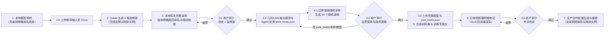

# MonsterStudio 完整流程与用户审计规范（SOP）

本规范定义将静态怪物模型转化为三维骨骼动画的标准作业流程（SOP），涵盖模型预检、Google Drive 资产传输、SkinTokens 四候选骨架生成、三道用户审计关卡（G1 / G2 / G3）、DINOv2 专属姿态头训练、双视图动作生成重建及 Colab 实例生命周期管理。

---

## 1. 全流程总览与用户审计关卡

### 1.1 标准主线

### 1.2 审计关卡定义

三道关卡与最终动作视频均以**用户明确确认**为准。自动评分、代码阈值达标、Agent 建议或等待超时均不替代用户通过。

| 关卡 | 审计输入材料 | 准出条件与锁定内容 | 不通过退回路径 |
| :--- | :--- | :--- | :--- |
| **G1 骨架审计** | 4 套候选恢复完整装饰后的**同一测试动作多视角视频**（正/侧/3/4）＋ **Blender 标准八面体骨骼四视角图**（正/侧/背/3/4，共 16 张）＋ **骨骼规范命名核验清单（`<KIND>_<SIDE>_<GROUP>_<INDEX>` 100% 合规通过）** ＋ 随动问题清单 | 用户指定唯一 `selected_candidate_id`，锁定完整绑定模型、规范化骨架与 `studio_rig_meta.json` | 修复骨骼命名/骨架/蒙皮/装饰随动，或重生成四候选后重审 G1 |
| **G2 姿势审计** | 选定模型生成的 **50 个真实随机姿势**（正/侧原图＋标签叠加图、单页缩略图总览、关节随机范围与异常摘要） | 用户认可随机策略，锁定完整模型、采样脚本与关节参数范围 | 仅采样问题改脚本重抽 50 个；模型/蒙皮/骨骼命名分类问题局部修复并补审 G1；骨架或输入缺陷退回四候选生成或预检 |
| **G3 考试审计** | **已有视频**与**导出 GLB 重渲染视频**并排同步对照（正/侧/3/4＋骨骼叠加）＋ 误差曲线与技术报告 | 用户判定考试通过，锁定专属 `dinov2_head.pt` 进入生产动作生成 | 视频/标定/IK 问题修后重考 G3；姿态泛化不足退回 G2 重采样训练；骨架缺陷退回 G1 |

---

## 2. 阶段一：输入预检与 Google Drive 传输

### 2.1 模型预检（含强制骨骼命名规范）

预检针对准备送入自动骨架服务的导出模型（`rig_input_variant`）以及任何已带骨骼进入/接续流程的绑定模型，在上传或进入下游前输出正/侧视实模图、**骨骼规范命名核验清单**与检查摘要。**本地工作目录与版本控制红线：** 在最终动作交付并获用户明确确认定稿（或授权正式接入引擎）前，阶段一的输入准备稿、颜色/图案试做稿、阶段二四候选、阶段三 50 姿势及阶段四考试中间产物一律放在 `scratch/work/`（检查渲染图放 `scratch/checks/`），严禁提前写入 `art_source/` 或游戏正式目录，严禁在 `art_source/` 下堆叠过程子目录，且绝对不得加入项目版本控制（Git / LFS / DVC）或正式来源／部署清单；淘汰的未确认过程稿不强制归档，可在 `scratch/` 中直接覆盖或随时删除：

| 检查项 | 标准要求 | 异常处理 |
| :--- | :--- | :--- |
| **无关装饰分离** | 排查挂件、饰品、外壳等无需参与主体动作解算、易遮挡关节或干扰轮廓的部件 | 临时隐藏或拆离装饰生成骨架输入；保留原工程完整装饰供阶段二恢复，禁止直接删毁源装饰 |
| **姿态与朝向** | 人形采用标准 A-pose / T-pose；非人形怪物校准正前方向与世界坐标轴 | 修正导出朝向与基础姿态 |
| **原点归零** | 根原点置于世界 `(0, 0, 0)`，保持各分件相对装配位置，导出重导入复核 | 应用偏移变换（非仅清零对象面板数值），防止子分件几何塌缩到同一原点 |
| **拓扑独立性** | 检查装饰与主体是否共顶点/边/面或焊接粘连（仅材质槽不同不算拓扑分离） | 沿用既有合理分件，仅拆离与主体实际粘连的装饰边界，不按材质或碎面机械切碎 |
| **网格基础质量** | 排查错误孔洞、内部多余面、重叠面、退化面、孤立点边、非流形与反法线 | 定向清理几何错误，保留衣物领口/袖口、发片、设计叠层等正常开口结构 |
| **正侧视遮挡** | 在固定正/侧正交相机下检查四肢、关节是否长期重叠或左右难以区分 | 对易混淆的左右肢体添加随部位运动的**差异化图案**作为视觉线索；**严禁采用左右纯改色**，避免训练依赖固定颜色 |
| **骨骼规范命名（强制）** | 凡输入模型已含骨架或完成骨架绑定后，**必须**将全部变形骨骼统一规范命名为 `<KIND>_<SIDE>_<GROUP>_<INDEX>`（10 类 `KIND`：`ROOT`/`RIGID`/`SPINE`/`HEAD`/`JAW`/`LIMB`/`WING`/`FLEX`/`TAIL`/`DIGIT`；`SIDE`：`C`/`L`/`R`），同步更新 `vertex_groups`、父子关系、动画 `fcurves` 与 `studio_rig_meta.json`，并通过 `validate_canonical_rig_bone_names` 零匿名骨校验（`valid=True`） | **硬性阻断项：** 严禁携带 `bone_0..N`、`Bone.001` 等匿名或非标骨骼进入下游；必须调用 `canonicalize_rig_bone_names_in_blender` 并逐骨核对刚性甲壳/挂件（`RIGID_*`）、柔性发辫/衣摆/触须（`FLEX_*`）、四肢分段（`clavicle_socket`/`upper_limb`/`forearm_hinge`/`hand_hub`）与指趾爪（`DIGIT_*`），输出完整命名映射表后方可放行 |

### 2.2 Google Drive 资产持久化与上传节点（U1 / U2）

所有资产遵循**「本地预检登记 → 上传 Google Drive → Colab 挂载读取 → 结果回存 Drive」**，禁止通过 Gradio 临时文件框或代码单元格直传临时 VM 代替持久化。

全流程仅设**两处常规本地模型上传点**，模型未发生实质改动时不重复上传：

1. **U1（首次自动骨架输入）**：上传预检通过的精简主体 GLB 及依赖清单，供 Colab 生成四候选骨架。
2. **U2（本地结合骨架并恢复装饰后）**：在本地完成装饰恢复、权重修复并通过相应审阅后，于下一次云端任务（云端渲染或合成训练）消费前，上传完整绑定模型的 `.blend` / GLB、贴图及 `studio_rig_meta.json`。
3. **增量同步规则**：仅修改采样脚本、关节角度范围、随机 seed 或动作提示词时，只同步脚本与配置；新增考试/参考视频或本地数据集时单独上传对应文件。

---

## 3. 阶段二：四候选骨架生成、装饰恢复与 G1 审计

### 3.1 四候选生成、装饰恢复与强制骨骼命名规范

1. **生成四候选**：Colab 运行 SkinTokens 生成 4 套候选骨架，保存各自 `.blend` 与元数据至 Drive。取回本地后，**默认释放本任务独占的 Colab 实例**（见 7.2 节）。
2. **恢复完整装饰**：在本地将预检阶段临时隐藏/拆离的装饰恢复至 4 套候选模型上：
   - 刚性挂件绑定至对应骨骼父级，柔性分件配置蒙皮权重并保持独立分件（不焊接合并至主体）。
   - 检查静止姿态与测试动作下的漂移、脱离、穿插及异常拉伸。
   - **后续 G1、G2 与正式训练均使用恢复装饰后的完整模型。**
3. **强制统一骨骼命名规范（Schema v2 硬门禁）**：在本地恢复完整装饰、导出 `studio_rig_meta.json` 与进入 G1 审计前，**必须作为强制预检步骤**调用 `canonicalize_rig_bone_names_in_blender` 将全部变形骨骼统一命名为 `<KIND>_<SIDE>_<GROUP>_<INDEX>` 格式，并通过 `validate_canonical_rig_bone_names` 校验 `valid=True` 且 `non_canonical_bones` 为空（同步重命名网格 `vertex_groups`、父子引用与动画曲线，并在 `studio_rig_meta.json` 记录 `schema_version=2`、`kind`、`sub_role`、`side`、`group_id`、`chain_index`、`legacy_name` 与 `bone_naming_validation`）：
   - **`KIND` 枚举**：`ROOT`（根骨）、`RIGID`（刚性胸腔/装甲/挂件锚点，0 局部旋转自由度 `fixed_local=True`）、`SPINE`（中轴躯干/颈部链）、`HEAD`（头颅主骨）、`JAW`（口器/下颌铰链）、`LIMB`（主承重肢体：含 `clavicle_socket` 锁骨/肩胯基座、`upper_limb` 上臂/大腿、`forearm_hinge` 前臂/小腿铰链、`hand_hub` 掌/腕多指扇形枢纽）、`WING`（翼骨主链）、`FLEX`（柔性飘带/裙摆/发辫/触须链）、`TAIL`（尾骨链）、`DIGIT`（指/趾/爪链）。
   - **`SIDE` 枚举**：`C`（中轴 `|x| <= 0.04 * width`）、`L`（左侧 `x > +0.04 * width`）、`R`（右侧 `x < -0.04 * width`）。
   - **严禁跳过预检重命名**：`classify_rig_bones` 混合分类器（名字规范解析 + 关节旋转自由度约束 + 3D 拓扑分支/几何骨长比例与掌指扇形不变量 `_is_digit_chain_subtree`）仅用于预检自动初筛及已训练历史旧权重的只读回放兼容；**所有新模型或重进预检的绑定模型必须完成规范重命名与人工逐骨复核，不得保留 `bone_0..N` 等匿名骨名称进入 G1、G2 或数据合成**。

### 3.2 G1 审阅包制作标准

- **四候选同动作多视角视频**：
  - 按怪物形态从 3.3 节参考库**择一**代表姿势或短动作（建议 6～12 秒）。
  - 4 套候选在相同时间线、帧率、动作相位、相机与灯光下执行同一动作意图（骨架拓扑不同时按部位映射控制，不得挑选各自有利的不同动作）。
  - 输出正面、侧面、3/4 视角视频（支持四候选并排同步播放、暂停、逐帧对照与单候选放大，标注候选 ID、视角与帧号）。
- **Blender 标准骨骼四视角图**：
  - 每套候选提供**正面、侧面、背面、3/4** 共 4 张材质预览（Material Preview）＋ **八面体（Octahedral）变形骨骼透显叠加图**（4 套共 16 张），清晰展示骨骼头尾、层级与关节落点。

### 3.3 G1 各形态测试动作参考库（按模型择一）

复杂姿势可选用 imagen 生成保持角色比例与外观一致的参考图辅助对位，以 Blender 实际蒙皮求值结果交付：

| 怪物形态 | 候选测试动作（择一执行） | 重点核查部位与缺陷 |
| :--- | :--- | :--- |
| **带翼类** | **收翼**（展开→收拢折叠）、**飞行**（上下拍翼周期）、**展翅**（翼根至翼尖完全展开）、**落地**（伸腿触地缓冲） | 翼根/翼中/翼尖联动、羽片或翼膜折叠间隙、躯干与尾羽随动、是否卷束穿体 |
| **人形类** | **盘膝坐下**、**双手举顶站立**、**双手合十**、**飞踢**、**握拳半蹲** | 肩/肘/前臂扭转/腕/指闭合、髋/膝/踝/趾配合、腋下与胯部体积挤压、衣摆随动 |
| **四足/多足兽** | **站立重心转移**、**走跑周期**、**急停起步**、**转向侧移**、**伏低趴卧**、**跳跃扑击**、**撕咬**（具可动下颌时）、**抬爪/摆尾** | 前后左右腿交替支撑与相位、肩髋深屈曲、脊柱/颈/尾联动、下颌开合（不以整头旋转伪装张嘴） |
| **异形怪物** | **多肢交替支撑/交叉抓取**、**长尾/蛇躯盘绕伸展**、**多触手异步卷曲**、**钳爪/口器铰接开合** | 多节链条扭转累积、软肢局部塌陷、铰接轴心准确度与刚柔部件边界 |

---

## 4. 阶段三：G1 后关节限制定制、50 个边界探索随机姿势小样与 G2 审计

### 4.0 G1 通过后几何/LBS 轴向探测与 Agent 定制 `joint_limits.json`

在 G1 用户选定唯一 `selected_candidate_id` 且完成 `<KIND>_<SIDE>_<GROUP>_<INDEX>` 规范命名后、进入 G2 采样前，新增**「几何与 LBS 轴向探测 + Agent 专属定制 `joint_limits.json`」**步骤（调用 `monster_sop.py joint-limits probe / apply`）：
- **不绑定窄动作列表（保证模型通用性）**：不在这一步缩窄或锁定后续要生成的具体动作列表；`joint_limits.json`（Schema `monster-joint-limits-v1`）定义的是**该怪兽骨骼拓扑与蒙皮网格在生理和几何上能承受的完整动作无关安全运动包络（Morphological Safe Envelope）**，同时显式配置全局 `ROOT` 的俯仰/横滚/偏航范围（`global_pitch_deg` 默认 `[-28°, +32°]`、`global_roll_deg` 默认 `[-25°, +25°]`、`global_yaw_deg` 默认 `[-22°, +22°]`）与三维全身位移比例（`translation_fraction_xyz`），使训练出的 DINOv2 姿态头在后续新增跳跃、受击、扑击等任意新姿势时无需重训。**固定正交多视图摄影棚下的 `ROOT` 偏航红线：** `ROOT` 控制的是角色相对固定摄影棚相机（`Cam_Front` 位于 `-Y` 看向 `+Y`）的全局刚体朝向，而非局部解剖关节；单轴 LBS 拉伸探测对刚体旋转恒为 0 形变，不能据此把 `ROOT.ry`（`global_yaw_deg`）放宽为 `[-180°, +180°]`，否则边界探索采样器推向 `lo`/`hi` 极值时会将角色转至 `±180°` 背对正视图相机。标准多视图摄影棚下 `global_yaw_deg` 应保持在正面斜向合理区间（如 `[-22°, +22°]`）。
- **确定性几何与 LBS 轴向探测（`probe_rig_joint_limits`）**：自动测量每根骨骼局部 `+rx / +ry / +rz` 轴在世界空间驱动骨端移动的真实语义方向（如 `forward(+Y)`、`up(+Z)`、`inward_towards_midline`），并结合 LBS 蒙皮边长拉伸率（`bad_edge_ratio <= 0.02`、`max_stretch_ratio <= 1.80`）与分件硬碰撞给出安全角度上限 `safe_lbs_ceiling_deg`。
- **通用三层几何／拓扑关节协调机制（`coordinate_pose_angles`，不依赖特定人形硬编码规则）**：
  1. **第 1 层 · 同骨多轴象限／卦限椭球耦合（`intra_bone_coupling`）**：自动探测每根可动骨骼在 2D 象限（`1:1`、`2:1`、`1:2` 射线）与 3D 八卦限上的安全缩放系数 $\gamma$，满足 $\max(u_i, u_j) + c_{ij}\min(u_i, u_j) \le 1$，单轴独立运动保留 100% 原始跨度，多轴同转自动抑制对角线越界（消除肩甲与上臂、骨盆与大腿、躯干俯仰伴随侧倾的对角穿插）。
  2. **第 2 层 · 跨骨骼拓扑方向耦合（`inter_bone_couplings`）**：沿骨骼父子树自动提取 `parent_child`、`chain_2hop`、`co_parent_sibling`、`ipsilateral_upper_lower_limb` 四类通用拓扑关系并测定各活跃方向组合的安全联合预算，消除多级关节同向叠加折叠穿模。
  3. **第 3 层 · 骨骼局部多球体代理与 3D 体积防穿插（`body_part_volumes`）**：从静止网格顶点与主控骨骼权重自动提取每根骨骼局部多球体代理与静止基线安全间距 `pair_min_clearance`；抽样时通过纯 NumPy FK 实时检测末端肢体（手掌/爪/前臂/小腿）接近胸壳或异侧肢体并沿可动祖先链自顶向下平滑回退。
- **Agent 定制与版本解耦**：Agent 结合怪兽形态与探测报告定制各骨 `limits_deg` 及 `coordination` 并落盘为 `scratch/work/<monster_id>/joint_limits.json`（U2 时同步至 Drive `monsters/<monster_id>/joint_limits.json`）。修改 `joint_limits.json` 仅触发 `sampler_script_or_seed_change`（保留 G1 通过状态，仅重抽 G2 50 个小样）。

### 4.1 边界探索随机采样原则（Stratified Boundary-Exploration Random Suite）

G1 用户明确选定 1 套 `selected_candidate_id` 并生成/确认 `joint_limits.json` 后，仅对该套完整绑定模型运行 **5 模态分层边界探索随机采样器（`sample_boundary_exploration_pose_euler_dict`）**，**直接按当前锁定的目标视频生成分辨率与视角模式**（默认双视图 `[Front | Side(Left)]`：768P 拼合 `1344×768`＝单面板 `672×768`，2K 拼合 `2560×1440`＝单面板 `1280×1440`；若开启 `ENABLE_3VIEW_STUDIO=True` / `MONSTER_ENABLE_3VIEW=1` 三视图 AB 测试特性开关，则采用单视频画布正视居中三联画 `[Left(+X→-X) | Front(-Y→+Y) | Right(-X→+X)]`：768P 拼合 `1344×768`＝单面板 `448×768 × 3`，2K 拼合 `2688×1440`＝单面板 `896×1440 × 3`）生成 **50 个在 `joint_limits.json` 范围内充分探索边界的随机姿势**（`pose_001`～`pose_050`，每个 ID 含正交多视图原图及 2D 标签叠加图）：

- **5 模态边界探索加权随机**：50 个样本全部为全身多关节联合随机姿势，按 5 类体制分层抽样：`25% in_phase_boundary_extension`（同相大开大合边界伸展/深屈）、`20% antiphase_fold_boundary`（父子反相 S 形折叠与极值扭转边界）、`20% cross_occlusion_twist_boundary`（内收横跨中轴自遮挡与前臂/掌指轴向扭转边界）、`20% full_body_dynamic_root_boundary`（全局 `ROOT` 俯仰/横滚/正面斜向偏航＋三维位移叠加四肢不对称边界）、`15% quasi_uniform_interior_coverage`（内部均匀覆盖过渡区）；其中前 3 类肢体/链条边界体制与内部覆盖体制（共 80% 样本）将全局 `ROOT` 锁定在朝向 `Cam_Front` 的温和正视窗口内，仅在 `full_body_dynamic_root_boundary`（20% 样本）中轮转探索 `ROOT` 各轴上下界；同时通过确定性轮转边界槽位，保证每根活动骨骼的每个有效自由度在 50 个样本中均触达下界 15% 与上界 15% 极值区（`audit_boundary_exploration_coverage` 校验双侧边界触达率）。
- **充分且稍激进的联合随机**：单样本同时随机多个关节，保留左右/前后肢体独立变化；不绑定步态模板，不要求姿势具备日常动作语义，也不要求足底贴地站稳。
- **按 `joint_limits.json` 约束严重异常**：严格在 `joint_limits.json` 设定的关节转动范围与 `ROOT` 位移范围内抽样，仅拦截错误轴向、严重反折、几何撕裂爆炸或肢体脱离。
- **真实抽样纪律**：记录固定 `seed`、`joint_limits.json` SHA-256、逐样本触达边界的关节清单 `boundary_joints` 与实际求值分布摘要；严禁反复更换 seed 挑图或手工摆拍替代随机采样输出。若启用严重异常自动重抽，须记录被拒样本原提案、原因与补样对应关系。

### 4.2 G2 审阅展示与分级返修

审阅页统一采用技能专用审阅模板 [`assets/g2_review.html`](../assets/g2_review.html) 生成 `g2_review.html`，提供单视角自适应居中放大、三视角/双视角同步缩放平移对照、非遮挡右侧关节参数与全骨角度检查抽屉（悬停骨骼行与舞台 2D 骨骼向量双向联动高亮）、50 姿势底部缩略图导航栏与采样体制可筛选总览弹窗。用户反馈（或授权 Agent 优化）按问题根因分级回退：

| 问题根因分类 | 调整内容 | 重审与版本失效规则 |
| :--- | :--- | :--- |
| **1. 采样策略问题**（幅度保守、方向设反、镜像锁定） | 修改采样脚本、关节轴向、角度范围或关联约束 | 重新随机抽样 50 个 → 提交 **G2**（模型与骨架未变，保留原 G1 通过状态） |
| **2. 选定模型局部缺陷**（局部权重拉扯、关节轴偏移、装饰脱节） | 在本地修复选定模型的网格、骨骼轴向、蒙皮权重或装饰绑定 | 补交受影响的 **G1** 动态/骨骼材料确认 → 重新生成 50 个姿势提交 **G2** |
| **3. 自动骨架结构缺陷**（核心关节缺失、层级无法满足运动） | 调整自动骨架配置或绑定方案，重新生成四候选 | 退回**四候选生成** → 本地恢复装饰 → **G1** → **G2** |
| **4. 输入模型基础缺陷**（初始姿态、拓扑粘连、严重遮挡） | 修改源模型结构、分件或图案标记，更新 U1 输入 | 退回**阶段一预检与 U1** → 四候选生成 → **G1** → **G2** |

---

## 5. 阶段四：数据合成、专属训练与 G3 摄影棚考试

### 5.1 完整训练集合成与 DINOv2 训练

1. **前置门禁与分辨率/视角模式对齐**：校验当前模型与采样器具备有效的 G1、G2 通过记录，模型更新已完成 U2 上传。**训练图与静止首帧基准图（双视图 `idle_split_1344x768.png` / `idle_split_2560x1440.png`，或三视图 `idle_3view_1344x768.png` / `idle_3view_2688x1440.png`）必须采用与目标视频生成完全一致的原生渲染分辨率与视角排布**（`composite_width = panel_width * num_views`、`composite_height = panel_height`：默认双视图 `[Front | Side]` 768P 为 `1344×768`＝单面板 `672×768`、2K 为 `2560×1440`＝单面板 `1280×1440`；开启 `MONSTER_ENABLE_3VIEW=1` 三视图时排布为单视频画布 `[Left | Front | Right]`，768P 为 `1344×768`＝单面板 `448×768 × 3`、2K 为 `2688×1440`＝单面板 `896×1440 × 3`；严禁低清渲染后插值放大，或跨分辨率/跨视角数混用）。
2. **批量合成、四模态解耦采样与 GPU 渲染加速规范**：在固定正交多视图摄影棚（双视图 `Cam_Front` + `Cam_Side`，三视图额外创建位于 `-X` 朝 `+X` 的 `Cam_Right`）下按上述锁定分辨率生成完整训练集（基线默认 **5,000 姿态**，或按资产专门约定如 10,000 姿态），采用四模态分层解耦采样（`40% synergistic` 单指独立目标＋链内协同、`30% decoupled` 全关节零耦合独立随机、`15% antiphase_extreme` 父子反相 S 形与边界极值双峰采样、`15% workspace_cross_occlusion` 胸前交汇自遮挡与前臂翻转），并在 Stage 2 结束时通过 `audit_pose_dataset_coverage` 自动门禁校验 `digit_pc1_variance_ratio <= 0.55`、`max_inter_finger_abs_corr <= 0.65`、`antiphase_sign_flip_ratio >= 0.12` 与最小解剖包络下限，防止“五指固定比例同步卷曲”等低秩耦合捷径学习；输出多视图渲染图、2D 骨骼端点（含三视图 `right_uv_head` / `right_uv_tail`）、相机标定（含锁定的 `panel_width`、`panel_height`、`composite_width`、`composite_height`、`num_views`、`view_order`）、`pose_coverage_audit.json` 及 v2.3 深度/表面可见性代理标签（含三视图 `right_head_aux` / `right_tail_aux`；若开启 `MONSTER_ENABLE_DENSE_SURFACE=1` 稠密表面开关，还额外光栅化静止姿态表面坐标图 `front_dense_rest.npz` / `side_dense_rest.npz` / `right_dense_rest.npz` 并缓存静态蒙皮 `rig_skinning.npz`）。
   - **EEVEE 动画条带批量渲染（默认）**：摄影棚默认 EEVEE 8 spp，兼容 `BLENDER_EEVEE` / `BLENDER_EEVEE_NEXT`；Stage 2 正交视图默认 `MONSTER_RENDER_STRIP=1`，目标 16 个独立骨架/Action 副本沿每个相机水平轴排列，奇偶沿视线错开 2.5m，保留半面板间隔与逐副本灯光/阴影链接。默认最大条带宽度 16384px，896px 面板含间隔时自动降为 12 副本；高分辨率按宽度自动拆批。双/三视图和上下堆叠共享同一标签标定，透视相机与 G2 边界审阅使用逐样本路径。训练后一半姿态保留运动模糊，条带固定快门 0.5，清晰/模糊批次隔离；渲染收据 `keypoints_gt.json.render_pipeline` 记录实际批次、调用和耗时。v3 保留 896px 原图，在 Reader 内根据完整变形网格（含道具/长尾）紧致方框同步裁剪 RGB、2D 点、上下文和稠密场到 448px，增益随实际占画幅比例而变。开关、引擎、采样数及条带契约均纳入数据集签名，旧数据缓存自动失效；不能直接复用旧训练结果。见 [条带渲染配置](video2rig-v3.md#eevee-动画条带渲染)。
   - **可选 Cycles 光追与 OpenImageDenoise GPU 开关**：显式设置 `MONSTER_RENDER_ENGINE=CYCLES`；使用 `CYCLES` 渲染时，按 `OPTIX -> CUDA -> METAL` 顺序启用硬件 GPU 后端，并将 `prefs.devices` 中的 CPU 设备设为 `device.use = False`（禁止 CPU 混合抢占分块）；启用 `OPENIMAGEDENOISE` 时**必须显式设置 `scene.cycles.denoising_use_gpu = True`**（Blender 默认 `False`，若遗漏会导致每帧将緩衝区拷回 CPU 用 40+ 核慢速降噪、GPU 利用率仅 ~6%；开启 GPU OIDN 后 2K 16 samples 双视图渲染从 ~1.66s 降至 ~0.20s，提速约 8.5 倍）。
   - **常驻显存与相机/灯光标定**：必须开启 `scene.render.use_persistent_data = True` 避免跨帧与正/侧相机切换重复上传网格与重建 BVH；所有正交相机（`Cam_Front`、`Cam_Side` 及三视图下的 `Cam_Right`）锁定 `sensor_fit = "VERTICAL"` 并调用 `view_layer.update()` 后再读取 `matrix_world`；三盏 Area Light（`KeyLight`、`FillLight`、`RimLight`）朝向始终对准模型中心 `center`；表面可见性采样器缓存静态蒙皮权重归属与三角面拓扑，每帧仅更新变形顶点坐标。
3. **专属头训练与 GPU 算力满载规范**：冻结 DINOv2 主干，在同分辨率面板裁切输入上训练怪物专属关键点热图头与辅助头（14px patch 自动边缘填充：双视图 768P 下 `672×770 -> 192×220` 热图、2K 下 `1288×1442 -> 368×412` 热图；三视图 768P 下 `448×770 -> 128×220` 热图、2K 下 `896×1442 -> 256×412` 热图；辅助头按 `num_views` 注入 `front=0 / side=1 / right=2` one-hot 视角编码；高斯核半径与面板高度同比例自适应；默认 `MONSTER_ENABLE_MOCAP_PRIORS=1` 下额外启用 `compute_bone_vector_structural_loss` 父子骨向量方向余弦与骨长结构损失；开启 `MONSTER_ENABLE_DENSE_SURFACE=1` 时启用 DINOv2 `[-4, -1]` 多层融合＋RGB 细节分支＋带高斯 NLL 不确定度 `dense_logvar` 的静止表面坐标头 `dense_head`；基线默认 15 epochs），备份旧权重后保存 `dinov2_head.pt`（含 `num_views`、`view_order` 与 `dense_surface_enabled`），并验证权重可在目标推理链正常加载求值。
   - **DINOv2 原生融合 SDPA 注意力**：必须将 `backbone.blocks[*].attn.forward` 绑定为 PyTorch `F.scaled_dot_product_attention`（FlashAttention / cuDNN SDPA），严禁在缺少 `xformers` 时退化为显式 $N \times N$ 注意力矩阵（2K 下 `N=9481` 会暴涨至 ~68 GiB 显存，SDPA 下 `batch_size=32` 仅占 ~29.6 GiB）。
   - **TF32、异步 DataLoader 与批量推理**：启用 `torch.backends.cuda.matmul.allow_tf32 = True`、`cudnn.allow_tf32 = True` 与 `cudnn.benchmark = True`；`DataLoader` 开启多进程 `persistent_workers=True`、`pin_memory=True` 与 `.to(device, non_blocking=True)` 异步 H2D 传输，并在 epoch 末统一同步标量 Loss 避免逐 batch `cudaStreamSynchronize` 阻塞流水线；推理阶段使用 `torch.inference_mode()` 多帧批量前向与多线程图片解码。

### 5.2 已有视频还原、三层运动学重建与 G3 考试审计

1. **独立考试素材**：使用独立于训练集的**已有视频**（核对正交相机标定、帧率、`view_order` 视图顺序，且**视频分辨率与视角数须与训练图锁定配置严格一致**；原 96 帧合成序列仅作附加技术回归，不替代已有视频还原）。
2. **三层通用＋Kind 专属运动学重建与 GLB 回读重渲染**：
   `视频抽帧 → DINOv2 姿态推理 → 多视图极线同步检查、对向侧视遮挡融合与三层运动学重建（通用核心 + Kind 专属求解器） → 逐帧重置 Rest Pose 动画烘焙 → 导出实际 GLB → 重新导入 Blender 按原相机与相同最高分辨率重渲染对比视频`。
   - **对向侧视三视图遮挡融合（`MONSTER_ENABLE_3VIEW=1`）**：当开启三视图 `[Left | Front | Right]` 时，`fuse_depth_visibility` 同时利用左视角 $y_{\text{direct}, L} = c_y + (u_S / W - 0.5) S \frac{W}{H}$ 与右视角 $y_{\text{direct}, R} = c_y - (u_R / W - 0.5) S \frac{W}{H}$（几何恒等式 $u_S + u_R = W$），并按跨侧可见性比值动态抑制被躯干遮挡或双臂交叉遮挡一侧的权重，从根源上消除单侧盲区导致的 100+ px 先验吸引子塌缩。
   - **第一层（骨骼分类与规范对齐）**：基于 `bone_taxonomy.py` 的混合分类器（`classify_rig_bones`）获取每根骨骼的 `kind`、`subkind`、`side` 与链节深度。
   - **第二层（全骨架通用运动学核心）**：
     - **短遮挡 2D 插值**：`clean_2d_trajectories_hampel` 仅对 `<= 3` 帧的短暂低置信度缺口作线性插值；`> 3` 帧的长遮挡保持原始低置信度，交由 3D 骨长与父子拓扑先验约束，**严禁将长遮挡插值点伪造为 0.35 高置信度覆盖 3D 融合**。
     - **保峰与自适应时序滤波**：默认启用 `MONSTER_ENABLE_MOCAP_PRIORS=1` 时，对 3D 轨迹采用**置信度自适应 1-Euro 滤波**（`one_euro_smooth_trajectories`，静止/慢动时抑制亚像素抖动，高速挥击时随瞬时速度自动抬升截止频率且消除固定窗振铃过冲；关闭时回退至 5 点二阶 Savitzky-Golay `savgol_smooth_array`），并对骨骼末端施加**接触感知脚部钉扎**（`pin_stance_foot_trajectories`，抑制触地支撑期水平滑步同时完整保留跳跃腾空高度）。
     - **躯干刚性簇 ICP 根姿态稳定与多锚点 IRLS Kabsch**：汇集 `root`、`rigid` 及高置信度 `spine`/`clavicle_socket` 锚点，经 3 轮 Huber 加权 Kabsch SVD 与 `solve_root_transform_torso_icp` 躯干刚性点云配准联合求解全局刚体旋转 $R_{\text{root}}(t)$ 与平移 $T_{\text{root}}(t)$。
     - **精确静止骨间距 FK 传递、关节分类先验与正交双分支欧拉限位**：所有子骨旋转在父骨实时局部坐标系 $M_{\text{parent}}(t) \cdot M_{\text{rest\_local}}$ 下求解，并严格通过 `rest_offset` 前向传递位置；启用 `MONSTER_ENABLE_MOCAP_PRIORS=1` 时按关节运动学角色施加 `regularize_rotation_anatomical_prior`（球窝关节 6D 正交防万向节死锁、铰链关节抑制平面外侧向摆动、扭转轴向柔和正则）；欧拉角限位采用正交双分支提取并对比距参考角测地距离，**严禁在限位裁剪后用无界 `minimum_swing` 覆盖导致超限扭转**。
   - **第三层（按 `kind` 分发的专门运动学求解器）**：
     - `root` / `rigid`：直接复用多锚点 IRLS Kabsch 全局刚体变换，刚性附件锁定零局部形变（$R_{\text{local}} = I_3$）。
     - `spine` / `head` / `jaw`：轴向串联阻尼（`0.92`），`head` 结合自身骨向量与唯一子骨向量联合稳定朝向。
     - `limb`（四肢主链）：`forearm_hinge`（前臂/小腿）利用观测空间腕部子骨锚点差分（`hand_hub.head - forearm.head`）加权校正肘部屈伸，并将腕指平面法向投影至静止局部 XZ 平面解算有界轴向 Twist；`hand_hub`（短掌骨枢纽）利用多指基部尾端在观测空间的差分向量（`digit_01.tail - hand.head`）加权扇形求解掌面朝向与翻转，消除 ~2.3 cm 短骨端差噪声放大及 FK/观测坐标系混用偏差。
     - `flex` / `tail` / `wing`：按链节深度递减置信度阻尼（$\alpha = \text{clip}((c - 0.12)/0.55, 0.18, 0.92) \cdot 0.94^{\min(d, 4)}$），防止飘带/长尾末端发散翻转。
     - `digit`（指/趾/爪）：采用指链耦合屈曲阻尼（`0.65 -> 0.52 -> 0.39`）与自适应平滑，抑制多指交叉遮挡下的高频乱跳。
   - **第四层（可选 Stage 6 Warm-Start 可微 LBS 表面精修，`MONSTER_ENABLE_DENSE_SURFACE=1`）**：以第三层解析求解姿态作为 Warm-Start 初值，利用 `match_dense_surface_correspondences`（通过前景 `mask > 0.55`、不确定度 `dense_logvar < -0.35` 及尺度归一化最近邻阈值三重过滤错配表面点）驱动 `refine_frames_with_dense_lbs` 轻量多视角可微 LBS 重投影微调，重点解锁纯端点不可观测的叶骨/肢体轴向扭转（Roll）与轮廓贴合度。
3. **代码测量与分层报告边界**：
   - **具 3D 骨骼真值**：通过 `compute_stratified_motion_metrics` 同时报告 **`all_bones`（全骨架）**、**`primary_bones`（除 `digit` 外的主干/四肢/飘带主骨骼）** 以及 **`by_kind`（按 `root`/`rigid`/`spine`/`head`/`limb`/`flex`/`digit` 分类）** 的骨端点位置误差、骨方向误差与非叶骨 SO(3) 旋转误差。
   - **仅具 2D 标注**：报告 2D 重投影误差、双视图竖直同步（基线阈值：768P 下平均竖直差 `< 18 px`、2K 1440P 下按比例 `< 33.75 px`，相关系数 `> 0.82`）及骨长一致性。
   - **无标注原视频**：报告双视图同步、置信度自一致性与逐帧视觉对照，明确标注无真值项，不编造 MPJPE / SO(3) 数值。
4. **G3 审阅包**：提供原视频与最终 GLB 重渲染视频的并排同步播放器（含 3/4 视图、骨骼叠加、误差曲线与失败帧定位），由用户做出 G3 最终判定。

---

## 6. 阶段五：生产动作批量生成与交付

1. **多视图动作视频生成（对齐锁定分辨率、视角数与满血权重）**：校验当前 checkpoint 具备有效 G3 通过记录后，提交动作规格（如 `idle:loop walk:loop run:loop slash:once`），由 MiniMax H3 / ComfyUI 结合静止参考图（双视图 `idle_split_*.png` 或三视图 `idle_3view_*.png`）生成单画布同步动作视频。**模型权重默认采用 `H3_PROFILE="full"`（BF16 扩散模型＋BF16 文本编码器＋FP16 视频 VAE），视频输出分辨率与视角数必须与训练图及 `calibration` 标定严格一致**（默认单阶段 `1344×768`＝双视图 `672×768 × 2` 或三视图 `448×768 × 3`；开启 `MONSTER_ENABLE_2K=1` 特性开关时双视图输出 `2560×1440`＝`1280×1440 × 2`、三视图输出 `2688×1440`＝`896×1440 × 3`，内部采用两阶段 2K 工作流：Pass 1 在模型原生 `1344×768` 画布采样 8 步保证多面板动作与构图不崩坏，Pass 2 通过 `MinimaxH3LatentUpscaler3D` 24 通道 3D 潜空间超分至 `2560×1440` 或 `2688×1440` 后结合原生 2K 首尾帧条件与 `MMH3SplitUpscale` 1344×768 分块滑窗重采样 4 步 `denoise=0.30` 补齐 2K 锐利细节；禁止降低输出分辨率或跨分辨率/跨视角数推理）。
2. **同步检查与失败硬拦截**：FFmpeg 抽帧后由 DINOv2 预测多视图骨骼端点并校验跨视图竖直极线同步（默认最多换 seed 重试 3 次）。**重试耗尽仍未通过同步检查时直接终止并标记失败，禁止继续执行后续 IK 烘焙或输出不合格 GLB。**
3. **三维重建与 IK 烘焙**：融合深度、可见性（三视图下含对向侧视遮挡优势加权）、短遮挡插值、时序平滑与固定骨长约束生成三维轨迹，经三层通用＋Kind 专属运动学求解器逐帧重置 Rest Pose 烘焙，导出 `<action_name>_animated.glb`。
4. **归档与逐片验收**：将本批实际生成的动画 GLB、三维轨迹、报告与清单回存 Drive（打包清单仅列本批产物，不混入历史遗留文件）。本地重新导入 GLB 核验骨架、蒙皮、贴图与 `loop` 首尾接缝，逐片提交用户审阅。

---

## 7. 运行环境与 Colab 生命周期管理

### 7.1 云端服务启动与改造要求

- **标准启动顺序**：Cell 1（挂载 Drive、拉取或解包源码、默认配置 `ENABLE_DEPTH_VISIBILITY=True` 与 `ENABLE_MOCAP_PRIORS=True`，可选 `ENABLE_2K_RESOLUTION`、三视图 AB 测试开关 `ENABLE_3VIEW_STUDIO` 与稠密表面精修开关 `ENABLE_DENSE_SURFACE`）→ Cell 2（SkinTokens Python 3.11（内部 bpy 4.5.15）与独立 Blender/bpy 5.2.3 Python 3.13 渲染环境）→ Cell 3（ComfyUI `127.0.0.1:8193`、MiniMax H3、DINOv2 缓存）→ Cell 4（启动 Worker `7865` 端口并写入 `MonsterStudio/runtime/endpoint_registry.json`）。
- **Google Drive 持久目录**：`MonsterStudio/src/`（源码备份）、`MonsterStudio/runtime/endpoint_registry.json`（运行态发现）、`MonsterStudio/monsters/<monster_id>/`（输入模型、四候选、完整绑定工程、采样配置、checkpoint、考试报告、阶段状态与动画 GLB）、`SkinTokens/` 与 `MonsterStudio/cache/h3_models/`（环境与权重缓存）。
- **必改项汇总**（相对于原 Notebook `v2.3-20261020004015` 基线）：
  1. 移除或禁用 `600s` 空闲看门狗自动断连及动作批次 `finally` 中的无条件 `auto_shutdown_after=True`，改为下述分阶段显式释放。
  2. 补齐 `stage_state.json` 的用户审计门禁状态（`awaiting_rig_review`、`awaiting_pose_review`、`awaiting_exam_review` 及 `user_decision=pending|approved|changes_requested|rejected`），未获对应关卡 `approved` 前硬拦截下游任务。
  3. 同步检查 3 次重试失败后硬终止，修复 `bake_glb_on_cloud` 分支，将 `api_reexam_only` 绑定至远程端点，且打包归档仅统计当批产物。

### 7.2 Colab 实例复用与分阶段释放

| 阶段节点 | 实例处理策略 | 执行前提与安全边界 |
| :--- | :--- | :--- |
| **新任务启动前** | 优先跨任务、跨会话复用现有实例 | 盘点当前账号全部运行时及各任务 `--config` 登记；不同任务隔离工作目录与日志，GPU 任务排队执行 |
| **自动骨架生成完成** | **默认释放本任务独占实例** | 四候选工程与元数据已回存 Drive 并核验，本地副本已取回；确认无其他会话共用后停止实例，转本地恢复装饰与审阅 |
| **本地改模 / 本地审阅** | 保持本地作业，不空挂独占 GPU | 后续需云端合成、训练或生成视频时，再复用可用实例并按 U2 同步模型 |
| **视频生成与反馈迭代** | **持续保留并复用实例** | 涵盖视频生成、用户查看、等待反馈、调参重生成全过程；单片完成、代码检查通过或等待回复期间均不关闭实例 |
| **本批全部视频满意** | **完成收尾持久化后释放独占实例** | 用户对本批清单内全部视频的当前版本明确满意；所有产物已回存 Drive 并核验后执行释放 |

**跨会话释放安全检查（每次关闭前必做）**：
1. 核对目标实例 endpoint、账号运行时列表及所有本地 Codex 会话的工作目录、后台进程与 GPU 队列（CLI 显示 `IDLE`、`[?]` 或瞬时 GPU 利用率为 0 不等于无人占用）。
2. 若其他会话仍在使用或排队依赖该实例，**严禁释放**，仅保存本任务结果并记录保留原因。
3. 确认无共享占用后执行实例释放，并再次查询远端运行时列表核实已成功下线。

## v3 Reader 补充契约

采用 `monster-reader-v3` 的候选、训练和 G3 执行 [v3 算法与运行参数](video2rig-v3.md)。该契约优先于本文历史 v2 的 `<KIND>_<SIDE>_<GROUP>_<INDEX>` 导出格式、窄偏航、全画幅单遍 Reader 和末 4 层微调描述；历史模型继续按其固定契约读取。新模型默认保留手指/脚趾，G1/G2/G3 用户门禁与云端生命周期要求保持有效。
